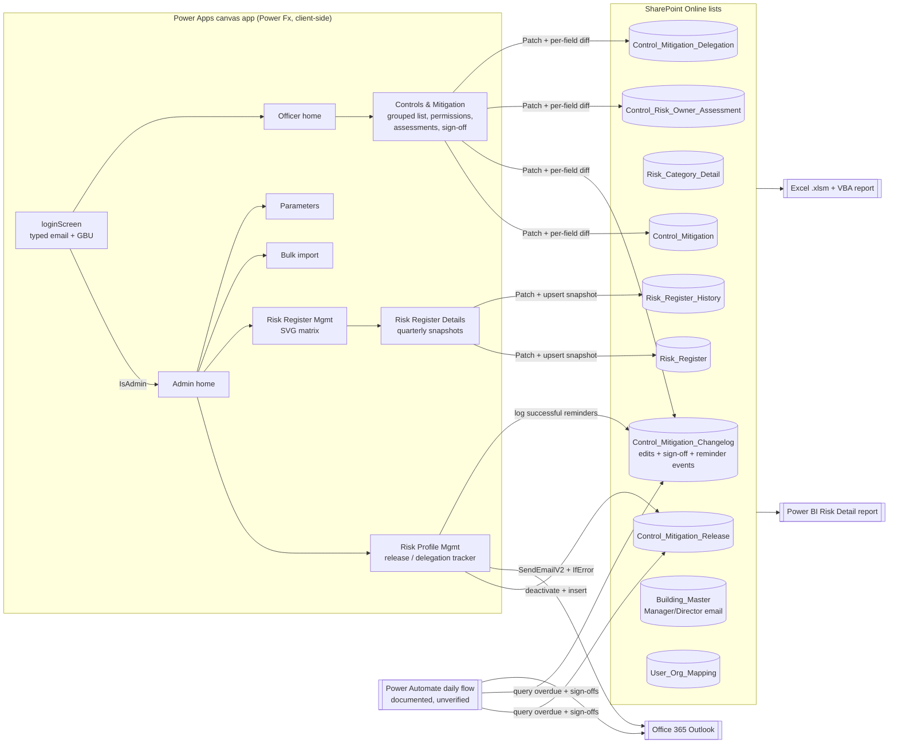

# Portfolio Project Audit — Guocoland ERM (Enterprise Risk Management) Power Platform Solution

- **Audit date:** 2026-10-21
- **Auditor stance:** read-only, evidence-based. No source, data, flows, or Studio session were modified. The only local actions were reading files, decoding the Excel workbook's VBA into a scratch folder, and syncing the live app into a new read-only folder (`guocoland-live-sync-20`).
- **Source of truth for "current app":** `guocoland-live-sync-20/` (synced from the live coauthoring session on 2026-10-21). Older `*-sync-*` folders are historical snapshots.
- **Evidence labels used throughout:**
  - **[VERIFIED]**: directly visible in inspected code, config, or documents. *Code inspection does not prove production deployment or real-world use.*
  - **[INFERRED]**: a reasonable interpretation that cannot be confirmed from artifacts.
  - **[CONFIRM]**: needs Min Zhe's confirmation (personal contribution, adoption, impact, permission to disclose).

---

## A. Executive Summary

**What the system does.** A Microsoft Power Apps canvas app on SharePoint Online lists, plus a Power BI report and an Excel/VBA reporting workbook. It digitises a property group's enterprise risk register. It covers:

- the risk taxonomy and a 5×5 likelihood × impact scoring matrix;
- financial scenarios and target ratings per risk;
- the controls and mitigating measures for each risk, and their action plans;
- assessments of those controls per building;
- a periodic, multi-party review cycle. ERM admins release reviews with due dates. Risk officers, building managers and directors sign off in tiers. Delegations are tracked, and overdue work triggers email reminders. Every edit is written to an audit log.

**Main technologies [VERIFIED].**
- Power Apps canvas app: Power Fx, authored as `.pa.yaml` source through the Canvas Authoring MCP / `pac` tooling.
- SharePoint Online lists as the only data store: 19 lists referenced by the current app.
- Office 365 Outlook connector, for email sent from inside the app.
- Power BI: a PBIP project with a TMDL semantic model, DAX measures and Power Query over SharePoint.
- Excel `.xlsm`: Power Query connections plus about 1,100 lines of VBA.
- PnP PowerShell, as a reference script for schema provisioning.

**Intended users [VERIFIED from code + docs].**
- ERM administrators: dashboard, release of reviews, reminders, risk register maintenance, parameters, bulk import.
- Risk officers: the controls and mitigation they are assigned.
- Building managers and directors, for one specific facilities risk: two-tier sign-off.
- Delegatees: staff who receive delegated controls.

**Strongest engineering qualities.**
1. **Workflow and state modelling on a constrained platform.** A tiered sign-off chain (manager → director → admin) and a delegation lifecycle are derived from append-only event rows. There is no status column to mutate (§D.1, §D.2).
2. **Auditability by design.** Field-level change diffing writes one changelog row per changed field. There are zero hard deletes in the app (`Remove(` count = 0), only soft-delete flags. Each risk keeps one snapshot per quarter.
3. **Custom visualisation with no charting library.** The risk matrix is generated as SVG inside Power Fx: collision-free bubble packing per cell, a "ghost" bubble for the previous quarter, and movement arrows trimmed with vector maths.
4. **Defensive integration code.** Each email is wrapped in `IfError`. Partial failures are reported per recipient, and reminders are logged only when the send succeeded. User text is HTML-escaped before it goes into email bodies and SVG.
5. **Data-integrity diagnosis.** In the Power BI work, profiling showed that 0 of 324 `Action_Plan.ControlID` values matched any current control ID. The report scope was cut back to avoid showing wrong data.

**Main limitations of the evidence.**
- **No automated tests and no version control.** The folder is not a git repository. Validation evidence is `compile_canvas` output recorded in the specs.
- **Contribution is ambiguous.** The project files are co-authored artifacts: "Prepared by Implementation Team", plus AI-assisted development ledgers under `.superpowers/`. Personal authorship is **[CONFIRM]** throughout.
- **No usage, adoption or performance metrics exist anywhere in the repository.**
- **The login is not secure.** The current app signs users in by a **typed email address plus a GBU picker**, not by the signed-in Microsoft 365 identity. This contradicts the project's own documentation (§D.4) and must not be presented as SSO.

---

## B. System Architecture

### B.1 Components [VERIFIED]

| Component | Evidence | Responsibility |
|---|---|---|
| Canvas app, 11 screens | `guocoland-live-sync-20/*.pa.yaml` (15,421 YAML lines, ~1,115 named controls) | All UI and all business logic (Power Fx) |
| SharePoint lists (19 used) | List references counted across screens; base schema in `sharepoint schema.txt` (outdated per `powerBI/schema-notes.md`) | Persistence; lookups act as foreign keys |
| Office 365 Outlook connector | `Risk Profile Management.pa.yaml:2205, 2506, 2876` | Release emails and delegation reminders |
| Power Automate reminder flow | `docs/superpowers/specs/2026-10-08-control-mitigation-release-design.md` (Part 2); `docs/superpowers/plans/2026-10-08-reminder-flow-build-steps.md` | Daily overdue reminder. **Designed and documented; the user built it by hand. Its existence and state in the tenant were not verified** **[CONFIRM]** |
| Power BI report | `powerBI/Guocoland ERM.Report`, `powerBI/Guocoland ERM.SemanticModel/definition/*.tmdl` | Single "Risk Detail" page that replicates the client's paper report |
| Excel reporting workbook | `Excel Report.xlsm` (Power Query connections to 9 lists; VBA modules `Module1`, `PlotAllRiskMarkersModule`, `Sheet2`) | Printable risk report, overview dashboard and user report (PDF exports in repo root) |
| PnP PowerShell | `scripts/pnp/01-extend-control-risk-owner-assessment.ps1` | Schema extension script. The ledger says schema was **actually created by hand in the SharePoint UI**, and the script was kept as reference (`.superpowers/.../progress.md`) |

### B.2 Screens [VERIFIED]

| Screen | Lines | Role |
|---|---|---|
| `loginScreen` | 395 | Email + GBU lookup → routes admin vs officer |
| `home page` | 1,163 | Admin KPIs, officer sign-off status roll-up, sign-off detail modal |
| `client home page` | 1,380 | Officer KPIs, "Delegated to me" with Acknowledge / Complete / Dismiss |
| `Risk Profile Management` | 2,950 | User ↔ risk assignment, **Release & due dates + email**, **Delegation Tracker + reminders** |
| `Risk Register Mangement` [sic] | 1,071 | Register list, quarter filter, **SVG matrix with movement arrows** |
| `Risk Register Details` | 1,630 | Edit one risk, **quarterly history snapshots**, designation → assignment sync, movement arrow |
| `controls and mitigation` | 4,222 | Grouped controls, row-level edit permission, per-building assessments, action plans, delegation, **tiered sign-off** |
| `parameters` | 1,349 | Edit likelihood and impact band thresholds |
| `bulk import` | 1,021 | Paste CSV → preview / validate → import, 6 entity types |
| `UnathorizedScreen` | 144 | Present but **not navigated to** from login |

### B.3 Data flow

### B.4 Where the logic lives [VERIFIED]

- **All business rules run client-side in Power Fx**, mostly in `OnVisible` and `OnSelect` handlers. There is no server tier, no plugins, and no SharePoint-side validation.
- **Persistence pattern:** a SharePoint list is read into a local collection (`ClearCollect`). Derived records are computed with `ForAll` / `With` / `AddColumns`. Writes use `Patch`. Collections are re-read after writes.
- **Cross-list references** use SharePoint lookup columns, written as `SPListExpandedReference` records (for example `controls and mitigation.pa.yaml:2331-2335`).
- **Event store pattern:** `Control_Mitigation_Changelog` serves as a general event log. Rows are distinguished by `FieldChanged` (field names, `OfficerSignOff`, `ManagerSignOff`, `DelegationReminder`, building assessment changes) and by `Title` prefixes (`DirSignOff-`, `MgrSignOff-`, `DelegReminder-`).

---

## C. Feature Inventory

Status key:
- **Impl**: implemented, verified by inspection.
- **Impl\***: implemented, but diverges from its spec or has a known defect.
- **Doc**: planned or documented only.
- **Lost**: built in a past snapshot, absent from the current app.

There are no test files, so no feature has "implemented with test evidence" status.

| # | Feature | Status | Key evidence |
|---|---|---|---|
| 1 | Email-based login and role routing (admin / officer) | Impl\* (insecure, see §D.4) | `loginScreen.pa.yaml:362-390` |
| 2 | Admin KPI dashboard (active, critical ≥20, no owner, pending, users) | Impl | `home page.pa.yaml:15-34` (uses `Concurrent`) |
| 3 | Officer KPI dashboard | Impl\* (high-risk threshold is 15 here vs 20 on admin page) | `client home page.pa.yaml:17-59` |
| 4 | Risk register list + quarter filter | Impl\* (filter uses record Created/Modified dates, not snapshot quarter) | `Risk Register Mangement.pa.yaml:6` |
| 5 | SVG risk matrix with previous-quarter ghost bubbles and arrows | Impl | `Risk Register Mangement.pa.yaml:975-1066` |
| 6 | Risk details editing (financial scenarios, target L/I/score) | Impl | `Risk Register Details.pa.yaml:136-310` |
| 7 | Quarterly snapshots + read-only past quarters + lazy backfill | Impl | `Risk Register Details.pa.yaml:10-37, 140, 245-307` |
| 8 | Designation → risk-assignment reconciliation on save | Impl | `Risk Register Details.pa.yaml:201-244` |
| 9 | Controls list grouped by "material control group", collapsible, searchable, sortable | Impl | `controls and mitigation.pa.yaml:139-245`, `:737` |
| 10 | Designation-based row visibility for non-admins | Impl | `controls and mitigation.pa.yaml:8-30, 147`; spec `2026-09-02-controls-mitigation-designation-visibility-design.md` |
| 11 | Single-editor rule (owner / admin / delegatee) with an owner-claim exception | Impl | `controls and mitigation.pa.yaml:1300-1307`; spec `2026-09-02-control-single-editor-design.md` |
| 12 | Field-level change log on control edits | Impl\* (edits only; creations are not logged) | `controls and mitigation.pa.yaml:2383-2411` |
| 13 | Per-building risk-owner assessments for the facilities risk (3 buildings) | Impl\* (upsert per building, not append-only as the July spec said; history kept via changelog) | `controls and mitigation.pa.yaml:2413-2446, 3581-3604` |
| 14 | Inline creation of material control groups from combo search text | Impl | `controls and mitigation.pa.yaml:2294-2321` |
| 15 | Action plans: Structured vs Remarks, max one per control | Impl | `controls and mitigation.pa.yaml:3185-3192`; spec `2026-09-02-action-plan-types-design.md` |
| 16 | Delegation: create / acknowledge / complete / revoke / dismiss | Impl\* (department-scoped; the July spec's building / Director → Manager design was not built; no duplicate guard) | `controls and mitigation.pa.yaml:1789-1809, 3858-3886, 3804`; `client home page.pa.yaml:914, 928, 1005` |
| 17 | Officer sign-off to admin ("Notify ERM Admin") | Impl | `controls and mitigation.pa.yaml:3993-4014` |
| 18 | Two-tier facilities sign-off: managers per building → director gate → admin | Impl | `controls and mitigation.pa.yaml:1150-1178, 3973-3992, 4021-4221` |
| 19 | Admin officer sign-off roll-up with "awaiting director" state | Impl | `home page.pa.yaml:45-109` |
| 20 | Release & due dates: officer picker, queue, email, re-release deactivates old row | Impl | `Risk Profile Management.pa.yaml:1488, 1715, 2017-2058, 2167-2231` |
| 21 | Delegation Tracker: stage derivation, counts, bulk and single reminders with cc | Impl | `Risk Profile Management.pa.yaml:26-83, 2392-2549, 2872-2910` |
| 22 | Daily overdue-reminder Power Automate flow | Doc (built by hand per plan; not verified) | `docs/superpowers/plans/2026-10-08-reminder-flow-build-steps.md` |
| 23 | Parameters: edit 5 impact + 5 likelihood band thresholds | Impl | `parameters.pa.yaml:1330+`; cached at `App.pa.yaml` OnStart |
| 24 | Bulk CSV import, 6 types incl. a "Consolidated" one-row → risk + contact + control + action plan | Impl\* (naive CSV split; partial idempotency; count reports valid rows, not successes) | `bulk import.pa.yaml:532, 825` |
| 25 | 30-second auto-refresh timers on 5 screens | **Lost**: present only in `guocoland-live-sync-16`; absent from 17-20 | timer marker counts per snapshot (see §M) |
| 26 | Power BI Risk Detail page (matrix cells, banding, controls table) | Impl (single page; action-plan section deliberately skipped) | `powerBI/.../Risk_Register.tmdl`, `Control_Mitigation.tmdl`; `powerBI/schema-notes.md` |
| 27 | Excel/VBA report: synchronous refresh, matrix marker plotting, grouped controls table | Impl | `Excel Report.xlsm` → `Module1.RefreshReportData`, `PlotAllRiskMarkers`, `Sheet2.RefreshControlsTable` |
| 28 | Subcategory 5-level hierarchy, OutlookTrend, AssetClass | Doc only (gap analysis / backlog) | `Guocoland_ERM_Gap_Analysis.docx`, `Guocoland_ERM_Feature_Backlog.docx` |
| 29 | Risk profiles / versioned scoring profiles (`Risk_Profile_Master`) | Schema only; **0 references in app** | list reference count |

### Selected feature detail

**F18: Two-tier facilities sign-off.**
- **Problem:** for one facilities-management risk, each building's manager must finish their controls first. Only then may the overseeing director give a final sign-off to ERM.
- **Implementation:** buildings carry `ManagerEmail` and `DirectorEmail`. On screen load the app computes `colMyManagedBuildings` and `colMyDirectedBuildings` (`:61-65`).
  - A manager's confirm writes one `ManagerSignOff` event per managed building, with `NewValue = BuildingCode` (`:3975-3989`).
  - The director's button builds `colDirectorReview`, one row per directed building (`:1157-1176`). A building is `Ready` if its latest manager sign-off is within 30 days, **or** the director also manages that building, which handles the self-managed case.
  - The final button is enabled only when every building is ready (`:4192`). It writes an `OfficerSignOff` event whose text lists every building with its signer and date (`:4202`).
  - The admin roll-up treats a manager as "awaiting director" until a later director event exists. The comparison uses auto-increment IDs, not dates (`home page.pa.yaml:82-96`).
- **Technical complexity:** state is *derived from an append-only event stream* across three entities. There are temporal windows, an ID-based ordering workaround for day-precision dates, and an edge case for a person in both roles.
- **Edge cases handled:** no manager assigned (shown in the UI, `:4119`); a stale sign-off older than 30 days (shown with its date, `:4158-4165`).
- **Not handled:**
  - Events are not tied to a release cycle, so a sign-off from a previous cycle inside the 30-day window still counts.
  - `ManagerSignOff` matching uses only `NewValue = BuildingCode`, not the manager's identity.
- **Business value:** enforces review order without a workflow engine **[INFERRED]**.

**F20/F21: Release and Delegation Tracker.**
- **Release** queues officers with per-officer due dates. For each one it then:
  1. deactivates the officer's existing active release row (`UpdateIf … isActive:false`);
  2. inserts a new row;
  3. sends an HTML email wrapped in `IfError`, adding failures to `colRelFailed_RPM`.

  A summary shows how many sent and which failed. Rows are kept on failure, so re-release is the retry path (`:2174-2231`).
- **Tracker** joins `Control_Mitigation_Delegation`, active release due dates (keyed by the delegator) and reminder events. It derives a stage with explicit precedence: Revoked > Completed > Closed > Overdue > In progress > Awaiting acknowledgement. It also derives a rank, badge and colours (`:37-83`).
- **Bulk reminders** send to each overdue delegatee with the delegator cc'd. Only *successful* sends are logged as `DelegationReminder` events, and the in-memory "last reminded" date is updated only for them (`:2496-2549`).

**F7: Quarterly snapshots.**
- The current quarter key is computed as `Year & " Q" & RoundUp(Month/3)`.
- On save, `Risk_Register` is patched first. Failure is checked with `IsError(varSavedRisk) || IsBlank(varSavedRisk.ID)`.
- **Lazy migration:** if a risk has *no* history yet and was last modified in an earlier quarter, its pre-save values are archived under that older quarter before being overwritten (`:245-275`).
- The current-quarter snapshot is then upserted: one row per risk per quarter (`:276-303`).
- Selecting a past quarter loads the form from the history row, and Save is disabled (`:140`).

---

## D. Deep Engineering Analysis

### D.1 Algorithms and business logic [VERIFIED]

1. **SVG matrix layout** (`Risk Register Mangement.pa.yaml:980-1066`). A pure functional pipeline in nested `With` scopes:
   - **Compute the previous position** for each risk: the latest history row with quarter key `Year*10+Q` below the current key.
   - **Emit rows:** one current row per risk, plus one ghost row when the position changed.
   - **Pack bubbles:** `GroupBy` the cell; inside each cell, place bubbles on a 3-column grid with `Mod(i-1,3)*22` horizontal and `RoundDown((i-1)/3)*11` vertical offsets.
   - **Paint cells** from a 25-character colour-band string (`"YYRRRNYRRRGN…"`).
   - **Draw arrows** from each ghost to its current bubble. The direction is normalised (`dx/d, dy/d`) and both ends are trimmed by the ellipse radii (10×5), so arrows start and end at bubble edges. A white under-stroke keeps them readable on coloured cells.
   - Codes longer than 3 characters use SVG `textLength` to fit.
   - User-derived text is XML-escaped.

   This is real computational-geometry and layout work, done in a declarative formula language.

2. **Field-level diff** (`controls and mitigation.pa.yaml:2383-2411`). An inline `Table()` of `{Field, Old, New}` covering 9 fields, normalised with `Text()`, is filtered to `Old <> New`. `ForAll` then emits one changelog row per changed field.

3. **Designation-set reconciliation** (`Risk Register Details.pa.yaml:201-244`). The app compares the previous designation set (split from a `"; "`-joined string) with the newly selected set:
   - removed designations → deactivate matching active assignments;
   - added designations → insert an assignment only if no active one exists (an existence check against duplicates).

4. **Visibility predicate with normalisation** (`controls and mitigation.pa.yaml:25, 147`). `Lower(Substitute(Trim(x)," ",""))` on both sides, with multi-valued `RelatedDept` split on `;`. Blank `RelatedDept` means visible to all. The documented reason is real data inconsistency, e.g. `Treasury (GLL)` vs `Treasury(GLL)` (spec).

5. **Natural sort of risk codes** (`controls and mitigation.pa.yaml:122-138`). Extracts the numeric part of codes like `R15-FM` and sorts by number, then by suffix presence, so R2 < R10 and R15 < R15-FM.

6. **VBA label layout** (`PlotAllRiskMarkersModule`). Pass 1 buckets risks by cell in a dictionary. Pass 2 searches for a column count that fits the labels inside 90% of the cell (ceiling division, minimum slot widths). Markers are positioned over the largest picture on the sheet, using measured axis margins.

7. **Power BI banding and matrix** (`Risk_Register.tmdl`). `RiskTargetScore`, then `TargetRiskBand` via `SWITCH(TRUE())` (thresholds documented as *placeholders*), then 25 `Cell_Lx_Iy` measures. `ControlRowNumber` uses `RANKX(ALLSELECTED(...))`. `MatchesSelectedRisk` is a documented visual-level filter workaround (`Control_Mitigation.tmdl:25-30`).

### D.2 Architecture and data

- **Event log as the source of workflow state.** Sign-offs, reminders and edits are rows, not status mutations. That supports history, re-notification and admin roll-ups.
  - **Trade-off:** one list is overloaded with heterogeneous events. Meaning is encoded in `FieldChanged` and in `Title` string prefixes (`StartsWith(Title,"DirSignOff-")`), which is brittle.
- **Soft deletes everywhere.** `Remove(` = 0 across the app. Deactivation uses `isActive=false`, and revocations also set `Status="Revoked"`.
- **Snapshot table for temporal data.** `Risk_Register` keeps current values, so other screens are unaffected. `Risk_Register_History` keeps one row per quarter.
- **Collections as a client-side cache / read model.** Lookups inside loops read local collections, not SharePoint. This was an explicit design rule ("Never live LookUp/Filter inside ForAll against SharePoint", July spec, Constraints section).
  - **Not followed everywhere.** `Risk Register Mangement.pa.yaml:6` does 6 `LookUp(Risk_Register…)` calls per risk row inside `AddColumns`; `Risk Register Details.pa.yaml:210, 221` do `LookUp(Contact_Risk_Assignment…)` inside `ForAll`.
- **Code duplication.** The grouped-list rebuild block appears 11 times in `controls and mitigation.pa.yaml` (`ClearCollect(colGroupedFlat, Blank())` × 11, header-row literal × 20). Classic canvas apps have no shared functions; user-defined functions or components could reduce this. It is a real maintainability cost, and every change has to be applied consistently.

### D.3 Reliability and correctness

**Strengths [VERIFIED]:**
- `IfError` around every email send, with per-recipient failure collection and success-only logging (Risk Profile Management).
- An existence check before creating a quarter snapshot, assignments, departments, users, or risks during import (upsert semantics).
- Save failure detection on the risk save (`IsError(varSavedRisk) || IsBlank(varSavedRisk.ID)`).
- An explicit `Refresh()` of SharePoint lists before rebuilding the tracker. The inline comment explains that cached rows were otherwise re-read (`Risk Profile Management.pa.yaml:30-32`). This is a real platform pitfall, diagnosed and documented.
- VBA forces `BackgroundQuery = False` on every connection before `RefreshAll`, "to avoid the async race condition where RefreshAll returns before background queries finish" (`Module1`, comment).
- Z-order bugs were fixed by deliberately putting modals last in `Children` (documented in two specs).

**Weaknesses:**
- **No transactions.** Multi-list writes (control → changelog → assessments) are sequential `Patch` calls without rollback. A failure midway leaves partial state.
- **Control save has no `IfError` / `IsError` check** on the `Control_Mitigation` Patch before diffing (`:2357-2411`). **[INFERRED]** If that Patch fails, `varSavedControl` would be blank or an error, and the diff could log spurious changes.
- **No duplicate guard** on delegation creation (`:3866`) or on Control / Contact CSV import.
- **Bulk import overstates success.** It reports `CountRows(Filter(colCSVPreview, isValid))` as "created", regardless of Patch outcomes (`bulk import.pa.yaml:825`). The parser splits on commas with no quote handling; the onboarding doc tells users to avoid commas.
- **SharePoint delegation limits.** Non-delegable `ForAll(Control_Mitigation …)` and `Filter`s with `Lower()` are capped at the app's data-row limit (500 by default, 2,000 max). The specs say ~89-109 compile warnings were accepted as "house style". Fine at the current data size, but a correctness risk as lists grow **[INFERRED]**.

### D.4 Security

- **Authentication: [VERIFIED] not identity-bound.** `loginScreen` looks up `User_Org_Mapping` by the **email typed into a text box** plus a GBU selection (`loginScreen.pa.yaml:363-389`). Everything downstream uses `varLoginUser`: `varCurrentUserEmail = Lower(Coalesce(varLoginUser.Title, User().Email))`, admin flag `varLoginUser.IsAdmin`.
  - A signed-in user can type another registered user's email, including an admin's, and get that user's app permissions.
  - The technical documentation states the app resolves `User().Email` (SSO). **The current code does not match that claim.**
  - `UnathorizedScreen` exists but is never navigated to.
- **Mitigating detail [VERIFIED].** Most audit writes record `User().Email` (the real M365 identity): changelog `ChangedBy` on control edits, assessments and reminders, and `SavedBy`. Impersonated *edits* are therefore still attributable. Sign-off events, however, record `varCurrentUserEmail` (the typed identity) (`:3985, 4001, 4203`).
- **Authorisation is UI-only.** Visibility, single-editor and admin gating are client-side `Visible` / `DisplayMode` rules. Anyone with SharePoint list permissions can read or write the lists directly, through SharePoint or another app. No item-level permissions or SharePoint-side validation were found **[VERIFIED absence in repo; tenant config not inspected]**.
- **Good practice:** HTML / XML escaping of user text in emails and SVG; no secrets in app code. The app link and environment ID are hardcoded in three places (`Risk Profile Management.pa.yaml:2182, 2500, 2873`); not secrets, but environment-specific.

### D.5 Performance

- **[VERIFIED, documented]** in the 2026-09-02 performance pass (single-editor spec, "Performance pass" section):
  - search debounce (`TriggerOutput.Delayed`, `:737`);
  - 4 whole-table pulls removed;
  - delegation IDs precomputed into `colMyDelegatedControlIds`;
  - assessment lookups consolidated into `colAsmtSummary`, built once per rebuild instead of about 4 scans per row (`:58, 165`).
- **[VERIFIED]** `Concurrent()` loads the KPI counts in parallel on both home pages.
- **No timings were measured or recorded.** Do not claim speed-ups in numbers.
- **N+1 pattern remains** in `Risk Register Mangement` `OnVisible` (6 lookups per risk row).

### D.6 AI / ML

**None in the product.** The development process used AI coding agents: `.superpowers/sdd/*` contains task briefs and reports for subagent-driven implementation, and `docs/superpowers/` contains AI-workflow plans and specs. That belongs under how the work was done, not under product features (see §L and §K).

---

## E. Engineering Decisions and Trade-offs

| Decision | Problem | Reasoning (source) | Trade-off | Alternatives | Evidence | Conf. |
|---|---|---|---|---|---|---|
| SharePoint lists, no Dataverse | Licensing: M365 E3 seeded Power Apps licence | Documented (Tech doc A.1; Onboarding §1) | No transactions, delegation limits, weak relational integrity, no server logic | Dataverse (premium), Azure SQL | docs | High |
| Changelog as a shared event store for edits, sign-offs and reminders | Need history plus admin visibility without email/flow (initially) | Documented: "reused — no new list, no email/Flow connector" (sign-off spec) | Overloaded schema, string-prefix semantics, required-column risk (spec warns `ControlID` must be optional) | Dedicated SignOff / Reminder lists; Dataverse audit | `2026-09-02-officer-signoff-to-admin-design.md` | High |
| Order sign-offs by auto-increment `ID`, not `ChangedDate` | `ChangedDate` stored at day precision | Documented ("ordering uses the auto-increment ID instead") | Relies on SharePoint ID monotonicity | DateTime column with time | same spec; `home page.pa.yaml:87` | High |
| One snapshot per risk per quarter (overwrite within quarter) + lazy backfill | Quarter-over-quarter movement without changing the main list | Memory/notes + code comments | Intra-quarter history lost; backfill keyed on `Modified`, which other edits can move | Append every save; SharePoint versioning | `Risk Register Details.pa.yaml:245-303` | High (code), Med (motivation) |
| Draw the matrix as generated SVG; keep the gallery only as a transparent click layer | Native gallery can't draw arrows or overlapping bubbles | **[INFERRED]** from the implementation | Hard to maintain long formula; fixed pixel geometry (350×260) | Power BI embed; PCF component | `Risk Register Mangement.pa.yaml:975-1070` | Med |
| Precomputed per-control summaries / ID sets | Repeated nested filters per gallery row | Documented (perf pass) | More state to keep in sync | Server-side views | single-editor spec | High |
| Normalised string matching for visibility | Free-text designations differ in spacing | Documented, with known-limitation section | Doesn't fix `&` vs `and`; no referential integrity | Lookup column to a department master | designation spec | High |
| Release: deactivate + insert instead of update | Keep release history; one active row per officer | Documented | Two writes, not atomic | Versioned status column | release spec | High |
| Scope Power BI report down when data linkage was broken | `Action_Plan.ControlID` matched 0/324 controls | Documented ("Decision confirmed with user 2026-07-19") | Incomplete report | Fix source data first | `powerBI/schema-notes.md` note 4 | High |
| Typed-email login | **No rationale documented** **[CONFIRM]**. Possibly for testing several roles with one account | — | Impersonation risk; contradicts docs | `User().Email` binding, with an admin-only "view as" for testing | `loginScreen.pa.yaml` | High (that it exists) |

---

## F. Top Portfolio-Worthy Highlights (ranked)

Scores are 1–5. **Diff** = differentiation from typical student projects. **Evid** = strength of supporting evidence. A low-code platform caps "technical difficulty" for many software employers; the scores reflect that honestly.

| # | Highlight | What / why it matters | Skills | Diff-iculty | Real-world | Diff | Evid | Prominence | Files |
|---|---|---|---|---|---|---|---|---|---|
| 1 | **Tiered sign-off workflow derived from an event log** | Manager-per-building → director gate → admin roll-up; state computed from immutable events with time windows | State modelling, event sourcing (lightweight), edge-case reasoning | 3 | 5 | 4 | 5 | **Hero** | `controls and mitigation.pa.yaml:1150-1178, 3973-4221`; `home page.pa.yaml:68-108` |
| 2 | **Audit trail architecture** | Field-level diffs, soft deletes only, quarterly snapshots with lazy backfill, read-only past quarters | Data modelling for compliance, migrations | 3 | 5 | 3 | 5 | **Hero / Featured** | `controls and mitigation.pa.yaml:2383-2411`; `Risk Register Details.pa.yaml:245-307` |
| 3 | **SVG risk matrix with movement arrows** | Generated vector graphic: packing, ghosts, vector-trimmed arrows, escaping | Visualisation, geometry, declarative programming | 4 | 4 | 4 | 5 | **Featured** (very visual) | `Risk Register Mangement.pa.yaml:975-1066` |
| 4 | **Review release + reminder pipeline** | Per-officer due dates, emails with partial-failure handling, delegation tracker stage machine, success-only logging; scheduled flow designed | Integration, failure handling, state machines | 3 | 5 | 3 | 4 (flow unverified) | **Featured** | `Risk Profile Management.pa.yaml:26-83, 2167-2549`; release spec |
| 5 | **Row-level access model** (visibility + single editor + delegation + owner-claim exception) | Precise business rules for who sees and edits what | Authorization design, precomputation | 3 | 4 | 3 | 5 | Featured, **framed honestly as client-side** | `controls and mitigation.pa.yaml:8-30, 147, 1300-1307` |
| 6 | **Data-integrity diagnosis in Power BI** | Profiled lookup ranges; found 0/324 matches; corrected type mismatches; cut scope instead of showing wrong data | Data engineering judgement | 2 | 4 | 3 | 5 | Detailed (good interview story) | `powerBI/schema-notes.md` |
| 7 | **Performance pass on a 4k-line screen** | Debounce, precomputed summaries, removed whole-table pulls | Profiling-by-reasoning, optimisation | 2 | 3 | 2 | 4 (no measurements) | Detailed only | single-editor spec "Performance pass" |
| 8 | **Excel/VBA reporting module** | Sync refresh to avoid a race; dictionary-bucketed label layout on an image; grouped tables | Office automation | 2 | 4 | 2 | 5 | Detailed only | `Excel Report.xlsm` VBA |
| 9 | **Bulk CSV import with preview / validation, 6 entity types** | Onboarding the client's spreadsheets; consolidated row → 4 linked records | ETL basics | 2 | 4 | 2 | 4 | Detailed only (note limits) | `bulk import.pa.yaml:532, 825` |
| 10 | **Requirements and gap analysis with the client** | Gap analysis, onboarding guide, backlog, weekly reports | Stakeholder management | 1 | 4 | 2 | 3 (authorship unclear) | Detailed (context) | `*.docx` in root |

---

## G. Measurable Impact

### G.1 Verified technical scope (system capability, not adoption)

| Metric | Value | Source | Type | Publishable? |
|---|---|---|---|---|
| App screens | 11 (10 functional + unauthorised placeholder) | `guocoland-live-sync-20/` | Capability | Yes |
| Source size | 15,421 YAML lines; ~1,115 named controls | Line / regex count | Capability | Yes, as "~15k lines of Power Fx/YAML" |
| Largest screen | 4,222 lines (`controls and mitigation`) | Line count | Capability | Yes |
| SharePoint lists used by the app | 19 (2 more defined in schema but unused) | Reference count | Capability | Yes (generic) |
| Growth over the audited window | 11,046 → 15,355 lines (2026-07-28 → 2026-10-21) | Snapshot line counts | Capability | Yes, *if* contribution is confirmed |
| Bulk import entity types | 6 | `bulk import.pa.yaml` | Capability | Yes |
| Fields diffed in the change log | 9 | `controls and mitigation.pa.yaml:2386-2394` | Capability | Yes |
| Risk codes in the client register | 16 (R01–R15 + R15-FM) | VBA `codes = Array(...)` | Data scope | **Sanitise** (client data) |
| Excel VBA | ~1,100 decoded lines, 4 main procedures | Decoded `vbaProject.bin` | Capability | Yes |
| Action-plan linkage defect found | 0 of 324 IDs matched | `powerBI/schema-notes.md` | Measurement on client data | Publish only in generic form ("found a broken foreign-key linkage affecting all action-plan rows") |
| Controls in the client data | ID range 728–1062 (≤ ~335 rows, not a count) | `schema-notes.md` | Data scope (July snapshot) | No; client data |

### G.2 Measured operational outcomes

**None in the repository.** There are no usage logs, timings, adoption counts, before/after process data or user feedback. There is no evidence of the app's production rollout either. The gap analysis lists "Microsoft 365 tenant / SharePoint hosting" for the client as **blocking** (2 Jul / 6 Jul 2026), and the live app runs in the implementation firm's tenant (PnP script URL). **[CONFIRM]**: Was it deployed to the client's tenant? Did real officers use it?

### G.3 Unverified business claims (do not publish without confirmation)
- "Replaced the Excel-based risk register process."
- "Reduced review cycle time."
- Number of officers / departments / buildings onboarded.
- "Automated reminders": the in-app email is verified; the daily flow is not.

### G.4 Suggested measurements (future, not achieved)
- Count of `OfficerSignOff` / `ManagerSignOff` events per release cycle: participation rate.
- Median days from `ReleasedOn` to sign-off: cycle time.
- Count of `DelegationReminder` events vs completions after a reminder.
- Changelog row volume per quarter: editing activity.
- Load time of `controls and mitigation` before and after the perf pass (Monitor tool).

---

## H. Technical Challenges

These are evidenced by code, comments or ledgers unless marked inferred.

1. **Stale reads from the SharePoint connector.** A comment says re-reading a list "otherwise returns the app's cached rows". Fixed with explicit `Refresh()` before derived rebuilds. *Relevance:* cache-invalidation reasoning. Evidence: `Risk Profile Management.pa.yaml:30-32`.
2. **Mis-identified schema semantics, caught mid-build.** The ledger records a "MAJOR CORRECTION": `RiskOwnerAssignment` was assumed to be a precursor of the new assessment model, but its choice values (Effective/…) showed it was unrelated. The planned migration was dropped and an erroneous edit reverted before data damage. *Relevance:* verifying assumptions against real data before migrating. Evidence: `.superpowers/.../progress.md`; July spec "Corrected 2026-07-28".
3. **Broken referential integrity in source data.** Detected by comparing ID ranges in Power BI; report scope cut. Evidence: `powerBI/schema-notes.md` note 4.
4. **Excel refresh race condition.** `RefreshAll` returned before background queries finished; fixed by forcing synchronous refresh. Evidence: VBA `Module1` comment.
5. **Canvas rendering / z-order bugs.** Buttons and modals were painted under opaque rectangles; fixed by ordering children. Evidence: sign-off specs.
6. **Lossy date precision.** Day-precision `ChangedDate` → ordering by ID. Evidence: sign-off spec.
7. **Data quality in free-text org fields.** Normalised matching, with documented limits. Evidence: designation spec.
8. **Lost work in the coauthoring workflow.** The auto-reload timers appear only in snapshot 16 and are absent from every later snapshot. **[INFERRED]** The change was never saved in Studio, or was overwritten. *Limitation / lesson:* the lack of version control made this hard to notice.

---

## I. Suggested Portfolio Content

### I.1 Homepage (30-second version)
- **Title:** Enterprise Risk Management Platform (Power Platform). Use the client name only if permitted **[CONFIRM]**.
- **Problem:** A real-estate group ran its risk register and quarterly control reviews in spreadsheets and email.
- **Contribution:** *[CONFIRM wording]* Designed and built the review workflow, audit trail and risk-matrix visualisation of a Power Apps + SharePoint ERM app during an internship at 8PI BizSolutions.
- **Tech:** Power Apps (Power Fx), SharePoint Online, Power Automate, Office 365 Outlook connector, Power BI (DAX/TMDL), Excel VBA.
- **Verified capability:** Tiered sign-off (building managers → director → ERM admin) derived from an append-only event log, with field-level change history and quarterly snapshots.
- **Visual:** a re-created, synthetic-data version of the SVG risk matrix with movement arrows.

### I.2 Recruiter case study
- **Overview:** an internal enterprise app for a property group's risk function: register, 5×5 scoring, controls, action plans, review cycles.
- **Problem:** the quarterly review needed accountability: who must review what, by when, who has signed off, and what changed.
- **My contributions [CONFIRM each]:** requirements and gap analysis with the client; data model extensions; the controls screen permission model; change log; sign-off workflow; release-and-reminder feature; quarterly history; matrix visualisation; Power BI and Excel reports.
- **Key features:** see §F #1–#5.
- **Outcomes:** capability-level only, e.g. "11 screens, 19 lists, ~15k lines of Power Fx". No adoption metrics until confirmed.
- **Images:** sanitised screenshots of the matrix, tracker and sign-off modal (synthetic data).

### I.3 Technical deep dive
- **Architecture:** diagram in §B.3. Client-side logic, SharePoint as storage, collections as a read model.
- **Algorithms:** SVG packing and arrows (§D.1-1), diff logging (§D.1-2), reconciliation (§D.1-3).
- **Decisions and trade-offs:** §E, especially the event-log-as-state choice and ordering by ID.
- **Edge cases:** self-managed buildings, stale sign-offs, partial email failure, lazy backfill.
- **Challenges:** §H 1–4.
- **Limitations (state them yourself; it builds credibility):**
  - client-side authorisation only;
  - no transactions;
  - SharePoint delegation limits;
  - duplicated rebuild blocks;
  - no automated tests;
  - **the login must be fixed before presenting it as secure**.
- **Future work:**
  - bind identity to `User().Email`;
  - SharePoint item permissions or Dataverse;
  - extract the rebuild logic into user-defined functions or components;
  - dedicated event lists;
  - instrumentation for cycle-time metrics.

---

## J. Visualization Recommendations

| Visual | Demonstrates | Real components | Interactive? | Assets needed | Confidentiality | Synthetic OK? |
|---|---|---|---|---|---|---|
| **Risk-matrix SVG re-creation** with a quarter toggle | Packing + movement arrows | Port of the `imgMatrixSvg_RRM` algorithm to JS | **Yes** (slider for Q-1 → Q) | Algorithm only | Use fake codes (R1…); generic colour bands | **Yes, required** |
| **Sign-off state machine diagram** | Manager → Director gate → Admin; Ready rule; 30-day window | `colDirectorReview`, admin `StatusKind` | Optional (click events to watch state change) | §C F18 | Remove building names | Yes |
| **Event-log timeline** | How changelog rows drive state | `FieldChanged` types | Yes (step through events) | Event schema | Generic emails | Yes |
| **Architecture / data-flow diagram** | Components and integrations | §B.3 Mermaid | No | — | Omit tenant / site names | — |
| **Simplified ER diagram** | Risk → Control → Assessment / Action plan / Delegation / Changelog / History | List schemas | No | `sharepoint schema.txt` + new lists | Generalise names; omit client-specific fields | — |
| **Delegation tracker stage precedence** | Stage derivation | `Risk Profile Management.pa.yaml:50-57` | Small truth table | — | None | Yes |
| **Before / after process** | Spreadsheet + email vs app | — | No | **Requires real process description [CONFIRM]** | Medium | Only if described truthfully |
| Screenshots: tracker, sign-off modal, matrix, details with quarter dropdown | UI | Live app | No | Capture with **dummy data** | Real data must not appear | Yes, use a sandbox copy |

Never present a re-created visual as a production screenshot; label it "re-created with synthetic data".

---

## K. Questions for Me

1. **Contribution split:** Which screens and features did you personally design or implement? Which existed before you joined (the July snapshot already had 11,046 lines), and which were teammates' work?
2. **AI-assisted development:** The repo shows Claude Code / subagent workflows. How do you want to describe your role: specifying, reviewing, debugging, integrating, manual schema work, client liaison?
3. **Deployment:** Was the app deployed to the client's Microsoft 365 tenant and used by real risk officers? Roughly how many users, departments or buildings?
4. **Reminder flow:** Did you build and enable the daily Power Automate reminder flow? Has it run successfully?
5. **Login design:** Why does the login use a typed email rather than `User().Email`? Is it a demo / testing affordance, and has it been raised with the team?
6. **Measured impact:** Any data on review cycle time, sign-off participation, or the time to compile the quarterly risk report, before vs after?
7. **Disclosure:** May you name the client and show its risk categories, building names or report layouts? Do you need written approval from 8PI BizSolutions?
8. **Excel / VBA and Power BI:** Were these delivered to the client, or exploratory? Which one is the "official" reporting output?
9. **Hardest problem:** Which bug or design problem took you longest? (Candidates: the stale-cache refresh, the RiskOwnerAssignment correction, the Action_Plan linkage.)
10. **Lost auto-refresh:** Was the 30-second auto-refresh deliberately removed, or lost in an unsaved session?

---

## L. Weaknesses and Limitations

1. **Login allows impersonation** (§D.4). This is the most serious issue. Fix it or disclose it before showcasing.
2. **Documentation drift.** The technical doc claims `User().Email` SSO resolution and 14 lists. The code uses a typed email and 19 lists. The July spec's building-based Director → Manager delegation and append-only assessments differ from what was built.
3. **Authorisation is presentation-layer only.** SharePoint permissions were not inspected.
4. **No automated tests, no version control, no CI.** Validation relied on `compile_canvas` plus manual testing; 89–109 accepted compiler warnings.
5. **Heavy duplication.** 11 copies of the grouped-list rebuild in one screen.
6. **Non-atomic multi-list writes;** no `IfError` on the control save.
7. **Semantic inconsistencies:**
   - "Residual Risk Rating" is computed from *target* L×I (`Risk Register Mangement.pa.yaml:6`);
   - the critical threshold is 20 on the admin page vs 15 on the officer page;
   - the quarter filter uses Created/Modified dates, not history quarters;
   - `varResidualScore` is set to 45, then overwritten (dead code).
8. **Hardcoding:**
   - 3 building codes in the assessment UI and writes;
   - 16 risk codes in VBA;
   - Power BI band thresholds marked as placeholders;
   - app URL / environment ID in email bodies.
9. **Bulk import:** naive CSV parsing, success count not tied to results, no duplicate guard for controls or contacts, and **mojibake in visible UI strings** (e.g. "No data yet — paste CSV", `bulk import.pa.yaml:793`). A user-facing debug panel ships in the screen.
10. **Scale ceilings:** non-delegable queries are capped by the data-row limit; the N+1 lookups in the register screen.
11. **Unused schema:** `Risk_Profile_Master` and `Impact_Dimension_Master` (versioned scoring profiles) are never read by the app.
12. **Auto-refresh feature lost** between snapshots 16 and 17.

---

## M. Evidence Index

Paths are relative to the project root `Guocoland ERM/`. "LS20" = `guocoland-live-sync-20/`.

| Path | Element / lines | Supports | Conf. |
|---|---|---|---|
| LS20/`loginScreen.pa.yaml` | `Button2.OnSelect` 362-390 | Typed-email login, role routing, no unauthorised redirect | High |
| LS20/`App.pa.yaml` | `OnStart` | Parameter caching into collections | High |
| LS20/`controls and mitigation.pa.yaml` | `OnVisible` 5-86 | Identity resolution, visibility sets, building roles, sign-off state load | High |
| same | `cmbRiskID` 116-245 | Natural sort; grouped / flattened list build; visibility filter | High |
| same | 737 | Search debounce | High |
| same | `btnNotifyAdmin` 1146-1189 | Director review build, Ready rule | High |
| same | `galGroupedControls.Items` 1300-1307 | Per-row `CanEditRow` | High |
| same | `colDelegateIcon_CM` 1789-1809; `btnDelegateSave_CM` 3858-3886 | Department-scoped delegation, no duplicate guard | High |
| same | `btnFormSave` 2290-2446 | Inline group creation, create vs edit, 9-field diff log, building assessment upsert + log | High |
| same | 3185-3192 | One-action-plan rule | High |
| same | `btnSignOffConfirm` 3968-4016 | Manager per-building events vs officer sign-off | High |
| same | `grpDirectorReviewOverlay` 4021-4221 | Director gate UI, final sign-off event | High |
| same | count: 11 × `ClearCollect(colGroupedFlat, Blank())` | Duplication | High |
| LS20/`home page.pa.yaml` | `OnVisible` 15-108 | `Concurrent` KPIs; officer status roll-up; ID ordering | High |
| LS20/`client home page.pa.yaml` | 17-59; 914, 928, 1005 | Officer KPIs (threshold 15); delegation lifecycle actions | High |
| LS20/`Risk Profile Management.pa.yaml` | `OnVisible` 26-83 | Refresh-before-rebuild; tracker stage precedence | High |
| same | `btnRelSend_RPM` 2167-2231 | Release: deactivate + insert + email + IfError + summary | High |
| same | `btnDgConfirmSend_RPM` 2492-2549; single reminder ~2872-2910 | Bulk / single reminders, cc, success-only logging | High |
| LS20/`Risk Register Details.pa.yaml` | `OnVisible` 5-37; `btnSave` 136-310 | Quarter key; snapshot upsert; lazy backfill; save error check; designation reconciliation; past-quarter read-only | High |
| same | `imgMoveArrow_RRD` 1544-1600 | Details-page movement arrow (SVG) | Medium (not read line-by-line) |
| LS20/`Risk Register Mangement.pa.yaml` | `OnVisible` 6 | N+1 lookups; quarter-by-date filter; "Residual" from target values; dead assignment | High |
| same | `imgMatrixSvg_RRM` 975-1066 | SVG matrix algorithm | High |
| LS20/`bulk import.pa.yaml` | 532 (parse), 825 (import), 852-969 (debug panel), 793 (mojibake) | Import design and limits | High |
| LS20/`parameters.pa.yaml` | 1330+ | Threshold editing | Medium |
| `guocoland-live-sync-16` vs 17–20 | `tmrAutoReload` count 5 → 0 | Auto-refresh lost | High |
| `reference-app-sync/`, `risk-register-app/`, sync-5/10/15/20 | Line totals 11,046 → 15,355 | Growth timeline (not authorship) | High (counts) |
| `docs/superpowers/specs/*.md` | 8 specs (2026-07-19 → 2026-10-08) | Documented decisions, known limits, validation output | High |
| `docs/superpowers/plans/2026-10-08-reminder-flow-build-steps.md` | — | Flow design (not deployment) | High (design) / Low (deployed) |
| `.superpowers/sdd/2026-07-28-…/progress.md`, `final-fix-report.md` | — | AI-assisted workflow; manual schema; RiskOwnerAssignment correction | High |
| `powerBI/schema-notes.md` | notes 1–10 | Data profiling; 0/324 linkage defect; type fixes; scope decision | High |
| `powerBI/Guocoland ERM.SemanticModel/definition/tables/Risk_Register.tmdl` | `RiskTargetScore`, `TargetRiskBand`, `Cell_L*_I*` | DAX banding / matrix | High |
| `…/Control_Mitigation.tmdl` | `ControlRowNumber`, `MatchesSelectedRisk` | RANKX; filter workaround | High |
| `…/relationships.tmdl` | 4 non-date relationships, auto date tables on | Model shape | High |
| `Excel Report.xlsm` → VBA `Module1.RefreshReportData` | — | Synchronous refresh race fix | High |
| same → `PlotAllRiskMarkersModule.PlotAllRiskMarkers` | — | Two-pass bucketing and layout; hardcoded code list | High |
| same → `Sheet2.RefreshControlsTable`, `PlotRiskMarker`, `Worksheet_Change` | — | Event-driven grouped report | High |
| `scripts/pnp/01-extend-control-risk-owner-assessment.ps1` | — | PnP provisioning (reference only) | High |
| `Guocoland_ERM_Technical_Functional_Documentation.docx` | A.1, A.4 | Claimed SSO and 14 lists (contradicted by code) | High |
| `Guocoland_ERM_Gap_Analysis.docx`, `…Weekly_Report.docx`, `…Feature_Backlog.docx`, `…Onboarding_Requirements (1).docx` | — | Client context, blockers (tenant), backlog, import format | High (content) / Low (authorship) |

---

## N. One-Page Portfolio Handoff Summary

> **Paste-ready context for another AI conversation. Keep the labels.**

**Project:** Enterprise Risk Management (ERM) app for a Singapore real-estate group, built by the implementation firm 8PI BizSolutions during Tan Min Zhe's internship (June–Oct 2026). It digitises the risk register, 5×5 likelihood×impact scoring, controls and mitigation, action plans, and a quarterly review / sign-off cycle. *Client name and internal details: disclosure **[UNCONFIRMED]**.*

**Verified technologies:**
- Power Apps canvas app (Power Fx; 11 screens; ~15.4k YAML lines; ~1,115 controls)
- SharePoint Online (19 lists)
- Office 365 Outlook connector
- Power BI (PBIP / TMDL, DAX, Power Query)
- Excel `.xlsm` with Power Query + ~1,100 lines of VBA
- PnP PowerShell (reference script)

**No** AI/ML in the product. Development used AI coding agents (Claude Code); the role split is **[UNCONFIRMED]**.

**Implemented features [VERIFIED in code]:**
- Role-routed dashboards
- Risk register + details with financial scenarios
- Quarterly snapshots with read-only past quarters
- SVG risk matrix with previous-quarter movement arrows
- Grouped controls list with designation-based visibility
- Single-editor permission rule with delegation
- Per-building control assessments
- Structured / remarks action plans (max one per control)
- Field-level change log
- Officer sign-off
- Two-tier manager → director → admin sign-off
- Admin review release with per-officer due dates and email
- Delegation tracker with stage derivation and email reminders
- Threshold parameters
- Six-type CSV bulk import
- Power BI single-page risk report
- Excel / VBA risk report

**Documented, not verified:** daily Power Automate overdue-reminder flow. **Lost:** 30-second auto-refresh (present in an Oct 9 snapshot only).

**Top 5 engineering highlights:**
1. **Tiered sign-off state derived from an append-only event log.** 30-day windows, an ID-based ordering workaround for day-precision dates, handling for the self-managed-building edge case. `controls and mitigation.pa.yaml:1150-1178, 3973-4221`; `home page.pa.yaml:68-108`.
2. **Audit architecture.** 9-field diff → one changelog row per changed field; zero hard deletes; per-quarter snapshots with lazy backfill of pre-history values. `controls and mitigation.pa.yaml:2383-2411`; `Risk Register Details.pa.yaml:245-307`.
3. **SVG matrix generated in Power Fx.** Per-cell 3-column bubble packing, ghost bubbles, normalised-vector arrows trimmed to the ellipse edges, XML escaping. `Risk Register Mangement.pa.yaml:975-1066`.
4. **Release / reminder integration.** Deactivate-then-insert releases, `IfError` per email, per-recipient failure summary, success-only reminder logging, delegator cc, precedence-based stage machine. `Risk Profile Management.pa.yaml:26-83, 2167-2549`.
5. **Data-integrity diagnosis.** Power BI profiling found 0/324 action-plan foreign keys matched; type mismatches fixed; report scope cut to avoid wrong output. `powerBI/schema-notes.md`.

**Supported numbers (capability, not adoption):** 11 screens; 19 lists; ~15.4k lines; largest screen 4,222 lines; 6 import types; 9 diffed fields; growth 11,046 → 15,355 lines between 2026-07-28 and 2026-10-21 (authorship unconfirmed). **No usage, performance or business-impact metrics exist.**

**Trade-offs:**
- SharePoint (cheap licensing) over Dataverse, at the cost of no transactions and delegation limits.
- A shared changelog as the event store, at the cost of string-prefix semantics.
- Overwrite-within-quarter snapshots.
- Generated SVG over native controls, at the cost of maintainability.
- Client-side precomputed collections for performance.

**Weaknesses to disclose or fix:**
- **The login is a typed email (impersonation possible)**, contradicting the docs' SSO claim.
- Authorisation is UI-only.
- No tests, no git.
- 11 duplicated rebuild blocks.
- Non-atomic writes.
- Naive CSV parsing.
- Label and threshold inconsistencies (residual vs target; 15 vs 20).
- Hardcoded building and risk codes.

**Unconfirmed:**
- personal contributions;
- the AI-assistance role;
- client deployment and adoption;
- the reminder flow running;
- the reason for the login design;
- any before/after impact;
- permission to name the client.

**Confidentiality:** do not publish the client name, building codes, risk taxonomy and descriptions, list and column names in full, tenant / site URLs, environment / app IDs, user emails, or screenshots with real data. Use synthetic re-creations.

**Recommended visuals:** an interactive re-creation of the risk matrix with a quarter toggle (synthetic data); a sign-off state-machine diagram; an event-log timeline; an architecture diagram; a simplified ER diagram.

**Questions pending:** see section K (10 questions: contribution split, AI role, deployment, flow, login rationale, metrics, disclosure, which reporting tool was delivered, hardest problem, lost auto-refresh).
