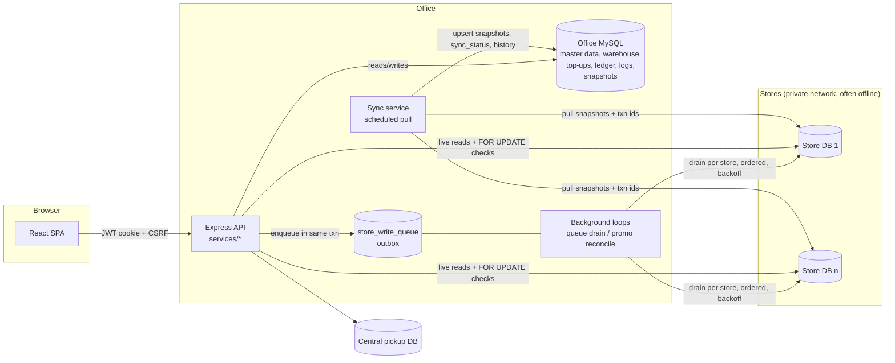

# PORTFOLIO_PROJECT_AUDIT — Unistop Inventory Management Platform

**Audit date:** 2026-10-21
**Scope inspected:** `Unistop-inventory-platform/` (git repo, 159 commits, 2026-06-25 → 2026-10-15), containing:
- `Inventory-Management-System/backend` — Express API (~30k LOC JS)
- `Inventory-Management-System/frontend` — React/Vite SPA (~34k LOC JSX)
- `Unistop-sync-database` — standalone snapshot-sync service (~1.6k LOC JS)

**Method:** Read-only. Source, docs, migrations and tests were read. The two unit-test suites were run; every DB module in them is stubbed through `require.cache`, so they make no network or DB calls. No app was started, no DB was queried, and no data was changed.
**Authorship:** Kept neutral at your request. The git evidence on authorship is in §K and §M.

Evidence labels used throughout:
- **[VERIFIED]**: directly supported by inspected code, config, tests or docs. This does *not* prove production deployment.
- **[INFERRED]**: a reasonable reading that the code can't confirm. The reasoning is given.
- **[CONFIRM]**: needs the owner's confirmation (contribution, adoption, impact, disclosure).

All paths below are relative to `Unistop-inventory-platform/`.

---

## A. Executive Summary

**What it does.** An office back-office platform for a chain of unattended retail stores. Each store is an automated, robot/cube-based vending-style shop with its own local MySQL database. The platform covers:
- the warehouse: products, batches, expiry
- store shelf positions and their stock
- replenishment ("top-up") planning and delivery
- purchasing and receiving
- promotions, promo codes and pickup codes
- sales and COGS reporting
- users and permissions, plus audit logs

**The core engineering problem.** There are N store databases that are often offline and reachable only over a private network, and one office database. The system has to plan from cached data, write to stores that may be unreachable, and never corrupt stock counts while doing it. The README states the rule in one line: *"use snapshots when short staleness is acceptable; use live store data when stale values could create an incorrect stock change."* [VERIFIED `Inventory-Management-System/README.md`]

**Main technologies [VERIFIED, package.json files].**
- Node.js and Express 5, MySQL via `mysql2`
- React 19, Vite 6, Tailwind, jsPDF
- Auth: bcrypt, JWT in an HTTP-only cookie, HMAC CSRF tokens, helmet, express-rate-limit
- `node:test` for tests
- SSH/rsync via `sshpass` for image distribution
- No ORM, no state-management library, no TypeScript

**Intended users [VERIFIED by the permission model, INFERRED roles].** Office staff: operations/replenishment planners, purchasing, store-ops and admins. There are 40 fine-grained permissions (`backend/src/config/permissions.js`).

**Strongest engineering qualities (all [VERIFIED] in code):**
1. **Durable per-store write outbox** (transactional-outbox pattern). It gives ordered, retried, idempotent delivery to stores that may be offline. UI lists fold queued writes over stale snapshots.
2. **Exactly-once delta delivery** of stock changes across two separate MySQL servers. It has no distributed transaction. Instead it uses an idempotency marker table on the store side, a consistent lock order, and a two-pass placement algorithm.
3. **Statistical replenishment policy.**
   - Blended multi-window demand rates, corrected for stockouts.
   - Bulk orders are winsorized.
   - Safety stock is set by a z-score service level (inverse normal via Acklam's approximation).
   - The rest of the policy: velocity bands, trip-capacity rationing and an expiry push.
4. **Financially careful reporting.**
   - FIFO COGS from a frozen, append-only delivery-cost ledger, so closed periods are reproducible.
   - Basket revenue is *allocated down* from the amount actually charged, so per-product revenue always sums to the money taken.
5. **Defensive concurrency** on live stock edits: `SELECT … FOR UPDATE` plus expected-value checks returning `409 POSITION_STALE`. Warehouse stock is reserved first-expiry-first-out.

**Main limits of the evidence.**
- No production metrics, usage data or before/after measurements exist in the repo.
- Test coverage is narrow. 67 tests pass, but the delta-delivery, COGS and revenue-allocation code has **no tests**.
- Purchase *suggestions* come from an external "PO report" JSON. The reorder algorithm behind them is not in this repo.
- "AI suggestions" are rule-based heuristics, not ML.
- Contribution split between contributors needs confirmation.

---

## B. System Architecture

### Components [VERIFIED]

| Component | Responsibility | Evidence |
|---|---|---|
| React SPA | 16 pages: dashboard, sales, transactions, product main list, inventory, positions, top-up generation, stock adjustment, promotions, purchasing, vendors, stores, reports, logs, accounts | `frontend/src/pages/*`, `frontend/src/App.jsx` |
| Express API | About 125 route handlers across 11 routers (grep count). Business logic lives in `services/*`; controllers are thin | `backend/src/app.js`, `backend/src/routes/*` |
| Office MySQL ("warehouse DB") | Master data, warehouse batches, top-up workflow, purchasing, users/permissions, audit logs, store write queue, snapshots | `backend/src/scripts/initDatabase.js`, `migrate*.js` (about 35 `CREATE TABLE` statements) |
| Store MySQL (one per store) | Source of truth for store products, positions/stock, card transactions, promos, categories | `backend/src/db/storesDB.js`, `services/storeInventoryTables.js` |
| Central pickup DB | Pickup codes redeemable across stores | `backend/src/db/pickupDB.js`, `promotions.service.js:37-47` |
| Sync service (separate process) | Scheduled sequential pull of 6 store tables into office snapshot tables, plus hourly inventory history | `Unistop-sync-database/src/*` |
| In-process background loops | Promo-code reconciliation (15 s), add-on log sync (10 min), temperature sync (5 min), store-write-queue drain (10 s) | `backend/src/server.js:31-144` |
| Proxies | CCTV recorders and Grafana, auth-gated; the Grafana key is injected server-side | `backend/src/routes/proxy.routes.js` |
| Image distribution | `sshpass` + `rsync` to store servers/clients | `backend/src/scripts/syncProductImage.sh`, `services/storeAds.service.js` |

### Data flow

### Where business logic lives [VERIFIED]
- Replenishment: `backend/src/services/topUps.service.js` (3.4k lines), `topUpForecast.js`, `topUpGuardrails.js`, `topUpDeltas.service.js`
- Store write delivery: `backend/src/services/storeWriteQueue.service.js`
- Live position edits / stock adjustment: `backend/src/services/inventory.service.js` (4k lines)
- Sales, revenue, COGS: `sales.service.js`, `pricing.service.js`, `cogs.service.js`, `costing.service.js`, `config/costing.js`
- Promotions and codes: `promotions.service.js`
- Purchasing / receiving: `purchasing.service.js`

### Persistence
- Raw SQL through `mysql2`, with parameterized `?` placeholders throughout.
- Explicit transactions: `beginTransaction / commit / rollback` with `FOR UPDATE` row locks.
- Schema changes are idempotent migration scripts. Several run automatically at server start (`server.js:166-225`). Some are fatal on failure, others warn and continue.

---

## C. Feature Inventory

Status key: **IT** = implemented, with test evidence · **IV** = implemented, verified by inspection only · **P** = partial · **X** = external dependency.

| # | Feature | What it does / how | Status | Evidence |
|---|---|---|---|---|
| 1 | Velocity-based top-up generation | Per store: checks snapshot freshness, cancels lists with expired batches, refuses duplicate pending lists, computes a statistical target per product, reserves warehouse stock FEFO, persists the list and its calculation parameters (`algorithm: "service_level_v2"`) in one transaction | IT (forecast math) / IV (orchestration) | `topUps.service.js:196-470`, `topUpForecast.js`, `test/topUpForecast.test.js` |
| 2 | Top-up completion with delivery guardrails | Re-reads live (or cached) positions. Caps delivery at min(requested, capacity room, target room). Fill-first plan per position. Freezes landed batch cost. Writes deltas and the outbox job in one transaction | IT (guardrail) / IV (rest) | `topUps.service.js:475-677`, `topUpGuardrails.js`, `test/topUpGuardrails.test.js` |
| 3 | Offline store delivery (deltas) | Units go to stores as "+N to position P", applied exactly once, with spill to the product's other positions and "unplaced" issues raised | IV (**no tests**) | `topUpDeltas.service.js:290-580` |
| 4 | Durable store write queue | Outbox with per-store ordering, exponential backoff (5 s → 60 s cap), permanent vs transient failures, manual retry, cancel/withdraw, short-wait "deliver now" | IT | `storeWriteQueue.service.js`, `test/storeWriteQueue.test.js` (15 tests) |
| 5 | Snapshot + queue overlay in lists | Shows each record as sent / queued / failed / removing / remove_failed | IT | `storeWriteQueue.service.js:417-494`, `test/storeWriteOverlay.test.js` (11 tests) |
| 6 | Live position edit with optimistic concurrency | Client sends expected product/category/full/current. Server locks the row and returns 409 `POSITION_STALE` on mismatch. Falls back to a queued delta when the store is offline | IV | `inventory.service.js:474-700`, `:2143` |
| 7 | Inactive positions ("holds") | Units in a deactivated position are held, not on sale. Deliveries add to the held quantity | IV | `storeInactivePositions.js`, `topUpDeltas.service.js:351-356` |
| 8 | Top-up review/edit/cancel | Edits keep the warehouse reservation exact (reserve more FEFO, release on decrease). The edited target resets to current + qty | IV | `topUps.service.js:670-1000` |
| 9 | Top-up issues / reports | Issue lifecycle (create, update, resolve, cancel) with row locks; warehouse shortage tracking with occurrence counts | IV | `topUps.service.js:1071-1560`, `:1964-2040` |
| 10 | Warehouse batches | Batches with expiry, pending (reserved) quantity, archiving of zero batches | IV | `topUps.service.js:1900-2290` |
| 11 | Purchasing: POs, ordering, receiving | Generate POs from suggestions or custom POs. Receive per item with row lock, expiry validation and landed-cost stamping (GST rate and BCRS frozen onto the batch) | IV / **X** (suggestions come from an external PO report JSON or URL) | `purchasing.service.js:116-165, 810-1190` |
| 12 | Vendor pricing / multi-vendor per product | `product_vendors.unit_price`, preferred vendor mirrored into the product cost | IV | `productVendors.service.js`, `vendors.service.js` |
| 13 | Sales overview / reports | Revenue allocated from the charged amount; refunds vs spoilage vs not-retrieved split; COGS with ledger coverage %; PDF/CSV export | IV (**no tests**) | `sales.service.js:240-760`, `pricing.service.js`, `cogs.service.js`, `frontend/src/utils/salesReportPdf.js` |
| 14 | Promotions & promo codes | Per-store writes through the queue with idempotent handlers. Cross-store promo-code reconciliation: a code used anywhere is invalidated everywhere, and the earliest `used_on` wins | IT (handlers) / IV (reconcile) | `promotions.service.js:85-230, 590-700`, `server.js:31-77` |
| 15 | Pickup codes | Central DB. Codes restricted to 0-9/A-F for store keypads. Multi-product codes. All-or-nothing bulk upload with per-line errors. Locked edit vs concurrent redemption | IT (16 tests) | `promotions.service.js:1231-1720`, `test/pickupCodes.test.js` |
| 16 | Store snapshot sync service | Sequential per-store pull. Schema discovery via INFORMATION_SCHEMA. Incremental transactions by id. Transactional upsert. Per-store status. Hourly history sampling | IT (6 tests) / IV | `Unistop-sync-database/src/*`, `test/*` |
| 17 | Auth, RBAC, CSRF | bcrypt, JWT cookie (HTTP-only, SameSite), user re-checked active on every request, HMAC CSRF bound to user scope with TTL, login rate limit, 40 permissions with dependencies, admin-only set | IT (permissions) / IV | `config/permissions.js`, `middleware/*`, `services/auth.service.js:488-508`, `test/permissions.test.js` |
| 18 | Audit logs | Product, position and stock-adjustment logs with before/after, consolidated Logs page | IV / P (actor can be client-supplied, see §L) | `services/logs.service.js`, `frontend/src/pages/LogsPage.jsx` |
| 19 | Store lifecycle (archive/restore) | Archive without deleting; idempotent | IT (6 tests) | `stores.service.js`, `test/storesArchive.test.js` |
| 20 | Dashboard: sales, CCTV, Grafana, temperature | Proxied feeds; temperature snapshot sync and chart | IV | `proxy.routes.js`, `temperatureSnapshots.service.js`, `components/dashboard/*` |
| 21 | "AI suggestions" | Rule-based: velocity bands, overstock detection, position-count recommendation (14-day coverage). **Not ML** | IV | `aiSuggestions.service.js:1-60` |
| 22 | Product image / store-ad distribution | rsync over SSH. Password passed via the `SSHPASS` env var, not argv | IV | `scripts/syncProductImage.sh`, `storeAds.service.js:150-230`, `docs/product-image-sync.md` |
| 23 | PDF/CSV documents | Top-up lists, product list, vendor report, sales report; dependency-free CSV export | IV | `frontend/src/utils/*Pdf.js`, `*Csv.js` |
| 24 | Country hiding | A configured country is hidden from queries and UI | IV | `config/hiddenCountries.js` (both sides) |

A UI endpoint was not counted as proof of a workflow. Rows 1–6 and 13–17 were traced from route to service to SQL.

---

## D. Deep Engineering Analysis

### D1. Replenishment algorithm [VERIFIED `backend/src/services/topUpForecast.js`, `topUps.service.js:2556-2770, 2936-3290`]

**Demand estimation**
- Three windows (14/30/60 days) are blended with weights 0.5/0.3/0.2 (`topUpForecast.js:1`).
- **Stockout exposure correction.** A window's rate is divided by *in-stock days*, not calendar days. In-stock days come from hourly inventory-history samples (`availability_ratio`).
  - The correction only applies once at least 50% of days are observed.
  - It is capped at a 2× uplift (`:62-98`).
  - Code comments explain both guards: sparse samples aren't representative, and availability sampling is imperfect.
- **Winsorization of bulk baskets.** Single transactions are capped at 3 units, *unless* the product shows recurring bulk demand: 3 or more events above 3 units (`topUpForecast.js:191-194`, `topUps.service.js:2951`).
- **Variance floor.** Variance is floored at the mean (Poisson assumption), so sparse sellers still get safety stock (`:132-135`).

**Policy (periodic review, order-up-to)**
- Reorder point = ⌈μ·R + z·√(σ²·R)⌉.
- Target = ⌈μ·P + z·√(σ²·P)⌉, where R is the days to the next visit and P = R + safety buffer.
- Both are bounded below by a minimum facing and above by shelf capacity.
- A top-up is triggered only when current < reorder point (`:146-189`).
- z comes from **Acklam's rational approximation of the inverse normal CDF**, written in-line to avoid a stats dependency (`:16-46`).
- **Demand bands** set the service level and minimum facing: FAST 97%/3, MEDIUM 95%/2, SLOW 92%/2, INTERMITTENT 90%/1.

**Business overlays** (`topUps.service.js:2520-2660`)
- New products get a fill percentage that depends on whether the product is a top seller or unproven.
- High-value items are capped at 2 units.
- Products with an **expiring warehouse batch** get the target pushed ×1.5 (capped at capacity), so stock clears instead of expiring centrally.

**Trip-capacity rationing** (`:2710-2750`)
- When total units exceed `max_units_per_trip`, a greedy pass allocates by *days of stock remaining* (most urgent first) and partially fills the marginal item.
- It records an audit: unconstrained vs planned vs deferred units and affected products.

**Why it matters.** This is applied inventory theory: safety stock, service levels, censored-demand correction and robust statistics. Each heuristic has an explicit guard and a written rationale. It goes well beyond "sales ÷ days".

**Limitations**
- Window weights, band thresholds and the 3-unit cap are hand-set constants. Nothing in the repo shows them being backtested or tuned.
- `pythonRound` (`topUps.service.js:2580`) suggests a port from a Python prototype that isn't in the repo [INFERRED].

### D2. Offline-tolerant write path [VERIFIED]

**Outbox** (`storeWriteQueue.service.js`)
- Jobs are rows in `store_write_queue`.
- Handlers register `{ apply, onDelivered }`. The docstring requires every `apply` to be safe to run twice and gives `job.id` as the idempotency key (`:6-24`).
- **Ordering:** jobs are drained per store in id order. A transient error *stops* that store's drain (`break`), so later jobs wait behind it. A `PermanentJobError` marks only that job failed and the drain moves on (`:196-230`).
- **Concurrency:** one drain per store at a time (`busyStores`). A kick that arrives mid-drain schedules a re-run instead of a parallel drain (`:251-270`).
- **Timeouts:** connection probes and writes are both time-boxed. On a write timeout the connection is *destroyed*, not returned to the pool (`:209-235`). A connection that arrives after the timeout is released so the pool doesn't leak (`:145-159`).
- **UX:** `deliverNow(stores, {waitMs})` races delivery against a timer. A request can then report "sent" for online stores without waiting on offline ones (`:280-301`).

**Atomic enqueue.** Top-up completion writes the deltas *and* the queue row in the same office transaction. The comment says why: *"a completed list can never exist without its delivery job (or the reverse)"* (`topUps.service.js:626-628`).

**Exactly-once delta application across two DBs** (`topUpDeltas.service.js:473-580`). There's no 2PC between the office and store servers. The design instead:
1. Locks the office delta rows `FOR UPDATE`. Edits take the same lock in the same order, so there's no interleaving.
2. Opens a store transaction and checks a store-side `topup_delta_applied` marker keyed by `job_id`.
3. If the marker is present, the store already committed but the confirmation was lost. It settles the office side *from the plan recorded in the marker* and does not touch store stock again.
4. Otherwise it locks the live store rows and computes the plan. It updates quantities, checking `affectedRows === 1`, and inserts the marker in the same store transaction, then commits.
5. Then it settles the office side and commits.

Every crash window between the two commits resolves correctly on retry. The marker table DDL runs *before* the transaction, and a comment explains why: DDL commits implicitly in MySQL (`:271-282`).

**Why deltas instead of final quantities** (`:8-29`). "+2 went into 612" stays true however long the store was offline and however many units it sold meanwhile. A final quantity computed at completion would be stale. While a delta is pending, planning and the Position page add it to cached/live quantities. An edit *re-targets* the pending delta instead of writing the store (`retargetPendingDelta`, `:118-144`).

**Placement algorithm** (`planDeltaApplication`, `:284-416`). Two passes:
1. Each delta goes into its own position, capped at full. If the position is inactive, it goes to the held quantity instead.
2. Overflow spills to the product's other active positions, in position order.

Running overflow only in pass 2 means it never takes room another position's own delivery needed. Units that can't be placed become `store_top_up_issues` rows, so they aren't silently lost.

**Why it matters.** This handles partial failure, idempotency, lock ordering and reconciliation between two independent databases. It's the strongest distributed-systems material in the repo.

**Limitation.** `busyStores` is in-process memory, so the ordering guarantee assumes a single backend process drains the queue [INFERRED]. The delta job is still safe under concurrency: office row locks plus the marker, and a second worker finds no PENDING deltas. Promo jobs rely only on handler idempotency, and their order could interleave if more than one backend instance shares the office DB.

### D3. Planning from stale data, safely [VERIFIED `topUps.service.js:2836-2925`, `topUpGuardrails.js`]
- A store whose snapshot is stale or whose last sync failed is still planned, from the last snapshot, and a notice is attached.
- It's refused only if no snapshot has ever been captured.
- The documented reasoning (`:2895-2904`): the plan is a *ceiling*. Completion re-reads live stock and delivers `min(requested, capacity − live, target − live)`. Stale data misses recent sales, so a cached plan tends to under-deliver, not over-deliver.
- `calculateSafeDeliveryQuantity` also handles **rolling deployment**. Lists created before `target_quantity` existed fall back to `calculation_current_quantity + requested`, and truly legacy lists keep the old behaviour (`topUpGuardrails.js:15-20`). There's a test for each case.

### D4. Financial correctness [VERIFIED]

**Landed cost** = unit price × (1 + GST rate) + BCRS deposit (`config/costing.js`).
- The GST rate and BCRS are **stamped onto each batch at receipt**, so a future rate change never rewrites history (`costing.service.js:25-43`).
- At top-up completion, `unit_cost_at_delivery` is frozen per batch.
- Batches with a zero cost are deliberately *not* stamped: that would record "free" stock and overstate profit (`topUps.service.js:581-598`).

**COGS** (`cogs.service.js:18-36, 169-248`)
- Sales rows don't name a batch, so per-transaction FIFO is impossible.
- Instead it does **FIFO at the period boundary**. Per (store, product), units sold before the period are skipped off the front of the delivery ledger, then the period's units consume actual landed costs.
- Units the ledger can't cover use a fallback cost and are counted. The report shows `coverage_pct` (ledger vs fallback units), and the PDF flags coverage below 50% (`frontend/src/utils/salesReportPdf.js:222-250`).
- A documented bug fix (`cogs.service.js:39-46`): only sales after the product's *first costed delivery* are skipped. Counting all history previously erased the ledger entirely.

**Revenue allocation** (`pricing.service.js:3-17, 243-303`)
- Revenue is allocated down from `transaction_amount`, the charged amount. List prices and promo formulas serve only as split weights. The comment states a data observation: *"Barely 2% of rows include a per-item price"*. That figure is developer-stated and unverified.
- The last line absorbs the rounding remainder, so parts always sum to the charged amount.
- **Add-on pins:** AI-recommendation discounts logged by the store are matched to sales by store + product + time proximity. A selection is consumed at most once and must precede the sale within a window.
- All pins are dropped if they can't reconcile with the charged total: *"honouring a bad pin invents revenue"*.

**Promo formulas** are compiled from store strings (`"*0.5"`, `"(3.90*floor(n/2))+…"`). A whitelist is checked first: only digits, operators, `n`, `u` and `floor`. Only then is `new Function` used (`pricing.service.js:28-56`).

**Refund taxonomy** (`sales.service.js:310-340, 487-560`)
- Refunds are split into "spoiled but retrieved", "not retrieved" (credited COGS back) and spoilage write-offs.
- Net revenue, gross profit and post-spoilage profit are computed separately.

**Timezone care** (`cogs.service.js:1-16`): the code avoids a `toISOString()` round-trip that would shift local DATETIME values by the UTC offset.

### D5. Concurrency & integrity on live stock [VERIFIED]
- **Optimistic concurrency** on position edits. The client sends the four expected fields. The server locks the row `FOR UPDATE`, compares, and returns 409 `POSITION_STALE` with the current values (`inventory.service.js:660-690`).
- Duplicate physical positions are refused (`:660-665`).
- **Lock order** is office pending-deltas first, then the store row. The delivery job uses the same order, which avoids deadlock and race (`inventory.service.js:606-620`).
- **FEFO reservation** of warehouse stock (`ORDER BY expiry_date, inventory_id FOR UPDATE`, skipping expired batches) uses a `pending_quantity` column. It is released or consumed on edit, cancel and complete (`topUps.service.js:1900-1960, 2069-2276`).
- After a write has committed, a failing downstream fetch must not become an error response. The comment says the user would retry and create a duplicate PO (`purchasing.service.js:361-373`).
- The vendor report number "double-minting" fix appears in the git log (2026-09-16) and in `migrateReportSequenceSchema.js` [VERIFIED as a commit; mechanism not deeply traced].

### D6. Sync service [VERIFIED `Unistop-sync-database`]
- Stores are synced sequentially with an inter-store delay. One failing store doesn't stop the others.
- Exponential-backoff retry applies only to connection-class errors.
- Table and column casing is discovered through `INFORMATION_SCHEMA`, and optional tables are tolerated.
- Card transactions are pulled incrementally by id. Office snapshot writes happen in one transaction.
- The position snapshot is keyed `(store_key, position)` because real stores reuse `Position_ID` across lanes.
- No deletions are propagated, by design: a temporary partial read must not delete office rows. The README states this trade-off and its consequences.
- Card PANs, expiry and EMV payloads are deliberately not copied (README).

### D7. Security [VERIFIED unless noted]

**In place**
- bcrypt hashing.
- JWT in an HTTP-only cookie: SameSite strict in production, secure configurable, 8 h expiry. `JWT_SECRET` of at least 32 characters is enforced in production (`config/auth.js`).
- The user is re-loaded and checked active on every request (`auth.service.js:488-508`).
- The CSRF token is HMAC-SHA256, bound to user id, username and role, with a TTL and a constant-time compare (`middleware/csrfProtection.js`).
- Login rate limiting. helmet is on, but **CSP is disabled** (`app.js:48`).
- Fine-grained RBAC with dependency expansion and admin-only permissions. A test asserts the backend and frontend permission lists stay in sync (`test/permissions.test.js:56`).
- The proxy strips the session cookie and the client Authorization header before forwarding upstream; the Grafana key stays server-side (`proxy.routes.js:27-36`).
- Parameterized SQL throughout. Dynamic table names come from server-side discovery, not user input [INFERRED from `findStoreInventoryTable` usage].

**Weaknesses:** see §L.

### D8. AI/ML
**None in this repo.** "AI suggestions" are deterministic heuristics (`aiSuggestions.service.js`). "AI add-on selections" are logs written by the *stores'* recommendation system, which this platform consumes for revenue pinning (`pricing.service.js:118-130`). Don't present this project as AI/ML work. The forecasting is classical statistics.

---

## E. Engineering Decisions and Trade-offs

| Decision | Problem | Reasoning (D = documented in code/docs; I = inferred) | Trade-off | Alternatives | Evidence | Conf. |
|---|---|---|---|---|---|---|
| Hybrid model: office snapshots for reads, live store for stock mutations | Stores are slow or offline; cross-store queries are needed | D: README "core rule" | Staleness must be surfaced (freshness, `store_sync_status`) | Central DB with stores as clients; CDC/binlog replication (README lists CDC as future work) | `README.md` "Cache versus live data" | High |
| Outbox queue instead of in-request store writes | Writes were lost when stores were down | D: `storeWriteQueue.service.js:6-11` | Eventual consistency; the UI needs delivery states; single-process ordering assumption | Message broker (RabbitMQ/SQS); store-side pull | same | High |
| Deltas instead of final quantities | A final quantity goes stale while the store sells offline | D: `topUpDeltas.service.js:14-17` | Negative or overflow deltas need placement rules; more state | Last-writer-wins absolute values; CRDT counters | same | High |
| Idempotency marker on the store, not 2PC | Two independent MySQL servers | D: `:19-24` | Adds a table to each store DB (the comment notes the store software never reads it) | XA transactions; saga with compensation | `:271-282, 473-580` | High |
| Plan from stale snapshot, cap at completion | An offline store would otherwise block replenishment | D: `topUps.service.js:2895-2904` | Plans can over-request; completion trims and releases the reservation | Block until fresh | `topUpGuardrails.js` | High |
| Freeze costs at receipt and delivery | Closed periods must stay reproducible | D: `topUps.service.js:581-598`, `costing.service.js:25-27` | Corrections to historical cost need explicit tooling | Recompute from current prices | same | High |
| Period-boundary FIFO COGS | Sales lack batch ids | D: `cogs.service.js:18-36` | Approximation; coverage % exposes the uncertainty | Weighted-average cost; static cost price | same | High |
| Allocate revenue from the charged amount | Line prices are mostly absent; discounts are invisible | D: `pricing.service.js:3-17` | Per-line revenue in multi-item baskets is an estimate | Build up from list prices (systematically wrong per the comment) | same | High |
| Hand-written inverse-normal | Avoid a stats dependency | D: `topUpForecast.js:16-17` | Must be correct; it's tested only indirectly | `jstat`, `simple-statistics` | same | High |
| Scheduled sync never deletes | A partial read must not erase office rows | D: sync README | Stale rows linger; mitigated with `last_synced_at` | Last-seen / `is_present` markers (README future work) | sync README | High |
| Startup migrations: some fatal, some non-fatal | Code must not run against missing schema | D: `server.js:166-225` | Startup runs DDL against the configured DB | A separate migration step in deploy | same | High |
| Raw SQL, no ORM | — | I: team familiarity / control over locking | Large service files; repetitive SQL | Knex, Prisma | services/* | Medium |
| Pull-based promo-code reconciliation every 15 s | The POS doesn't check in at redemption | D: `server.js:31-37` says a zero-window fix needs the POS | A reuse window of up to about one sync interval remains | Synchronous central redemption (done for pickup codes via the central DB) | `promotions.service.js:590-597` | High |

---

## F. Top Portfolio-Worthy Highlights

Scores run 1–5: Difficulty (Diff), Real-world relevance (Rel), Differentiation from typical student projects (Diffn), Evidence strength (Evid).

| Rank | Highlight | What it does / why it matters | Skills | Diff | Rel | Diffn | Evid | Prominence | Files |
|---|---|---|---|---|---|---|---|---|---|
| 1 | Exactly-once offline stock delivery (outbox + deltas + store-side marker) | Stock changes reach intermittently connected stores correctly despite lost acks, concurrent edits and moved products | Distributed consistency, idempotency, lock ordering, failure analysis | 5 | 5 | 5 | 4 (code clear; delta path untested) | **Hero** | `storeWriteQueue.service.js`, `topUpDeltas.service.js`, `topUps.service.js:475-677` |
| 2 | Service-level replenishment forecast | Statistically grounded shelf targets with stockout correction, bulk winsorization, variance floor, trip rationing | Applied statistics, inventory theory, robust heuristics | 4 | 5 | 5 | 5 (tested) | **Hero** | `topUpForecast.js`, `topUps.service.js:2556-2770, 2936-3290`, `test/topUpForecast.test.js` |
| 3 | Plan-from-stale, cap-at-live guardrail | Replenishment keeps working while stores are offline and can't over-fill | Safety-by-construction reasoning, rolling-deploy compatibility | 3 | 5 | 4 | 5 (tested) | Featured | `topUpGuardrails.js`, `topUps.service.js:2836-2925` |
| 4 | Reproducible FIFO COGS from a frozen cost ledger | Profit reports that don't move when prices or GST change; COGS coverage shown | Financial data modelling, temporal correctness | 4 | 4 | 4 | 3 (no tests) | Featured | `cogs.service.js`, `costing.service.js`, `topUps.service.js:581-598` |
| 5 | Revenue allocation from the charged amount, with add-on pins | Per-product revenue that sums to the cash taken, handles invisible discounts | Data reconciliation, defensive matching | 4 | 4 | 4 | 3 (no tests) | Featured | `pricing.service.js` |
| 6 | Snapshot/queue overlay with delivery states | The UI shows what each store *will* have, with per-record queued/failed states | State reconciliation, UX for eventual consistency | 3 | 4 | 4 | 5 (11 tests) | Detailed (part of #1) | `storeWriteQueue.service.js:417-494`, `test/storeWriteOverlay.test.js` |
| 7 | Optimistic concurrency on live positions + FEFO reservation | Prevents lost updates and expired-stock picks | Transactions, `FOR UPDATE`, 409 conflict design | 3 | 5 | 3 | 4 | Detailed | `inventory.service.js:474-700`, `topUps.service.js:1900-1960` |
| 8 | Store snapshot sync service | Normalizes heterogeneous store schemas into office caches with status | ETL, schema discovery, retry/backoff | 3 | 4 | 3 | 4 | Detailed | `Unistop-sync-database/src/*` |
| 9 | Security layer: JWT cookie, HMAC CSRF, RBAC with 40 permissions | Solid baseline web security | Web security fundamentals | 2 | 4 | 2 | 4 | Detailed only | `middleware/*`, `config/permissions.js` |
| 10 | Pickup codes with cross-store redemption | Central DB, keypad constraints, all-or-nothing bulk upload | Transactional validation | 2 | 4 | 2 | 5 (16 tests) | Detailed only | `promotions.service.js:1231-1720` |

**Omit or keep minor:**
- CRUD screens (vendors, products, accounts), PDF/CSV exports, CCTV/Grafana proxies, temperature charts.
- The "AI suggestions" label (misleading; it is heuristic).

---

## G. Measurable Impact

### Verified technical scope (system capability, not adoption)

| Metric | Value | Source | Type | Safe to publish? |
|---|---|---|---|---|
| Codebase size | ~30k LOC backend JS, ~34k LOC frontend JSX, ~1.6k LOC sync service | `wc -l` | Capability | Yes (approximate) |
| API surface | ~125 route handlers, 11 routers | grep of `routes/*` | Capability | Yes |
| Office schema | ~35 tables created by init/migration scripts | grep `CREATE TABLE` | Capability | Yes (no schema detail) |
| Permissions | 40 fine-grained permissions | `config/permissions.js` | Capability | Yes |
| Automated tests | 67 passing (61 backend + 6 sync service), run 2026-10-21 | `node --test` | Measured (test run) | Yes |
| Store entries in dashboard config | 10 | `frontend/src/config/dashboardConfig.js` | **Configuration, not proof of live deployment** | Count only, with confirmation; don't publish names |
| Development period | 2026-06-25 → 2026-10-15 (159 commits) | git log | Fact | Yes |
| Background cadences | queue drain 10 s; promo reconcile 15 s; snapshot sync 5 min default; history hourly | `server.js`, sync README | Configuration defaults | Yes |

### Measured operational outcomes
**None in the repository.** No production logs, metrics, throughput figures or before/after data were found.

### Unverified business claims (do not publish without data)
- Reduced stockouts or waste
- Time saved per top-up run
- Number of live users
- Transaction volumes
- Accuracy of COGS

### Suggested measurements (if you have access and permission)
1. Count of completed top-up lists and delivered units per month (`store_top_up_lists`, `store_top_up_position_deltas`).
2. Queued store writes and their median time-to-delivery for offline stores (`store_write_queue.created_at` → `sent_at`).
3. Share of deliveries trimmed by the guardrail (`requested_quantity` vs `final_quantity`).
4. COGS ledger coverage % over time (`cogs_basis.coverage_pct`).
5. Stockout-day rate before and after the v2 forecast (`store_inventory_history.availability_ratio`).
6. Manual top-up planning time before and after (would need an interview or estimate; label it as such).

---

## H. Technical Challenges

| # | Problem | Why hard | Implemented approach | Limitation | Evidence |
|---|---|---|---|---|---|
| 1 | Writes to offline stores were lost (README implies; the outbox comment states the motivation) | Network partitions; the store may commit and drop the ack | Durable outbox, ordered per store, permanent vs transient errors | Single-process ordering assumption | `storeWriteQueue.service.js:6-24` |
| 2 | Applying the same delivery twice double-counts stock | No shared transaction across servers | Store-side idempotency marker written in the same store transaction; office settled from the marker detail | Marker table lives in each store DB | `topUpDeltas.service.js:19-24, 473-580` |
| 3 | Products move positions or positions fill up while a delivery waits | Live state differs from the plan | Two-pass placement, spill to sibling positions, unplaced units become issues | Spill is position-order greedy | `topUpDeltas.service.js:284-416` |
| 4 | Sales history is biased low during stockouts | Censored demand | Exposure-day correction with coverage and 2× guards | Depends on history-sample quality | `topUpForecast.js:62-98` |
| 5 | One-off bulk purchases inflate forecasts | Heavy-tailed baskets | Cap at 3 per transaction unless bulk recurs | Hand-set thresholds | `topUpForecast.js:191`, `topUps.service.js:2951` |
| 6 | COGS ledger was erased for products with pre-ledger sales (documented fix) | Mixed legacy/new data | Skip only sales after the first costed delivery | Fallback cost for uncovered units | `cogs.service.js:39-46` |
| 7 | Discounts invisible in line data | Data only carries the basket total | Allocate down from the charged amount; reconcile pins | Multi-item lines are estimates | `pricing.service.js:3-17` |
| 8 | Rolling deployment while lists are in flight | Old rows lack new columns | Layered fallbacks in the guardrail; startup migrations | — | `topUpGuardrails.js:15-20`, `server.js:166-185` |
| 9 | Promo code reused at a second store before sync | No synchronous POS check-in | 15 s reconciliation; earliest `used_on` wins | A window remains (acknowledged) | `server.js:31-37`, `promotions.service.js:590-597` |
| 10 | Timezone drift in date filters | mysql2 parses DATETIME as local time | Format from local getters | — | `cogs.service.js:1-16` |
| 11 | Heterogeneous store schemas | Casing and optional tables vary | INFORMATION_SCHEMA discovery | — | `storeRepository.js:383-414` |

Challenges 1, 6 and 10 come from code comments and commit messages. Whether *you personally* met them is **[CONFIRM]**.

---

## I. Suggested Portfolio Content

### Homepage — 30-second version
- **Title:** Offline-tolerant inventory and replenishment platform for an unattended retail chain
- **Problem:** Replenish many automated stores whose databases are frequently offline, without ever corrupting stock counts.
- **Contribution:** [CONFIRM] e.g. "Designed and built the replenishment forecast and the offline delivery pipeline."
- **Tech:** Node.js/Express, MySQL, React, Vite
- **Verified capability:** "Completed deliveries reach offline stores exactly once, as position deltas, through a durable per-store outbox." Optionally: "67 automated tests."
- **Visual:** Animated sequence diagram of a delivery surviving a lost acknowledgement.

### Case Study — Recruiter version
- **Overview:** An office platform that manages warehouse stock, store shelf positions, replenishment, purchasing, promotions and sales reporting across a store network. Each store runs its own local database.
- **Problem:** Stores are often unreachable. Planning must work from cached data, and writes must not be lost or applied twice.
- **My contributions:** [CONFIRM: which of the highlights in §F you personally built].
- **Key features:**
  - Statistical top-up planning
  - Offline-safe delivery
  - Reproducible profit/COGS reports
  - Role-based access with 40 permissions
  - Cross-store promo and pickup codes
- **Outcomes:** Capability statements only, until metrics are confirmed (§G).
- **Images:** Sanitized UI captures or synthetic-data screenshots (§J).

### Case Study — Technical Deep Dive
1. **Architecture:** the hybrid snapshot/live model (diagram from §B).
2. **Algorithm:** the forecast pipeline, from windows to exposure correction to winsorization to the z-score policy to trip rationing, with formulas (§D1).
3. **Consistency:** the outbox, the delta model, the marker-based exactly-once protocol and lock ordering (§D2). Walk through the three crash windows.
4. **Decisions & trade-offs:** the table in §E. Deltas vs absolutes; marker vs XA; plan-stale/cap-live.
5. **Financial correctness:** frozen cost, period-boundary FIFO, coverage %, allocation from the charged amount (§D4).
6. **Edge cases:** product moved, position full, inactive position, negative delta, lost ack, rolling deploy.
7. **Limitations (be candid):**
   - Single-process queue ordering
   - Untested delta and COGS code
   - Hand-tuned constants
   - The audit actor can be supplied by the client
8. **Future work:**
   - Tests for `planDeltaApplication` and `buildCogsResolver`
   - A DB-level lease for queue drains
   - Backtesting the forecast
   - Encrypted store credentials and CSP

---

## J. Visualization Recommendations

| Visual | Demonstrates | Real components | Interactive? | Assets needed | Confidentiality | Synthetic OK? |
|---|---|---|---|---|---|---|
| 1. Architecture diagram | Snapshot vs live split, outbox, sync service | §B Mermaid | No (hover tooltips optional) | Redrawn diagram | Generic only: no hostnames, IPs or store names | Yes |
| 2. Exactly-once delivery sequence | Lost-ack recovery via the marker | `applyTopUpDeltaJob` steps | **Yes**: toggle "drop ack here" at each step and watch the retry settle correctly | Step script | Low | Yes |
| 3. Delta placement simulator | Two-pass placement with spill/unplaced | `planDeltaApplication` | **Yes**: positions as bars; change product, fullness, inactive | Port of the pure function (it has no I/O) | Low; generic algorithm | Yes |
| 4. Forecast explorer | Window blending, stockout correction, z-score target | `topUpForecast.js` (pure) | **Yes**: sliders for sales, availability, service level, visit days | Pure function port | Constants may count as business-sensitive, see §L/§K | Yes |
| 5. Outbox state machine | pending → sent / failed / cancelled, backoff curve | `storeWriteQueue.service.js` | Optional | Diagram | Low | Yes |
| 6. COGS ledger walk-through | Period-boundary FIFO | `cogs.service.js` | Optional | Toy ledger | Low | Yes |
| 7. UI screenshots | Delivery-state badges, stale-position 409 dialog, top-up review | Positions/Promotions/Generate Top-Up pages | No | Capture from a **test DB with synthetic data** | Real product names, prices and stores must not appear | Must be synthetic |

Never use a production screenshot, real sales figures or real store locations without written approval.

---

## K. Questions for You

1. **Contribution:** Git shows two contributors. One author handle (two spellings) has ~137 of 159 commits, including all commits on the sync service, forecast, delta, queue, COGS and pricing files. The other has 22, mainly early UI and positions work (June–July 2026). Which highlights in §F did *you* design and implement, and did anyone else (or AI coding tools) contribute substantially?
2. **Deployment:** Is this running in production, and for how many stores, users and how long? (The repo only shows configuration.)
3. **Measured impact:** Any data on stockouts, waste, planning time or delivery accuracy before and after the v2 forecast or the offline queue?
4. **Motivation:** Was the outbox/delta design driven by a specific incident, such as lost top-ups when a store was offline? May that be described publicly?
5. **Forecast tuning:** Where did the weights, bands and caps come from? Was any backtesting done, perhaps in the Python prototype implied by `pythonRound`?
6. **Disclosure:** Do you have employer permission to name the company, show screenshots, or describe the forecast constants and business rules (GST/BCRS handling, expiry push)?
7. **Users:** Who used it day to day (planners, drivers, purchasing), and how often were top-up lists generated?
8. **Operations:** How many backend instances drain the store write queue in production? This bears on the ordering limitation in §D2.
9. **External PO report:** Who owns the purchase-suggestion algorithm behind the PO report JSON? Is it yours?
10. **Role framing:** Internship, contract or part-time? What title and dates should appear?

---

## L. Weaknesses and Limitations

**Testing**
- No tests for the highest-risk code: `planDeltaApplication`, `applyTopUpDeltaJob`, `buildCogsResolver`, `allocateTransaction`, `compilePromoFormula`.
- No integration tests against a real MySQL.
- No frontend tests.
- No CI configuration found.

**Architecture and maintainability**
- Very large files:
  - `ProductOverview.jsx` 6.9k lines, `StockAdjustmentPage.jsx` 5k, `PromotionsPage.jsx` 3.6k
  - `inventory.service.js` 4k, `topUps.service.js` 3.4k
- No TypeScript or schema validation library; validation is hand-written.

**Concurrency assumption.** Per-store queue ordering relies on the in-memory `busyStores` set, i.e. a single draining process [INFERRED]. The delta path stays safe; promo-job ordering might not be.

**Audit integrity.**
- Several controllers accept `req.body.changed_by` ahead of the authenticated user (e.g. `inventory.controller.js:171,191`, `productVendors.controller.js:21,36`).
- 11 files contain the `"Unistop Admin"` fallback.
- The README acknowledges both. The audit actor can therefore be spoofed by an authenticated client.

**Security hardening gaps**
- helmet CSP is disabled (`app.js:48`).
- The global error handler returns HTTP 400 with `error.message` for every error, leaking internal messages and blurring 4xx/5xx (`app.js:127-136`).
- Store DB and SSH credentials are stored in the office DB, and the README lists encryption at rest as future work. SSH uses password auth through `sshpass`.
- The documented office deployment is plain HTTP restricted to a trusted network (README).
- `new Function` on store-supplied promo formulas. A character whitelist guards it and the sources are internal, but it is still dynamic code evaluation.

**Startup side effects.** Server start runs DDL and permission backfills against whatever DB is configured (`server.js:166-225`).

**Unsafe seed script.** `initDatabase.js`'s tail seed block deletes and reseeds warehouse/top-up tables without a transaction. It was noted earlier in this workspace and left unfixed by request; it's unsafe against real data.

**Sync service**
- `MAX_RETRIES` is really total attempts.
- `ER_ACCESS_DENIED_ERROR` is retried as if it were a connectivity error (`storeSyncRunner.js`).
- No deletion reconciliation (by design).

**Constants and external pieces**
- Forecast constants are not empirically validated in the repo.
- Purchase suggestions depend on an external report not in the repo.

**Mislabels.** "AI suggestions" and "AI report" are heuristics. Present them as rule-based analytics.

---

## M. Evidence Index

| Path | Symbol / lines | Supports | Conf. |
|---|---|---|---|
| `Inventory-Management-System/README.md` | "Architecture at a glance", "Cache versus live data" | Hybrid model, core rule | High |
| `…/backend/src/services/storeWriteQueue.service.js` | header `:6-24`; `drainStore` `:161-246`; `processStore` `:251-270`; `deliverNow` `:280-301`; `overlayStoreWrites` `:431-494`; `queueStoreRemoval` `:500-556` | Outbox, ordering, backoff, overlay | High |
| `…/backend/src/services/topUpDeltas.service.js` | header `:8-29`; `retargetPendingDelta` `:126`; `getFillFirstPlan` `:149`; `loadDeliveryPositions` `:197`; `ensureStoreMarkerTable` `:271`; `planDeltaApplication` `:290-416`; `settleWarehouse` `:422`; `applyTopUpDeltaJob` `:473-580`; `queuePositionEditDelta` `:582` | Exactly-once deltas, placement | High |
| `…/backend/src/services/topUps.service.js` | `generateTopUpLists` `:196`; `completeTopUpList` `:475-677` (cost freeze `:581-598`, atomic enqueue `:626-628`); `editTopUpList` `:812`; `reserveWarehouseStock` `:1900`; `calculateTopup` `:2603-2764`; `getUsableInventorySnapshot` `:2895-2925`; `buildProductSalesStatistics` `:2936`; `getAvailabilityHistory` `:2991` | Replenishment orchestration | High |
| `…/backend/src/services/topUpForecast.js` | `:1-207` (Acklam `:16-46`, exposure `:62-98`, policy `:146-189`) | Forecast math | High |
| `…/backend/src/services/topUpGuardrails.js` | `calculateSafeDeliveryQuantity` | Cap at live | High |
| `…/backend/src/services/inventory.service.js` | `updateLiveStorePosition` `:541-700` (lock order `:606`, stale 409 `:678-688`); `updateOfflineStorePosition` `:2143` | Optimistic concurrency, offline edits | High |
| `…/backend/src/services/cogs.service.js` | `:18-46`, `loadDeliveryLedger` `:108`, `buildCogsResolver` `:169-248` | FIFO COGS | High |
| `…/backend/src/services/pricing.service.js` | `compilePromoFormula` `:28`; add-on pins `:118-235`; `allocateTransaction` `:243` | Revenue allocation | High |
| `…/backend/src/services/sales.service.js` | `:240-760` | Refund taxonomy, coverage %, profit lines | Medium (skimmed) |
| `…/backend/src/config/costing.js`, `services/costing.service.js` | `landedUnitCost`, `resolveCostingRates` | Landed cost, stamped rates | High |
| `…/backend/src/services/purchasing.service.js` | `loadPoReport` `:116`; `getPurchaseSuggestionsAfterWrite` `:361`; `receivePurchaseOrderItem` `:810` | External suggestions; receiving | High |
| `…/backend/src/services/promotions.service.js` | `:9-47`, job types `:85-230`, `reconcilePromoCodeUsage` `:590-700`, pickup codes `:1231-1720` | Queue use, reconciliation, pickup codes | High |
| `…/backend/src/server.js` | loops `:31-144`, startup migrations `:166-225` | Background jobs, startup DDL | High |
| `…/backend/src/app.js` | helmet `:48`, auth/CSRF mount, error handler | Security posture | High |
| `…/backend/src/middleware/csrfProtection.js`, `requireAuth.js`, `requirePermission.js`, `rateLimiters.js`; `config/auth.js`, `config/permissions.js` | — | Auth/RBAC | High |
| `…/backend/src/routes/proxy.routes.js` | header stripping `:27-36` | Proxy safety (contains internal hosts: do not publish) | High |
| `…/backend/src/services/aiSuggestions.service.js` | `:1-60` | Heuristic, not ML | High |
| `…/backend/src/controllers/inventory.controller.js` | `:171,191` | Client-supplied audit actor | High |
| `…/backend/test/*.test.js` | 61 tests | Test evidence (forecast, guardrails, queue, overlay, pickup codes, archive, permissions) | High |
| `Unistop-sync-database/README.md`, `src/sync/storeSyncRunner.js`, `src/utils/retry.js`, `src/repositories/*` | — | Sync design, retry, schema discovery | High |
| `Unistop-sync-database/test/*.test.js` | 6 tests | Sync test evidence | High |
| git log | 159 commits; author counts in §K Q1 | Timeline; authorship (needs confirmation) | Medium |

---

## N. One-Page Portfolio Handoff Summary

> **Paste-ready. The labels are deliberate: [V] verified in code, [I] inferred, [C] requires owner confirmation.**

**Project.** Office inventory and replenishment platform for a chain of unattended automated retail stores, each with its own local MySQL DB that's often offline. [V]

**Purpose.** Warehouse, shelf-position, replenishment, purchasing, promotions and sales/COGS management across stores, without corrupting stock when stores are unreachable. [V]

**Verified technologies.** Node.js, Express 5, MySQL (`mysql2`, raw parameterized SQL, explicit transactions with `FOR UPDATE`), React 19, Vite 6, Tailwind, jsPDF, bcrypt, JWT HTTP-only cookie, HMAC CSRF, helmet, express-rate-limit, `node:test`, SSH/rsync. **No AI/ML.** [V]

**Implemented features.**
- Statistical top-up planning
- Top-up review/edit/complete with guardrails
- Offline store delivery via deltas
- Durable store write queue
- Live position edits with conflict detection
- Inactive positions
- Warehouse batches with FEFO reservation
- POs and receiving with landed-cost stamping
- Sales reports with FIFO COGS and refund taxonomy
- Promotions, promo codes and pickup codes
- RBAC with 40 permissions
- Audit logs
- Standalone snapshot-sync service

All [V]. Purchase *suggestions* come from an external report outside the repo. [V]

**Top 5 engineering highlights**
1. **Exactly-once offline delivery.**
   - Completion writes per-position deltas and an outbox job in one transaction.
   - The store applies them under row locks and records a `job_id` marker in the same store transaction.
   - A retry after a lost ack settles from the marker without re-applying.
   - Two-pass placement spills overflow and logs unplaced units.
   - [V] `topUpDeltas.service.js:473-580, 290-416`; `topUps.service.js:475-677`. Untested.
2. **Durable per-store outbox.** Ordered per store, transient failures block later jobs, permanent failures skip, exponential backoff 5 s → 60 s, time-boxed connections, overlay of queued writes onto snapshots with delivery states. [V] `storeWriteQueue.service.js`; 26 tests.
3. **Service-level replenishment forecast.** 14/30/60-day blend (0.5/0.3/0.2), stockout exposure correction (≥50% coverage, ≤2× uplift), bulk winsorization (cap 3 unless recurring), Poisson variance floor, z-score reorder point and order-up-to target via Acklam's inverse normal, demand bands, expiry push ×1.5, trip-capacity rationing by urgency. [V] `topUpForecast.js`, `topUps.service.js:2603-2764`; 6 tests.
4. **Plan-from-stale, cap-at-live.** Offline stores are still planned from the last snapshot, and completion delivers min(requested, capacity room, target room) against live stock. Rolling-deploy fallbacks are included. [V] `topUpGuardrails.js`; 5 tests.
5. **Reproducible financials.** GST/BCRS stamped at receipt and landed cost frozen at delivery. Period-boundary FIFO COGS with a coverage % shown. Revenue allocated from the amount charged, so lines sum exactly. [V] `cogs.service.js`, `pricing.service.js`. Untested.

**Supported numbers.**
- ~30k LOC backend, ~34k LOC frontend, ~1.6k LOC sync service
- ~125 route handlers, ~35 tables, 40 permissions
- 67 automated tests passing (run 2026-10-21)
- 159 commits, 2026-06-25 → 2026-10-15
- 10 store entries in dashboard config — configuration, **not** proof of live use [V/C]

**Trade-offs.** Eventual consistency vs lost writes. Deltas vs absolute quantities. Store-side idempotency marker vs XA. Snapshots never delete (safety) vs stale rows. Period-boundary FIFO as an approximation, with coverage disclosed. A promo-code reuse window remains because the POS has no synchronous check-in. [V]

**Limitations.** [V unless marked]
- The highest-risk code is untested.
- Very large files.
- Audit actor can be client-supplied.
- CSP disabled; generic 400 error handler.
- Plaintext store and SSH credentials in the DB.
- Queue ordering assumes a single draining process [I].
- Forecast constants not empirically validated in the repo.

**Unconfirmed claims [C].**
- Personal contribution split (git: one author handle, ~137/159 commits, including all core-algorithm files; a second contributor has 22, mostly early UI).
- Production deployment and scale, users, business impact, and the motivation behind the designs.
- Permission to disclose the company name, store names, screenshots and business rules.

**Confidentiality.** Do not publish:
- Internal IPs and hostnames (proxy and Grafana targets)
- Store names and locations
- Real product, price or sales data
- DB schema/table names in detail
- Credentials or `.env` values
- Screenshots of the live system

Treat forecast constants and pricing rules as possibly business-sensitive until approved.

**Recommended visuals.**
1. Generic architecture diagram.
2. Interactive "lost ack" exactly-once sequence.
3. Delta placement simulator (pure function).
4. Forecast explorer with sliders.
5. Screenshots built on synthetic test data only.

**Questions for the owner.** Personal contributions; deployment scale; any measured impact; incident behind the outbox design; source of the forecast constants; disclosure permissions; daily users; number of queue-draining instances; ownership of the external PO-report algorithm; role title and dates.