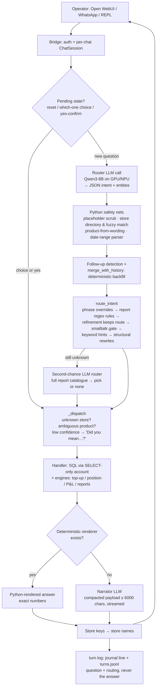
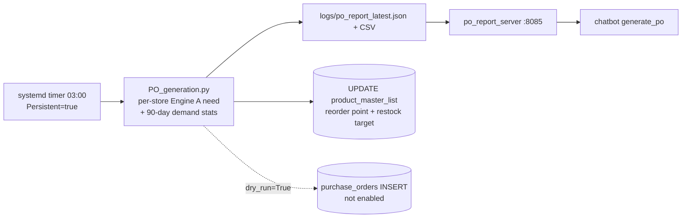

# Portfolio Project Audit: Unistop AI (operations assistant for robot vending stores)

**Audited:** 2026-10-22. **Repository:** `Unistop-AI_Projects/Unistop-Ai_Chatbot` (git, branch `main`).
**Method:** I read the source, docs, deploy units, tests, benchmark results and the local turn log, and I ran the pure unit tests with the database and LLM pointed at dead ports. I did not query the production database, did not call the LLM server, did not run the live tests or the router eval, and changed nothing in the project.

**Evidence labels used throughout**
- **[VERIFIED]**: directly supported by code, config, tests or artifacts I inspected. It shows what the code does, not that it ran in production.
- **[INFERRED]**: a reasonable reading that I could not confirm. The reasoning is given.
- **[CONFIRM]**: needs your answer (authorship, adoption, impact, disclosure).

**Sensitive values:** I have left out IP addresses, hostnames, DB account names, credentials, store revenue and product-level figures. Where the report mentions them, it does so only in general terms.

---

## A. Executive Summary

**What it is.** Unistop AI is a natural-language operations assistant for a chain of robot vending stores (about 12 store keys in Singapore plus one in the Philippines, per the project guide). Operators ask questions in plain English, such as "what should I load at CCK 505 tomorrow", "profit for Raffles Place last month" or "what sells with Milo". The system answers from the company's MariaDB inventory and sales database. It is reachable from a terminal REPL, from Open WebUI through an OpenAI-compatible HTTP bridge, and from WhatsApp through a Twilio bridge (the WhatsApp bridge is written but not yet deployed). [VERIFIED]

**Core design.** The LLM never computes numbers. A local 8B model (Qwen3-8B, INT4, OpenVINO on an Intel Arc iGPU and NPU) does two narrow jobs:
1. **Router:** classifies the question into JSON (intent plus entities).
2. **Narrator:** writes prose for a few intents.

Everything else is deterministic Python and SQL, including:
- entity cleanup, store-name resolution and date parsing
- routing rules and multi-turn state
- the forecasting engines and P&L accounting
- rendering of most answers

[VERIFIED: `unistop_ai.py` module docstring L22-27, `narrate()` L3534, `deterministic_answer()` L4164]

**Main technologies [VERIFIED]:**
- Python 3.12, standard-library `http.server` services, `mysql-connector`
- OpenVINO GenAI (continuous batching, prefix caching, NPU static-shape pipeline)
- Qwen3-8B INT4
- Open WebUI, Twilio REST and webhook validation
- systemd units and a timer
- `unittest` and a custom LLM routing-eval harness

**Intended users.** Unistop's store operators and owner: restocking staff, purchasing, and management. [VERIFIED from prompts and renderer wording; exact user roles are CONFIRM]

**Strongest engineering qualities**
1. **A hybrid LLM and deterministic architecture with layered guardrails.** The LLM's output is validated and corrected by Python at several points:
   - placeholder scrubbing and store-name sanitising
   - regex routing rules that override the router
   - a confidence-gated "Did you mean…?" step
   - a second-chance catalogue router
   - Python-rendered answers, so numbers never pass through the LLM
2. **Measured, regression-gated LLM behaviour.**
   - 133-case hand-labelled golden routing set and an eval harness that scores the final routed intent and fields
   - ~200 unit tests
   - a turn log with a miss-review script
3. **Domain-heavy computation**, ported from the company's ops backend and kept in one shared module that both the chatbot and the PO job import:
   - service-level inventory forecasting (z-scores, variance, stockout-corrected exposure, winsorising)
   - FIFO batch reservation
   - FIFO COGS ledger P&L with basket revenue allocation and a sandboxed promo-formula parser
   - a variance-based PO safety-stock model
   - a position (slot) recommender with a backtest
4. **Edge-AI deployment on a laptop-class Intel SoC.** One model copy per device, GPU preferred with NPU overflow, prefix caching for the 3.2k-token router prompt, and SSE streaming. A documented benchmark shows mean turn latency falling from 56.7s to 10.7s against the earlier CPU and Ollama setup (different hardware; caveats in §G).

**Main limitations of the evidence**
- **Authorship is unclear.** Every commit is by one author (`TMinZhe`, 2 commits). The forecasting, position and P&L engines are described in their own docstrings as *ports of the ops backend's JavaScript*, so the algorithm design may not be yours. The repo also carries a guide written for AI coding sessions (`CLAUDE.md`), which suggests AI-assisted development. [CONFIRM]
- **Little real-world usage is recorded.** The turn log has 19 turns from 4 sessions over 2 days. There is no measured business outcome. [VERIFIED]
- **Some engines have no direct tests.** `topup_engine.py`, `position_engine.py` and `PO_generation.py` are not unit-tested directly; their fidelity to the backend is asserted in comments, not shown by tests.

---

## B. System Architecture

### Components [VERIFIED]

| Component | File | Role |
|---|---|---|
| LLM service | `ov_llm_server.py` (367 lines) | OpenVINO GenAI pipelines, one per device (GPU, NPU), each with its own lock. Each role (router / narrator / analysis) has a device preference list. A request takes the first idle device that fits the prompt, else queues on the preferred one. OpenAI-style `/v1/chat/completions` with SSE streaming and per-call perf metrics. |
| LLM client | `ov_llm.py` | `chat()` / `chat_stream()` over urllib; tolerates a non-streaming server. |
| Core assistant | `unistop_ai.py` (5,662 lines) | Router prompt, `classify_intent`, Python safety nets, store directory, date parser, original intent handlers, compaction for the narrator, deterministic renderers, `route_intent`, `dispatch`, `ChatSession`, turn logging, REPL. |
| Reports | `reports.py` (1,670 lines) | 11 operator reports, each a data function plus a pure renderer, in a `REPORTS` registry. Uses an injected `ReportContext` instead of importing the core module. |
| Top-up engine (Engine A) | `topup_engine.py` (754) | Pure forecasting and top-up computation; port of the backend's `topUpForecast.js` and related files. |
| Position engine (Engine B) | `position_engine.py` (606) | Slot recommendations, slot plan, backtest; port of the backend's `positionPlanner.js`. |
| Engine data loaders | `engine_data.py` (418) | All SQL for both engines, through an injected query function. |
| P&L engine | `pnl_engine.py` (661) | Store P&L; port of the backend's sales, pricing and COGS services. |
| PO generator | `PO_generation.py` (1,111) | Nightly purchase-order recommendation job (v5), with no LLM. Imports Engine A for per-store "immediate need". |
| PO report server | `po_report_server.py` | Serves the cached nightly PO JSON to the chatbot. |
| Bridges | `unistop_ai_server.py`, `unistop_ai_whatsapp_server.py` | Open WebUI bridge (bearer auth, one session per chat) and Twilio WhatsApp bridge (signature validation, sender allowlist, asynchronous replies). |
| Ops | `deploy/*.service`, `po-generation.timer`, `install_services.sh` | systemd units for the LLM, bridge, Open WebUI, PO job and PO server. |
| Quality | `tests/`, `eval_router.py`, `review_misses.py`, `benchmark_*.py` | Unit and live tests, golden routing eval, miss review, latency benchmarks. |
| Legacy / standalone | `topup_data_prep.py`, `sales_analysis.py` | Not imported by the chatbot. `topup_data_prep.py` is an earlier version of the assistant; `sales_analysis.py` is a batch LLM analysis whose outputs are normalised in Python. |

### One chat turn (data flow) [VERIFIED: `ChatSession._handle` L5408, `classify_intent` L601, `route_intent` L4934, `_dispatch` L5014]

### Offline / batch flow [VERIFIED: `deploy/po-generation.*`, `PO_generation.py` `__main__` L1090-1111]

### Integrations [VERIFIED]
- **MariaDB** (company inventory DB): the chatbot reads through a SELECT-only account (`CHATBOT_DB_CONFIG`, `db_config.py` L60-66). The PO job uses the admin account and **writes**: it updates two columns of `product_master_list` every run (`write_minimum_reorder_quantities`, L1029). PO row inserts exist but are hard-coded to `dry_run=True` (L1111).
- **Open WebUI**: an OpenAI-compatible bridge. It answers Open WebUI's own background "### Task:" prompts (titles, tags) with canned replies so they never reach the pipeline (`_open_webui_task_reply`).
- **Twilio WhatsApp**: request-signature validation (`_validator.validate`, L130) and an allowlist (`sender_allowed`, L70). Replies are sent asynchronously because LLM latency can exceed Twilio's ~15s webhook timeout.

### Persistence and state [VERIFIED]
- There is no application database. Conversation state is held in memory per `ChatSession` (history capped at 2 turns, plus pending choice and confirmation) and is lost on restart.
- The store directory is cached in-process for 10 minutes.
- The PO report is cached as a file and served over HTTP.
- The turn log is append-only JSONL.

---

## C. Feature Inventory

Status key: **T** = implemented with test evidence · **I** = implemented, verified by inspection · **P** = partial · **D** = documented / planned only.

### C1. Conversational core

| Feature | What it does / how | Status | Evidence |
|---|---|---|---|
| LLM intent router | 19 router-known intents. Returns JSON at temperature 0.1. Robust parsing: strips `<think>` blocks and code fences, then extracts the JSON span. Defaults are filled with `setdefault`. On any failure it returns `unknown` and never raises. | T (golden eval) | `classify_intent` L601-705 |
| Placeholder and slot scrubbing | Router values such as "unknown", "null" or "product" are cleared. | T | L694-697, `_PLACEHOLDER_VALUES` L724 |
| Store-name resolution | Builds aliases from the DB: key, full name in any spacing or hyphenation, a unique 3+ digit number, a unique first word. Shared words (two "Pioneer" stores) trigger a "which one?" question. Typos are fuzzy-matched (difflib, cutoff 0.8). Unknown places ("stock at orchard") get an explicit "I don't know that store". A store from history carries over only on follow-ups. Store keys in answers are relabelled to names. | T (~35 tests) | `build_store_directory` L748, `stores_named_in_text` L805, `_sanitize_router_stores` L913, `label_stores_in_text` L904 |
| Date-range parser | Explicit dates, ranges, month names with year inference, relative periods; returns ISO bounds. | T | `parse_date_range` L2436; `test_pnl.py` date tests |
| Multi-turn refinement | The router only flags `is_refinement`. Python backfills any field still at its default from the previous turn. An explicit change wins, and lists are replaced, not concatenated. `is_self_contained()` overrides false refinements on long fresh questions. | T | `merge_with_history` L1023, `is_self_contained` L5312 |
| Deterministic routing layer | Phrase overrides, then 11 regex report rules, then structural rewrites (profit without a product goes to store P&L; warehouse stock with a store goes to store stock; velocity of one product goes to product sales). | T | `route_intent` L4934, `_REPORT_RULES` L4793 |
| Second-chance router | When everything else says "unknown", a second LLM call sees a catalogue of all 30 reports and picks one or "none". The pick runs through normal dispatch and is labelled "(Reading this as: …)". Has a kill switch. | T | L4847-4931; tests L796-834 |
| Low-confidence confirmation | When the router's confidence is low, the bot asks "Did you mean…?" before acting. Skipped when Python decided the route. | T | `_dispatch` L5063-5080; ChatSession tests |
| Ambiguous product choice | Tiered product search (phrase, all words, known words, any word), then a numbered "which one?" list. | T | `find_products` L193, `resolve_product_choice` L4552 |
| Smalltalk gate | The router's "smalltalk" verdict stands only if the text looks like a greeting. A one-word product name labelled smalltalk becomes a product query. | T | L670-683, `_looks_like_smalltalk` L4369 |
| Narrator with bounded payloads | Each intent has a compactor. `_fit_payload` drops list tail items from the largest list until under 6,000 chars and records `<key>_omitted_count`, so the model gets valid JSON and an honest "N more". Output is streamed. | T (`test_payload_sizes`, live) | L3493-3615 |
| Deterministic renderers | 20+ intents are rendered in Python in "owner words". The narrator is skipped, which removes field-name leakage and arithmetic risk. | T | `_DETERMINISTIC_ANSWERS` L4145, `reports.REPORTS` L1648 |
| Session isolation and concurrency | One `ChatSession` per Open WebUI chat ID or WhatsApp sender, each with its own lock, so two users can run on the GPU and NPU at once. | I (concurrency not benchmarked) | `ChatSession` L5360; `run_chat` in `ov_llm_server.py` |
| Turn log and miss review | A journal line plus a JSONL record per turn (question and routing, never the answer). `review_misses.py` groups unanswered and second-chance turns, errors and clarifying questions. | T | `log_turn` L5545, `review_misses.py` |

### C2. Operational capabilities (intents)

| Capability | How it's computed | Status | Evidence |
|---|---|---|---|
| Top-up (restock) list preview | Engine A (details in D1). Includes freshness and pending-list preconditions, FIFO-by-expiry batch reservation (preview only), a slot fill plan and position hints. | I (engine not directly tested) | `get_topup_list` L1549, `topup_engine.py` |
| Position (slot) recommendation and slot plan | Engine B: blended velocity over days actually on sale, a band service level, best-fit slot reallocation. | I | `position_engine.py` L224-505 |
| Position backtest | Replays past days using only the data available on each day and scores each decision against the outcome window. Compares against a legacy rule. | I | `get_position_backtest` L540 |
| Purchase orders | Read from the nightly report (details in D1). | I | `generate_po` L1736, `PO_generation.py` |
| Store P&L | FIFO COGS ledger, refunds, cost credit, spoilage, basket allocation, promo formulas. | T (31 tests) | `pnl_engine.py`, `store_pnl` L2565 |
| Product and category profit ranking | Reuses `compute_pnl` per product. | T | `reports.product_profit` L147 |
| Sales summary vs previous period | Revenue, transactions and basket size against the previous equal period. Warns when a store's sales sync is more than 24h stale ("no sales" may mean "no data"). | T | `reports.sales_summary` L1335, `stale_sales_sync` L1377 |
| Transaction lookup | Filters by store, product, date and time of day ("from 4pm"). "Is there…?" questions get Yes/No; a "No" for a product names its last sale there. | T | `reports.transaction_lookup` L1518, `parse_time_window` L1462 |
| Product sales / first and last sale | Per-product units and revenue using a REGEXP on packed `order_info`. | T | `reports.product_sales` L1234 |
| Bought together | Basket co-occurrence with attach % and lift, real affinities (lift ≥ 1) ranked first, minimum support of 2. | T | `basket_stats` L1088 |
| Sales by hour and weekday, promo and add-on performance, price lookup (incl. promo price), warehouse value at landed cost incl. GST and BCRS, refunds and issues, top-up history | Pure data function plus renderer each. | T (`test_reports.py`, 49 tests) | `reports.py` |
| Stock (store, warehouse, expiry), velocity bands, overstock, compare stores, trend report, vendor lookup and relationship, adjustment history, lead time, list stores | SQL plus Python aggregation. | T / I | `unistop_ai.py` L1090-3170 |

### C3. Infrastructure

| Feature | Status | Evidence |
|---|---|---|
| OpenVINO multi-device LLM server with prefix caching, NPU static-shape budgets, warm-up, SSE streaming with client-disconnect cancel | I | `ov_llm_server.py` L118-310 |
| systemd deployment (LLM, bridge, Open WebUI, PO timer, PO server) with an idempotent installer | I (the guide says it's installed on the target PC; CONFIRM) | `deploy/` |
| Nightly PO job writing reorder points | I; five dated CSV outputs between 6 and 22 Oct show it has run | `logs/min_reorder_*.csv` |
| Automatic PO creation in DB | **P**: code exists, hard-coded `dry_run=True` | `PO_generation.py` L1111 |
| WhatsApp channel | **P**: implemented; deployment blocked on the sender allowlist (per the project guide) | `unistop_ai_whatsapp_server.py`, `CLAUDE.md` |
| LLM-written SQL fallback | **D**: parked, with a written safety spec | `docs/FUTURE_text_to_sql.md` |

---

## D. Deep Engineering Analysis

### D1. Algorithms and business logic

**Engine A: service-level top-up forecast** (`topup_engine.py`) [VERIFIED code; design origin CONFIRM, the docstring says it's a port]

1. **Demand rate**
   - Rates are computed over three windows (the analysis window, 30 days and 60 days) and blended with weights 0.5 / 0.3 / 0.2 (`build_forecast` L395).
   - Each window's denominator is the number of days the product was actually in stock (`availability_exposure` L371). The uplift is capped at 2×, and the correction only applies when at least 50% of the window's days were observed. This corrects demand that was hidden by stockouts.
2. **Outlier control**
   - One-off bulk purchases are capped at 3 units per sale line (winsorising).
   - Products with 3 or more bulk lines keep their real quantities as "recurring bulk" (L216-237).
3. **Variance**
   - Sample variance of daily demand, floored at the mean rate (a Poisson floor) so sparse sellers don't get zero safety stock.
4. **Service level**
   - Velocity bands (FAST / MEDIUM / SLOW / INTERMITTENT) map to service levels 0.97 / 0.95 / 0.92 / 0.90.
   - z comes from an Acklam inverse-normal approximation (no SciPy dependency, L111).
   - Reorder point = ⌈rate·R + z·√(var·R)⌉; target = the same with protection days (R + buffer). Both are clamped to [minimum facing, shelf capacity] (L459-464).
5. **Special cases**
   - New products ("WATCH" band) get a fill target of 50% or 30% of the shelf depending on network top-seller rank, capped at 2 units if they cost more than $10.
   - Stockout fallback rate.
   - Near-expiry warehouse batches push the target up by 50% so they sell through.
6. **Trip capacity cap**: most urgent first (days of stock remaining), one partial line, a full audit of deferred units (L513).
7. **FIFO-by-expiry reservation** of warehouse batches, net of pending quantities (L687), and a slot fill plan (L705).

*Why it's notable:* this is a real inventory-theory model: periodic review, a service-level safety stock, and censored-demand correction. It is not a heuristic "sold last week × 2".

**PO generator v5** (`PO_generation.py`) [VERIFIED]
- **Safety stock.** Lead-time demand plus Z·σ·√L, with Z = 1.65, computed from a zero-filled 90-day daily series. It falls back to a flat buffer when there are fewer than 14 sale-days, because σ isn't trustworthy then (`calc_lead_time_buffer` L586).
- **Usable stock from near-expiry batches.** Counted proportionally: min(batch, velocity × days to expiry) (docstring fix #2).
- **Caps.** The order is case-rounded, then capped in order by: line value ($300), shelf life, and category days-of-supply. The last cap catches cheap items with big case sizes that the value cap misses (L628).
- **Avoiding a circular dependency.** The reorder point is written back as an output, never used as an input floor, because flooring against last night's output would ratchet it upward (`calc_order_quantity` docstring L653).
- **Shared code path.** Per-store "immediate need" imports Engine A itself rather than keeping a copy, so the PO numbers can't drift from what stores are told (comment at L82-89).

**Store P&L** (`pnl_engine.py`) [VERIFIED; 31 unit tests]
- **COGS.** A per-(store, product) FIFO delivery ledger. Sales before the period are drawn down without being costed (`skip`). Units missing from the ledger fall back to catalogue cost, and ledger units are counted separately from fallback units (L338-374).
- **Basket allocation.** The amount actually charged is split across a multi-item basket by expected line value. Values are cent-rounded, and the last line takes the remainder so the parts always sum exactly (`_split` L263).
- **Add-on pins.** Add-on lines are pinned to the add-on price accepted within the previous 15 minutes (`AddOnMatcher` L309), and the pins are used only if they are consistent with the charged amount (`allocate_transaction` L275).
- **Promo formulas.** The DB stores promo formulas as strings such as `(3.90*floor(n/2))+(3.90*(n%2))`. They are parsed by a **whitelisted recursive-descent parser**, never `eval()`: only digits, operators, `floor`, `n` and `u` are allowed, and non-finite or negative results are rejected (L117-247).
- **Documented deviation from the backend.** Ledger rows stamped with unit cost 0 are skipped. The docstring reasons that they would otherwise cost those units at $0 and inflate profit (L32-37).

**Engine B: positions and backtest** (`position_engine.py`) [VERIFIED code]
- Velocity is 0.4 × the last 7 days + 0.6 × the window, counted only on days the product was on sale.
- Best-fit slot reallocation (`plan_slots` L327).
- A **walk-forward backtest** that rebuilds each past day's state from history and scores decisions only where the outcome window has fully passed, to avoid look-ahead bias (L540). It also compares against the legacy rule.

**Smaller algorithms [VERIFIED]:**
- basket lift and affinity analysis (`basket_stats`)
- tiered fuzzy product search with LIKE escaping (`_like` L188)
- alias-overlap store matching where the longest alias wins (`stores_named_in_text`)
- time-of-day window parsing

### D2. Architecture
- **Separation of concerns [VERIFIED].** The engines are pure (rows in, dict out), DB access is isolated in `engine_data.py` and `load_pnl_inputs`, and `reports.py` takes an injected `ReportContext` so it never imports the monolith. This is what makes the P&L and reports testable without a DB.
- **Single shared turn implementation [VERIFIED].** `ChatSession` replaced three copies of the turn loop. The docstring notes the two bridges had drifted (one lacked the confirmation flow, and smalltalk was saved as history) (L5360-5375).
- **Single source of truth for the forecasting math [VERIFIED].** Both the chatbot and the PO job import the same Engine A.
- **Weakness:** `unistop_ai.py` is a 5.7k-line module mixing the prompt, handlers, routing, rendering and sessions.

### D3. Data handling (messy real-world schema) [VERIFIED]
- Amounts and timestamps are VARCHAR, with a malformed row (`date_time = "2020"`). Code guards with `_parse_amount` and `CHAR_LENGTH(date_time) >= 19` filters.
- Line items are packed as text (`"pid,qty[,price];…"`) and parsed defensively, with invalid parts dropped (`_parse_order_items` L292, `parse_order_lines`).
- The `stores` table is empty, so store names come from a different table.
- Stale store sync is surfaced to the user rather than reported as "no sales".
- Known data issues are documented as "don't fix in code" facts in the project guide, so they are not silently papered over.

### D4. Security [VERIFIED unless marked]
- **Least privilege for the LLM-facing process.** The chatbot connects with a DB account the database restricts to SELECT, so even a code bug can't write. The comment ties this to future LLM-written SQL (`db_config.py` L60-63).
  - **Caveat:** the project's own docs say this account currently shares the admin password, so the boundary isn't independent yet. Do not publish this detail.
- **Secrets** come from the environment or a gitignored, chmod-600 env file (`.gitignore`). The bridge refuses to start without an API key.
- **Constant-time bearer check** (`hmac.compare_digest`).
- **WhatsApp:** Twilio signature validation and a mandatory sender allowlist (the bridge refuses to start without one).
- **SQL injection:** every value I checked is bound as a `%s` parameter. f-strings only build placeholder lists or fixed clauses; user LIKE wildcards are escaped.
- **No `eval`** of DB-stored promo formulas.
- **Logs** never record answers, only questions and routing.
- **Gaps:**
  - plain HTTP; the bridge binds 0.0.0.0, LAN only [INFERRED]
  - no per-user authorisation (anyone with the key sees all stores)
  - the in-memory `_sessions` dict is never evicted
  - the admin account is used by the nightly writer

### D5. Reliability
- **Fail-safe defaults.** A router exception returns `unknown`. An unreadable store directory returns the last cached copy. Position hints are advisory, so their failure only adds a warning. Turn-log write failures never affect the reply. [VERIFIED]
- **Preconditions before top-up.** Inventory snapshot freshness (≤120 min), a blocking pending list, and an expired reservation are each reported clearly. [VERIFIED L1576-1595]
- **Streaming robustness.** Client disconnect cancels generation (`StreamingStatus.CANCEL`), and errors are sent as SSE events. [VERIFIED]
- **PO path decoupled from chat latency.** Nightly computation plus a cache with a 5s fetch timeout. [VERIFIED]
- **Startup check.** The LLM server checks that the devices it needs are visible and exits with a clear message. [VERIFIED]

### D6. Performance
- **Prefix caching.** The ~3.2k-token router prompt is prefilled once and reused (scheduler config at L109-118). The benchmark shows router TTFT around 130ms. [VERIFIED code + benchmark JSON]
- **Fewer LLM calls.** Python rendering cut narrator calls to 0.58 per turn in the benchmark. The report attributes a large share of the speed-up to this software change, not the hardware.
- **Heterogeneous device scheduling.** GPU first, NPU for overflow, chosen from a measured device comparison (GPU about 2.5× faster per request).
- **Bounded prompts.** Narrator payload is capped at 6,000 chars, and only the last 2 turns of compact JSON history go to the router, to stay inside the NPU's 4,096-token static prompt budget.

### D7. AI/ML engineering (the most portfolio-relevant layer)
- **Model deployment:** INT4 channel-wise Qwen3-8B, chosen because it is the format the NPU requires and it also runs on GPU and CPU, so one copy serves every device (docstring L40-42). Thinking mode is disabled through the chat template.
- **Structured output validation:** tolerant JSON extraction, default filling, enum checks on confidence, and placeholder scrubbing.
- **Hallucination mitigation by construction:** numbers never come from the LLM, the narrator gets pre-computed data only, store names are injected before streaming, and the prompt forbids field names.
- **Evaluation:**
  - **routing eval:** a golden set measuring router accuracy, *effective* accuracy (after the Python layers, the number to protect) and self-consistency across repeats
  - **unit tests** with the LLM mocked
  - **latency benchmark** with token-level metrics
  - The docs explicitly refuse to call self-consistency "accuracy" (`docs/unistop_ai_performance_report_2026-10-06.md` §5).
- **Prompt-change discipline:** the project guide records that adding few-shot examples to the router prompt regressed other questions, so new intents are routed in Python and the prompt is left alone. [VERIFIED as a documented rule; the measurement itself is not in the repo]

---

## E. Engineering Decisions and Trade-offs

| # | Decision | Problem | Rationale (documented / inferred) | Trade-off | Alternatives | Evidence | Conf. |
|---|---|---|---|---|---|---|---|
| 1 | LLM only routes and narrates; Python computes and renders | An 8B model is unreliable at arithmetic and state | **Documented** (module docstring, `merge_with_history` docstring) | Exact, auditable numbers, but every new question type needs code | Tool-calling agent; text-to-SQL | `unistop_ai.py` L22-27, L1023-1048 | High |
| 2 | Add new intents as Python regex rules, not router-prompt edits | Prompt edits regressed other intents | **Documented** (guide, second-chance comment L4839-4845) | Stable routing, but a growing pile of regexes that can conflict; ordering matters | Fine-tuning the router; embedding classifier | `_REPORT_RULES` L4793 | High |
| 3 | Second-chance catalogue router instead of LLM SQL | Unanswerable questions | **Documented** (`FUTURE_text_to_sql.md`: SQL fallback parked until misses justify it) | Every answer is a tested report; questions with no matching report still get "I can't" | Validated text-to-SQL behind the read-only account | L4847-4931; docs | High |
| 4 | Separate LLM service, one pipeline per device, GPU first with NPU overflow | Several processes import the core; model must not load per process; concurrent users | **Documented** (server docstring + device benchmark) | Simple lock scheduler, but not batching across requests on the same device | vLLM-style batching; one device only | `ov_llm_server.py` L8-30, L203-221 | High |
| 5 | Port the backend's engines to Python instead of calling the backend | Chatbot and PO job need the same numbers as the ops dashboard | **Documented** ("so numbers match its dashboard") | Two implementations (JS + Python) that can drift; no cross-check tests in repo | Expose the backend engines as an API | engine docstrings | Medium (why not an API is CONFIRM) |
| 6 | Precompute POs nightly, cache, serve over HTTP | PO computation is slow (one DB pass per store) | **Documented** | Answers can be up to a day stale | On-demand with caching | `unistop_ai.py` L134-139 comment, L1719-1729 | High |
| 7 | Database-enforced read-only account | An LLM-facing process must not mutate data | **Documented** | Strong guarantee, *once the credential is independent* | App-level SQL checks only | `db_config.py` L60-66 | High |
| 8 | Deterministic history merge with "default = unset" | Router re-derives JSON each turn and drops fields | **Documented**, including its known limitation (null "all stores" vs "not mentioned") | Predictable, but can't express "reset to default" | Let the LLM carry state | L1023-1060 | High |
| 9 | Show low-confidence routes as a question | Silent wrong answers | **Documented** | Extra turn for the user; skipped when Python routed | Always execute | L5063 | High |
| 10 | Skip zero-cost ledger rows (deviation from backend) | 72 rows / 221 units stamped $0 would inflate profit | **Documented** | Deliberate mismatch with the backend dashboard | Mirror backend exactly | `pnl_engine.py` L30-37 | High |
| 11 | Reorder point is an output, never an input floor | Circular ratchet | **Documented** | None significant | MOQ floor | `PO_generation.py` L668-672 | High |
| 12 | Stdlib `http.server`, no web framework | Few dependencies on a slow-internet machine | **Inferred** (the guide notes slow internet and asks to avoid heavy packages) | No middleware, TLS or async; fine for LAN scale | FastAPI / uvicorn | bridges | Low-Med |

---

## F. Top Portfolio-Worthy Highlights (ranked)

Scores are 1–5: Difficulty / Real-world relevance / Differentiation from student projects / Evidence strength.

| # | Highlight | What / why it matters | Skills | D | R | Diff | Ev | Prominence | Files |
|---|---|---|---|---|---|---|---|---|---|
| 1 | **Guardrailed hybrid LLM pipeline** (router → Python nets → rule routing → second chance → deterministic render) | Makes a small local model safe for numeric business questions; shows judgment about where *not* to use an LLM | LLM systems design, structured output, defensive design | 4 | 5 | 4 | 5 | **Hero** | `unistop_ai.py` L601-705, L4934-5080, L4145 |
| 2 | **LLM evaluation and regression gate** (golden set scoring *effective* intent + fields, consistency, miss-log loop) | Shows you treat LLM behaviour as measurable and protect it | Evaluation design, testing, MLOps habits | 3 | 5 | 4 | 5 | **Featured** | `eval_router.py`, `tests/golden_router.json` (133), `review_misses.py`, `log_turn` L5545 |
| 3 | **On-device LLM serving on Intel GPU + NPU** with prefix caching and overflow scheduling; benchmarked | Edge inference without a cloud API; measured, honestly attributed latency gains | Inference optimisation, hardware-aware deployment, benchmarking | 4 | 4 | 5 | 4 | **Featured** | `ov_llm_server.py`, `docs/…2026-10-06.md`, `benchmarks/results/*.json` |
| 4 | **Service-level restock forecasting** (stockout-corrected, winsorised, z-score safety stock, trip cap, FIFO reservation) | Real inventory theory driving daily restock decisions | Applied statistics, domain modelling | 4 | 5 | 4 | 3 (port; no direct tests) | Featured *if authorship confirmed*, else Detailed only | `topup_engine.py` L371-560, L687-720 |
| 5 | **FIFO-COGS P&L engine** with basket allocation and a sandboxed promo-formula parser | Correct accounting on messy data; parser instead of `eval` | Domain logic, parsing, numerical care | 4 | 5 | 4 | 5 (31 tests) | Featured (authorship CONFIRM) | `pnl_engine.py`; `tests/test_pnl.py` |
| 6 | **PO generation v5** (variance safety stock with sparse-data fallback, proportional expiry, cascading caps, anti-ratchet) | Shows iteration on correctness ("v5 fixes three gaps") | Operations research basics, iterative correctness | 3 | 5 | 3 | 3 (no unit tests) | Detailed only | `PO_generation.py` L1-60, L586-700 |
| 7 | **Store-name entity resolution** (DB-derived aliases, ambiguity questions, typo match, unknown-place refusal, history rules) | The unglamorous NLU work that makes a bot usable | NLU engineering, edge-case testing | 3 | 4 | 3 | 5 (~35 tests) | Detailed only (good story snippet) | L742-1000; `test_unit.py` |
| 8 | **Least-privilege data access + bridge security** (SELECT-only account, bearer auth, Twilio signatures, allowlist, no answers in logs) | Security thinking around an LLM touching business data | AppSec basics | 2 | 4 | 3 | 4 | Detailed only | `db_config.py`, bridges |
| 9 | **Walk-forward position backtest** | Validates recommendations without look-ahead bias | Evaluation methodology | 3 | 3 | 4 | 3 | Detailed only | `position_engine.py` L540 |
| 10 | **Deployment as systemd services + nightly timer** | Runs unattended on a store PC | Linux ops | 2 | 3 | 2 | 4 | Omit / one line | `deploy/` |

---

## G. Measurable Impact

### Verified technical scope

| Metric | Value | Source | Type | Publishable? |
|---|---|---|---|---|
| Python codebase | ~16.9k lines (core module 5,662) | `wc -l` | capability | Yes |
| Distinct capabilities | 19 router intents + store P&L + 11 Python-routed reports (30 in the second-chance catalogue) | `_ROUTER_SYSTEM`, `_SECOND_CHANCE_CATALOGUE` | capability | Yes |
| Golden routing set | 133 hand-labelled cases, 35 distinct intent labels | `tests/golden_router.json` | test asset | Yes |
| Unit tests (offline) | 190 run, 189 pass (the one error needs a DB connection) | my run, 2026-10-22 | measurement | Yes |
| Live tests | 14 DB-backed tests (not run by me) | `tests/test_reports_live.py`, `test_payload_sizes.py` | test asset | Yes |
| Stores covered | ~12 store keys (SG + 1 PH) | project guide | deployment scope | Approval needed |
| Nightly PO report | 331 products, 13 vendors in latest report | `logs/po_report_latest.json` (counts only) | operational output | Approval needed |

### Measured performance [VERIFIED artifacts; measured by the project, not re-run by me]

| Metric | Before (2026-08-18, CPU, Ollama) | After (2026-10-06, Arc GPU, OpenVINO) | Notes |
|---|---|---|---|
| Router stage mean | 24.9s | 3.75s | Mostly from removing model reloads, not GPU speed (the report says so) |
| End-to-end turn mean / median / p95 | 56.7 / 52.0 / 81.0s | 10.7 / 9.8 / 25.2s | **Different host and runtime**; 12 questions × 3 runs |
| Decode throughput | ~14 tok/s | ~21–22 tok/s | ~1.5× |
| Narrator calls per turn | 1.00 | 0.58 | From Python rendering |
| Router TTFT (prefix cache) | – | ~130ms on a ~3.3k-token prompt | |
| GPU vs NPU router | 2.6s vs 6.6s | | `benchmark_devices.json` |
| Hard errors | 0/12 | 0/36 | Small sample |

Safe phrasing: *"Cut mean response time from ~57s to ~11s (about 5×) when moving from a CPU/Ollama setup to an OpenVINO deployment on an Intel Core Ultra iGPU, and reduced LLM calls per turn by rendering most answers deterministically."* Always mention that the hardware also changed.

**Routing accuracy:** the project guide states the last eval run scored 230/230 (100% effective) on an earlier 115-question set. The golden set now has 133 questions. **I did not re-run it**, because it needs the LLM server and DB. Re-run it before quoting a number. [CONFIRM]

### Real usage [VERIFIED, and weak]
- `logs/turns.jsonl`: **19 turns, 4 sessions, 6–8 Oct 2026**; 16 answered, 1 unanswered, 1 choice. This is not evidence of adoption, and it may only reflect testing.
- The PO job has produced outputs on five dates between 6 and 22 Oct (`logs/min_reorder_*.csv`). It writes reorder points to the production catalogue, so it is likely the most "in production" component. [INFERRED; CONFIRM whether staff use those values]

### Unverified business claims (do not publish without data)
- time saved on restock or PO planning
- reduction in stockouts or wastage
- number of operators using it
- whether the WhatsApp channel is live

### Suggested measurements
1. Number of distinct operators and turns per week from `turns.jsonl` over 30 days.
2. Answer rate: share of turns with outcome `answer` vs `unanswered`.
3. Re-run `eval_router.py --repeats 2` and quote the effective accuracy with the date.
4. Before/after time for an operator to build a top-up list or PO (ask the operator).
5. Stockout rate (the availability history already exists) before and after top-up lists were adopted, if they were.

---

## H. Technical Challenges

| # | Problem | Why it's hard | Approach | Limitation | Evidence |
|---|---|---|---|---|---|
| 1 | Small local LLM misroutes or invents entities ("store=unistop9" on a store-less question; "product=unknown"; store names in the product slot) | 8B model with no fine-tuning; prompt edits have side effects | Python safety nets after every router call, each tied to an observed failure in comments ("seen: …") | Rule set grows; needs the golden set to stay safe | L913-1000, L694-697 |
| 2 | Follow-ups ("and for 660?") after reports the router doesn't know | Router re-files the follow-up elsewhere | Remember `routed_intent` and `report_query`; bare-follow-up detection; refinement keeps the route | Only 2 turns of memory | L5440-5447, `report_query` L4809 |
| 3 | Demand hidden by stockouts | Zero sales ≠ zero demand when the shelf was empty | Exposure-days denominator with coverage threshold and 2× uplift cap | Needs availability history; falls back when coverage < 50% | `topup_engine.py` L371-392 |
| 4 | Basket revenue attribution with promos and add-ons | Card transactions record one total for many items | Weighted split with exact-sum rounding, add-on pins with consistency check, parsed promo formulas | Formulas that fail to parse are ignored | `pnl_engine.py` L250-335 |
| 5 | Narrator payload overflow and field-name leakage | Long lists exceed context; model copies `empty_slot_pct` into prose | Per-intent compactors, honest truncation counts, Python renderers for most intents | Narrated intents remain (expiry, adjustments, top-up headline) | L3493-3615 |
| 6 | Latency on CPU (~57s/turn) | Model reloaded per call (context-size mismatch) | Diagnosed in the August report; moved to resident OpenVINO pipelines, prefix caching, GPU/NPU | Concurrency not benchmarked | both performance reports |
| 7 | "No sales" vs "no data" | Stores stop syncing | Stale-sync warning in the sales summary | Only in `sales_summary` | `reports.py` L1374-1396 |
| 8 | Twilio 15s webhook timeout vs ~10s+ LLM turns | Synchronous replies time out | Empty TwiML now, reply later via REST | In-memory sessions | WhatsApp bridge docstring |

*Challenges 1, 2, 5 and 7 are evidenced by "seen:" comments and guide notes that describe real observed failures. Whether you personally hit and fixed them is [CONFIRM].*

---

## I. Suggested Portfolio Content

> All "my contribution" wording below is a **draft pending your confirmation** (see K1–K3).

### Homepage: 30-second version
- **Title:** Unistop AI: a guardrailed, on-device LLM assistant for retail operations
- **Problem:** Operators of a robot-vending chain needed answers on stock, restocking, purchase orders and profit without writing SQL or opening dashboards.
- **Contribution (CONFIRM):** Built a chat assistant where a local 8B model only classifies questions and Python computes every number, then served it on an Intel laptop GPU/NPU.
- **Tech:** Python · OpenVINO GenAI · Qwen3-8B INT4 · MariaDB · Open WebUI · Twilio · systemd
- **Verified capability:** About 30 operational question types answered from live data; mean response time down from ~57s to ~11s after moving to on-device GPU inference (new hardware and runtime).
- **Visual:** the pipeline diagram (§B) as a clean animated flow.

### Case study: recruiter version
- **Overview.** Unistop runs automated vending stores. Their data (sales, stock per slot, warehouse batches, deliveries) lives in one MariaDB database. Unistop AI lets operators ask in plain English over a web chat or WhatsApp.
- **Problem.** Operators needed quick, *trustworthy* numbers. A general chatbot that guesses figures is unacceptable for restocking and purchasing.
- **Your role (CONFIRM).** Designed and built the assistant pipeline, the evaluation tooling and the on-device LLM serving; ported the company's restock/position/P&L logic into Python; deployed it as services.
- **Key features.**
  - restock lists with service-level safety stock
  - store P&L with FIFO cost of goods
  - nightly purchase-order recommendations
  - product, sales, promo and basket reports
  - store-name understanding with clarifying questions
- **Outcomes (verified, technical).**
  - ~5× faster responses after the inference migration
  - a 133-case routing test set and ~200 automated tests
  - a read-only DB account so the assistant can't change data
- **Images.** Architecture diagram; a sanitised chat walkthrough on synthetic data; a benchmark chart.

### Case study: technical deep dive (outline)
1. **Architecture:** router / safety nets / deterministic routing / second chance / handlers / renderer-or-narrator; the shared `ChatSession`; the separate LLM service.
2. **Why the LLM doesn't compute:** examples of failure modes (field-name leakage, dropped fields across turns) and the fixes.
3. **Algorithms:** restock forecast (stockout-corrected exposure, winsorising, z-score safety stock); P&L ledger and basket allocation; promo parser; PO safety stock with sparse-data fallback.
4. **Evaluation:** effective vs raw router accuracy; consistency; the miss-review loop; why prompt edits were frozen.
5. **Inference engineering:** INT4 channel-wise for NPU compatibility, prefix caching, GPU-first/NPU-overflow locking, an honest breakdown of where the speed-up came from.
6. **Edge cases:** ambiguous store names, unknown places, stale sync, zero-cost ledger rows, VARCHAR timestamps.
7. **Trade-offs:** regex rule growth vs prompt stability; ported engines vs a backend API; nightly PO cache vs freshness.
8. **Limitations:** monolithic core module, engines not directly unit-tested, little usage data, no concurrency benchmark.
9. **Future:** text-to-SQL fallback under a validated read-only sandbox (the spec already exists), splitting the core module, engine parity tests against the backend.

---

## J. Visualization Recommendations

| Visual | Demonstrates | Real basis | Interactive? | Needs | Confidentiality | Synthetic OK? |
|---|---|---|---|---|---|---|
| **Pipeline diagram** (hero) | Where the LLM is and isn't used | §B Mermaid | Light (hover per stage) | Diagram only | Safe | n/a |
| **"Trace a question" stepper** | One question's JSON at each stage: router output → sanitised → routed → rendered | Real stage structure | Yes | Synthetic question and data | Safe with fake stores and products | **Yes, required** |
| **Guardrail gallery** | 4–5 before/after cases (invented store dropped; ambiguous "Pioneer" leads to a question; typo matched; unknown place refused) | Unit-test cases | Optional | Use test-style fake names | Replace real store names | Yes |
| **Safety-stock explainer** | Reorder point and target vs rate, variance and service level; stockout exposure correction | Engine A formulas | **Yes (sliders)** | Formulas only | Formulas are generic inventory theory; band constants and thresholds need approval | Yes |
| **Basket allocation explainer** | Splitting a charged amount across items with a promo and an add-on | `allocate_transaction` | Yes | Synthetic basket | Safe | Yes |
| **Latency chart** | 57s → 11s by stage, with a "hardware vs software" breakdown | Benchmark JSON | No | Numbers from the docs | Fine with approval | Real aggregates |
| **GPU vs NPU scheduling diagram** | Request lands on the idle device | `run_chat` | Small animation | – | Safe | n/a |
| **Eval dashboard snapshot** | Golden-set score, consistency | `eval_router.py` output | No | A fresh eval run | Questions may contain store and product names; sanitise | Prefer real numbers, sanitised text |

**Do not:**
- use screenshots of real chats showing revenue, profit, store names, prices or supplier names without approval
- fabricate a "production" screenshot; label any mock as a recreation on synthetic data

---

## K. Questions for Me

1. **Authorship:** Which parts did you write yourself? Specifically: (a) the chatbot pipeline and routing in `unistop_ai.py`; (b) the engines (`topup_engine.py`, `position_engine.py`, `pnl_engine.py`), which say they are ports of the ops backend's JS. Who designed the original backend algorithms? (c) `PO_generation.py` v1–v5; (d) `ov_llm_server.py` and the OpenVINO migration.
2. **AI-assisted development:** The repo includes a guide for Claude Code sessions. How do you want to describe your use of AI coding tools? Many employers value honest framing, e.g. "designed, specified and verified; implemented with AI pair-programming".
3. **Team and role:** Was this an internship? What was your title and timeframe, and who else worked on it? Who were your stakeholders?
4. **Adoption:** Do operators actually use the Open WebUI chat? How many, and how often? Is the WhatsApp channel live?
5. **PO job in production:** Are the nightly reorder points and PO recommendations used by purchasing staff? Has `dry_run` ever been turned off?
6. **Impact:** Do you have any before/after observations, such as time to prepare a restock list, stockouts, wastage, or the manual process this replaced?
7. **Eval number:** Can you re-run `eval_router.py --repeats 2` and the full unit suite so the portfolio can quote a current, dated accuracy figure?
8. **Decisions:** Why port the backend engines into Python instead of calling the backend? Whose idea was the GPU/NPU split, and was any alternative (cloud API, a different model) evaluated?
9. **Disclosure:** May you name Unistop, show store names, describe the forecasting constants and data schema, or show sanitised screenshots? Is there an NDA?
10. **Sibling projects:** The parent folder also contains a people tracker and a product-recognition project. Are those yours, and should they be portfolio pieces too? They were not audited here.

---

## L. Weaknesses and Limitations

- **Authorship and originality:** the core algorithms are explicitly ports of an existing backend. Presenting them as original designs would be inaccurate unless you designed the backend too.
- **Usage evidence is minimal:** 19 logged turns. There are no business metrics.
- **Tests:**
  - `topup_engine.py`, `position_engine.py` and `PO_generation.py` math have no direct unit tests; parity with the JS backend is asserted, not tested.
  - One "pure" test needs a DB (`test_reports.BrandAsProductTest.test_vendor_slot_used_as_product_for_price`).
  - The router eval was not re-run in this audit.
- **Code structure:** `unistop_ai.py` is a 5.7k-line module, and routing is a long, order-dependent chain of regex rules (maintainability risk).
- **Benchmark caveats:** small sample (12 questions), single user, different hardware before and after; NPU overflow and concurrency are not measured.
- **Security posture is incomplete:**
  - the read-only DB credential is not yet independent of the admin one (per the project docs)
  - HTTP without TLS
  - no per-user authorisation
  - unbounded in-memory session map
  - the nightly job writes to production with the admin account
- **State:** conversation state is in memory and lost on restart; only 2 turns of history.
- **Known data limitations, documented and not fixed:**
  - FIFO COGS ignores delivery dates
  - 135 of 174 promo rows are stale
  - part of the warehouse value is estimated from catalogue cost
- **Doc drift:** the guide's paths (`~/unistop-ai/AI_Chatbot`) and question count (115) don't match the repo (actual path differs; 133 golden cases).
- **Uncommitted work:** about 840 lines of current changes are not committed (the user's choice; noted for completeness).
- **Legacy files:** `topup_data_prep.py` (an older copy of the assistant) and `sales_analysis.py` aren't used by the chatbot. Don't present them as part of it without explanation.

---

## M. Evidence Index

| File | Symbol | Lines | Supports | Conf. |
|---|---|---|---|---|
| `unistop_ai.py` | module docstring | 1-55 | Architecture, LLM-doesn't-compute rule, engines are ports | High |
| `unistop_ai.py` | `_ROUTER_SYSTEM` | 436-598 | Router intents and prompt | High |
| `unistop_ai.py` | `classify_intent` | 601-705 | JSON parsing, defaults, safety nets, fail-to-unknown | High |
| `unistop_ai.py` | `build_store_directory`, `stores_named_in_text`, `fuzzy_store`, `unknown_place_in_text`, `_sanitize_router_stores` | 742-1000 | Store entity resolution | High |
| `unistop_ai.py` | `merge_with_history` | 1023-1085 | Deterministic multi-turn merge | High |
| `unistop_ai.py` | `get_topup_list` | 1549-1716 | Preconditions, Engine A call, FIFO reservation, filters | High |
| `unistop_ai.py` | PO cache comment, `generate_po` | 1719-1806 | Nightly PO cache design | High |
| `unistop_ai.py` | `parse_date_range` | 2436-2528 | Date parsing | High |
| `unistop_ai.py` | `_fit_payload`, `narrate` | 3493-3610 | Payload bounding, narrator prompt, streaming | High |
| `unistop_ai.py` | `_DETERMINISTIC_ANSWERS`, `deterministic_answer` | 4145-4172 | Python-rendered answers | High |
| `unistop_ai.py` | `_PHRASE_OVERRIDES`, `_REPORT_RULES` | 4573, 4793 | Rule-based routing | High |
| `unistop_ai.py` | `_SECOND_CHANCE_CATALOGUE`, `second_chance_route`, `final_intent` | 4847-4931 | Second-chance router | High |
| `unistop_ai.py` | `route_intent`, `_dispatch` | 4934-5280 | Routing order, confirmation gate | High |
| `unistop_ai.py` | `ChatSession` | 5360-5500 | Shared turn logic, session lock, history rules | High |
| `unistop_ai.py` | `log_turn`, `turn_outcome` | 5503-5574 | Observability without answer logging | High |
| `topup_engine.py` | header, constants | 1-90 | Port of backend; band policy | High |
| `topup_engine.py` | `winsorize_lines`, `availability_exposure`, `build_forecast`, `calculate_topup`, `apply_trip_cap` | 216-552 | Forecast and safety-stock model | High |
| `topup_engine.py` | `reserve_fifo`, `get_fifo_position_plan` | 687-720 | FIFO reservation, slot plan | High |
| `position_engine.py` | header, `recommend_positions`, `plan_slots`, `get_position_backtest` | 1-32, 224-390, 540+ | Engine B, walk-forward backtest | High |
| `pnl_engine.py` | header | 1-45 | P&L definitions, deliberate deviation | High |
| `pnl_engine.py` | `_PromoParser`, `compile_promo` | 117-247 | Sandboxed formula parser | High |
| `pnl_engine.py` | `_split`, `allocate_transaction`, `AddOnMatcher`, `DeliveryLedger` | 263-374 | Allocation and FIFO COGS | High |
| `PO_generation.py` | header | 1-75 | v5 corrections, write targets | High |
| `PO_generation.py` | `calc_lead_time_buffer`, `apply_days_of_supply_cap`, `calc_order_quantity` | 586-680 | Safety stock, caps, anti-ratchet | High |
| `PO_generation.py` | `write_minimum_reorder_quantities`, `write_pos_to_db`, `__main__` | 1029-1111 | Production writes; PO inserts dry-run | High |
| `ov_llm_server.py` | docstring, `_device_config`, `DevicePipeline`, `run_chat`, `_stream` | 1-60, 101-310 | Multi-device serving, prefix cache, streaming | High |
| `db_config.py` | `CHATBOT_DB_CONFIG` | 57-66 | Read-only account separation | High |
| `unistop_ai_server.py` | `_check_auth`, `_open_webui_task_reply`, per-chat sessions | 50-140 | Bridge auth, session mapping | High |
| `unistop_ai_whatsapp_server.py` | docstring, `sender_allowed`, signature validation | 1-140 | WhatsApp security, async replies | High |
| `reports.py` | `REPORTS`, `basket_stats`, `stale_sales_sync`, `transaction_lookup` | 1648, 1088, 1377, 1518 | Reports, lift analysis, stale-data warning | High |
| `eval_router.py` | whole | 1-121 | Effective-accuracy eval design | High |
| `tests/golden_router.json` | – | – | 133 cases | High |
| `tests/test_unit.py`, `test_pnl.py`, `test_reports.py` | – | – | 190 offline tests (189 pass in my run) | High |
| `docs/unistop_ai_performance_report_2026-10-06.md` | §2-5 | – | Latency figures and caveats | High (project-measured) |
| `docs/unistop_ai_performance_report.md` | §3.4 | – | Model-reload root cause (Aug baseline) | Medium |
| `docs/FUTURE_text_to_sql.md` | – | – | Parked feature and safety spec | High |
| `deploy/*` | units, timer, installer | – | Deployment design | High (installed state: CONFIRM) |
| `logs/turns.jsonl` | – | – | 19 turns, 4 sessions | High |
| git log | 2 commits, author TMinZhe, 6 Oct 2026 | – | Commit authorship only | Medium |

---

## N. One-Page Portfolio Handoff Summary

> Paste this section into another conversation. It stands on its own.

**Project:** Unistop AI, a natural-language operations assistant for Unistop, a chain of ~12 automated (robot) vending stores in Singapore plus one in the Philippines. Operators ask about stock, restocking, purchase orders, profit, prices, promos and sales. It answers from the company's MariaDB database through a web chat (Open WebUI) and a terminal, and has a WhatsApp bridge that is built but not deployed.

**Verified technologies:**
- Python 3.12; stdlib HTTP servers; mysql-connector
- OpenVINO GenAI serving Qwen3-8B INT4 on an Intel Core Ultra Arc iGPU and NPU
- Open WebUI (OpenAI-compatible bridge); Twilio WhatsApp
- systemd services plus a nightly timer
- unittest; a custom LLM routing-eval harness

**Implemented features (verified in code):**
- ~30 question types:
  - store and warehouse stock, expiry
  - restock lists, slot recommendations and backtest
  - purchase orders from a nightly job
  - store P&L, product/category profit
  - sales summary vs previous period, transaction lookup, sales by hour
  - promo and add-on performance, price lookup, warehouse value
  - bought-together analysis, vendor info, trends
- Store-name understanding: aliases, typos, "which one?" for ambiguous names, refusal of unknown places
- Multi-turn follow-ups
- Low-confidence "Did you mean…?"
- A second-chance router for unmatched questions
- Turn logging and miss review

**Top five engineering highlights:**
1. **The LLM never computes numbers.** The 8B model only routes questions to JSON, and narrates a minority of intents. Python safety nets correct its output (placeholder scrubbing, store sanitising, regex routing rules, confidence gate, second-chance catalogue router). Most answers are rendered by deterministic Python, so figures are exact. (`unistop_ai.py` `classify_intent` L601, `route_intent` L4934, `deterministic_answer` L4164)
2. **Measured LLM behaviour.** A 133-case hand-labelled golden set scores the final routed intent and fields, plus self-consistency across repeats. There are ~200 unit tests with the LLM mocked, and a turn log with a miss-review script. Prompt edits are frozen after measured regressions; new intents are added as Python rules. (`eval_router.py`, `tests/`, `review_misses.py`)
3. **On-device inference.** One model copy per device, GPU first with NPU overflow (per-device locks), prefix caching for the 3.2k-token router prompt, SSE streaming with disconnect cancel. Mean turn latency fell from 56.7s (CPU/Ollama, Aug 2026) to 10.7s (OpenVINO GPU, Oct 2026). The gain is partly hardware, partly removing model reloads, partly fewer LLM calls; the hardware also changed. (`ov_llm_server.py`, `docs/unistop_ai_performance_report_2026-10-06.md`)
4. **Inventory forecasting.** The restock engine blends three windows, corrects for stockouts using in-stock exposure days, winsorises bulk purchases, and sets a z-score safety stock by velocity band. It then applies a trip-capacity cap and FIFO-by-expiry batch reservation. The PO job adds Z·σ·√L safety stock with a sparse-data fallback, proportional near-expiry stock, cascading caps, and an anti-ratchet reorder point. (`topup_engine.py`, `PO_generation.py`) **These engines are documented as Python ports of the company's existing backend: authorship unconfirmed.**
5. **P&L engine.** FIFO delivery-ledger COGS, a basket revenue split that always sums exactly, add-on price pinning, and a whitelisted recursive-descent parser for promo formulas stored in the DB (no `eval`). It has 31 unit tests. (`pnl_engine.py`) **Also a port; authorship unconfirmed.**

**Supported numbers:**

| Fact | Value | Basis |
|---|---|---|
| Lines of Python | ~16.9k | count |
| Router intents | 19 | prompt |
| Report catalogue | 30 | `_SECOND_CHANCE_CATALOGUE` |
| Golden routing cases | 133 | `tests/golden_router.json` |
| Offline unit tests | 189/190 pass | audit run, 2026-10-22 |
| Mean turn latency | 56.7s → 10.7s | project benchmark, different hardware |
| Router stage mean | 24.9s → 3.75s | project benchmark |
| Router TTFT | ~130ms | with prefix cache |
| GPU vs NPU router | 2.6s vs 6.6s | device benchmark |
| Narrator calls per turn | 0.58 | benchmark |
| Latest PO report | 331 products, 13 vendors | needs disclosure approval |
| Logged real usage | 19 turns, 4 sessions | too small to claim adoption |

**Trade-offs:**
- Deterministic Python vs LLM flexibility: exact numbers, but each new question type needs code.
- Regex routing vs prompt edits: stable, but rule sprawl.
- Ported engines vs calling the backend: same numbers as the dashboard, but two implementations.
- Nightly PO cache vs freshness.
- A DB-enforced read-only account for the chatbot.

**Unconfirmed (ask before claiming):**
- personal authorship of each component, and use of AI coding assistants
- role, team and timeframe
- operator adoption; whether WhatsApp is live
- whether PO and reorder outputs are used by staff
- any business impact
- current eval accuracy (last documented: 230/230 on an earlier 115-question set; not re-run)

**Weaknesses:**
- 5.7k-line core module
- engines not directly unit-tested
- small benchmark sample with no concurrency test
- the read-only DB credential not yet independent of the admin's
- HTTP without TLS; in-memory sessions
- the nightly job writes to production with the admin account

**Confidentiality:** Exclude or sanitise:
- IPs and hosts, DB account names and credentials
- store names and revenue/profit figures, prices, supplier names
- the schema (table and column names), unless approved
- the exact forecasting constants, unless approved
- any real chat screenshots

Generic formulas (safety stock, FIFO COGS) can be explained with synthetic data. Treat everything as **requires approval** until the employer confirms what may be disclosed.

**Recommended visuals:**
1. Pipeline diagram (hero).
2. "Trace a question" interactive stepper on synthetic data.
3. Guardrail before/after gallery.
4. Safety-stock slider explainer.
5. Latency breakdown chart with a hardware vs software split.
6. Basket-allocation explainer.

**Open questions:** authorship split (pipeline vs ported engines vs PO vs LLM serving); AI-tool framing; role and team; adoption numbers; production use of PO outputs; impact data; a fresh eval run; why the engines were ported; disclosure permissions; whether the sibling projects (people tracker, product recognition) are also yours.
