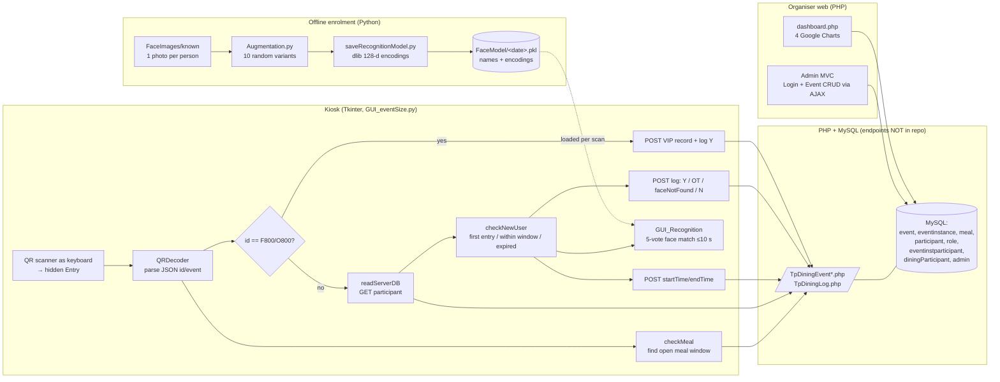
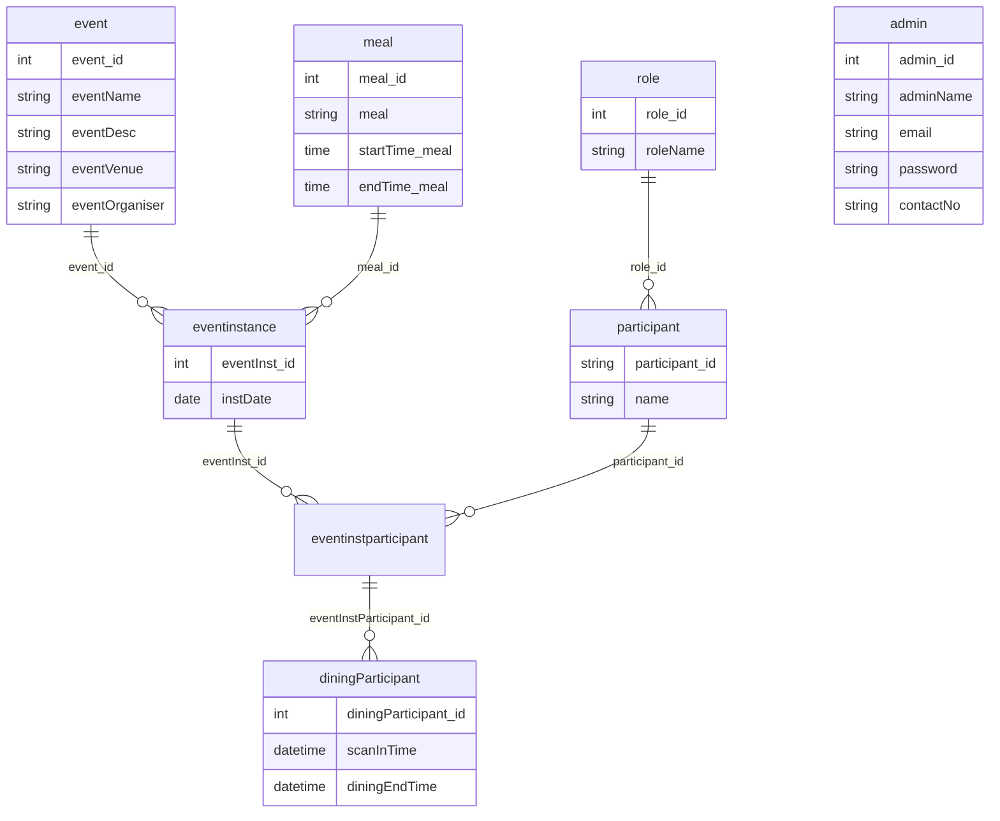

# PORTFOLIO_PROJECT_AUDIT — "MP Project" (Event Dining Access Kiosk with Face Verification)

**Audited:** 2026-10-22 · **Repository root:** `Downloads/MP Project/MP Project/` (all paths below are relative to it)
**Method:** I read every source file, plus static inspection of the data artifacts. I did not run the application, connect to any database or server, or unpickle the model files. I counted the model contents from pickle opcodes without executing them.
**Evidence labels used throughout:**
- **[VERIFIED]**: directly visible in code or artifacts. This does not prove the code was deployed.
- **[INFERRED]**: a reasonable interpretation that the code cannot prove. The reasoning is given.
- **[CONFIRM]**: only you can answer this.

---

## A. Executive Summary

**What it is.** This is a **self-service meal-entry kiosk for a multi-day event**. A guest scans a QR code (JSON `{"id","event"}`) at a full-screen Tkinter kiosk. The kiosk looks the guest up on a PHP/MySQL server and works out which meal window is open now. On first entry, it requires **live face verification**: the camera must match the guest's claimed identity on 5 frames within about 10 seconds. It then writes a dining time-window and logs the outcome. A separate PHP web layer gives organisers an **event CRUD admin panel** and an **attendance analytics dashboard** built with Google Charts. [VERIFIED]

**Main technologies.** [VERIFIED]
- Python 3.11, built from `__pycache__/*.cpython-311.pyc`
- Tkinter + Pillow for the kiosk UI
- OpenCV + `face_recognition` (the dlib 128-d face embeddings) for vision
- NumPy and pickle for the model artifact
- `urllib`/`requests` for HTTP calls to the server
- PHP 8 with PDO in a small custom MVC framework (admin panel), plus mysqli for the dashboard
- MySQL, jQuery, Bootstrap 5.3, Google Charts

**Intended users.** [INFERRED from roles, countries and VIP logic in the code]
- Event participants entering meal sessions
- Event staff who handle the "please approach staff" fallbacks
- Organisers and admins who manage events and review attendance

**Strongest engineering qualities.**
1. **Two-factor entry:** something you hold (the QR code) plus something you are (your face). The face check is 1:1 verification against the identity the server returns. It does not need 1:N identification to succeed. [VERIFIED]
2. **Temporal voting** (5 positive frames) under a **watchdog timeout** running on a background thread, so a single lucky frame cannot let someone in. [VERIFIED]
3. **An offline enrolment pipeline:** one photo per person, 10 randomised augmentations, then 128-d encodings saved as a date-stamped model artifact. [VERIFIED]
4. **Time-window business rules:** the active meal is auto-detected from server-defined windows. The first scan starts a dining window, and scans after it ends are refused as repeat meals. [VERIFIED]
5. **Outcome logging with four distinct codes** (`Y`, `OT`, `faceNotFound`, `N`) feeding an attendance dashboard. That dashboard bins entries into 15-minute intervals. [VERIFIED]
6. **Visible iteration:** three generations of the kiosk survive in `unused codes/`. They show the design moving from a local SQLite lookup to server-authoritative QR verification. [VERIFIED]

**Main limitations of the evidence.**
- **The server endpoints the kiosk depends on are not in the repository.** These are `TpDiningEvent*.php` and `TpDiningLog.php`. Writes, duplicate prevention and the database schema cannot be verified.
- There are **no tests, no README, no requirements file, no git history and no DDL**.
- Several assets the UI references are missing, so the app cannot run as it stands.
- **Several real bugs** affect the claims you could make (see L).
- The PHP dashboard has **SQL-injection-prone string-concatenated queries**.
- Strong signals suggest this is a **Temasek Polytechnic team "Major Project"**, not professional or NUS work (see K, Q1). **This framing must be confirmed before you publish anything.**

---

## B. System Architecture

### Components

| Component | Files | Responsibility | Status |
|---|---|---|---|
| Kiosk app (entry point) | `GUI_eventSize.py` | Full-screen Tk app. Captures QR input, detects the meal window, calls the server, applies entry rules, shows the result, logs the outcome | Implemented [VERIFIED] |
| Face verification | `GUI_Recognition.py` | Loads the encodings model and streams the webcam into Tk. Detect → encode → nearest neighbour → 5-vote confirmation with a timeout | Implemented, with bugs [VERIFIED] |
| Kiosk screens | `GUI_Design.py` | Home, invalid QR, stranger, already-eaten, welcome and face-prompt screens | Implemented, but image assets are missing [VERIFIED] |
| Config | `config.py` | Server base URL, dining allowance, face-recognition feature flag | [VERIFIED] |
| Enrolment / model build | `Augmentation.py`, `saveRecognitionModel.py`, `AutoAugmentAndSaveModel.py` | Augments photos, encodes faces, writes `FaceModel/<date>.pkl` | Implemented. Daily scheduling is commented out [VERIFIED] |
| Model artifacts | `FaceModel/30.pkl`, `FaceModel/60.pkl` | 30 identities × 10 = ~300 encodings, and 60 × 10 = ~600 encodings | [VERIFIED by opcode count] |
| QR codes | `QRCode/F_QRCode/` (800), `QRCode/O_QRCode/` (800) | Pre-generated QR images | Artifacts only. The batch-generation code is commented out [VERIFIED] |
| Server API (kiosk backend) | *not in the repo*. Referenced at `config.py:5-10` | Participant lookup, meal windows, write the dining window, VIP insert, log | **Absent** |
| Admin panel | `php/Admin app/dining_management/` | Login/logout and AJAX CRUD for dining events | Partially implemented [VERIFIED] |
| Attendance dashboard | `php/dashboard.php`, `php/ajaxData.php`, `php/dropdownList/*` | Cascading selector (event → date → meal) and 4 charts | Implemented, but injection-prone [VERIFIED] |
| Legacy and experiments | `unused codes/*`, `test.py`, `test/mqtt.py` | Earlier kiosk versions, offline recognition test, QR generator, unrelated MQTT script | Deprecated |

### Data flow

### How components communicate [VERIFIED]
- **Kiosk → server:** plain HTTP GET/POST with **query-string parameters**. The base URL is a LAN IP (`config.py:2-10`). Responses are JSON (`GUI_eventSize.py:21-22, 77-79`).
- **QR scanner → kiosk:** the scanner acts as a keyboard. It types into a hidden, white-on-white Tk `Entry`, and a `StringVar.trace_add("write", …)` callback fires on every keystroke. The payload is processed once both `{` and `}` have arrived (`GUI_eventSize.py:36-46, 195-199`). [INFERRED: keyboard-wedge scanner. This is the standard reason for this pattern.]
- **Admin UI → PHP:** `XMLHttpRequest` POSTs `FormData` with a `data_type` field. The controller dispatches on that field and returns JSON (`dining_event.view.php:170-197`, `DiningEvent.php:20-82`).
- **Dashboard:** jQuery AJAX fills the cascading dropdowns with server-rendered `<option>` HTML (`ajaxData.php`). After that it does a full page load with GET params, and PHP embeds JSON into the Google Charts scripts (`dashboard.php:265-435`).

### Where business logic lives
- **Kiosk side** (Python): meal detection, the first-entry and expiry rules, VIP handling and face verification.
- **Server side** (absent): persistence of dining windows. Duplicate prevention cannot be verified.
- **Dashboard** (PHP): aggregation and binning.

### Inferred database schema (from SQL joins; no DDL in repo) [INFERRED, high confidence]

Source: `php/dashboard.php:69-75`, `php/ajaxData.php:7,31`, `Admin_Model.php:13-20`, `DiningEvent_Model.php:13-23`. A `country_id` on participants is suggested by a form fragment in `php/test.php:47-59` that is never used.

---

## C. Feature Inventory

### C1. QR-triggered entry flow
- **Problem:** fast, unattended admission to meal sessions.
- **Implementation:**
  - A hidden `Entry` with a write-trace accumulates scanner keystrokes. Once both braces have arrived, the text is parsed with `json.loads`.
  - The kiosk checks that `event` is present, URL-encodes spaces, and calls `App(id, event, mealType, today)`.
  - After each scan the textbox is cleared, the screen resets, and `QRDecoder()` runs again to drain input.
- **Complexity:** event-driven input with no button presses, built on the Tk variable-trace mechanism.
- **Edge cases:**
  - Non-JSON input without `{` is cleared immediately (`:68-70`).
  - Malformed JSON that does contain braces raises an unhandled exception.
  - The key check `("id" and "event") in d` only tests `"event"` (`:53`).
- **Status:** Implemented. **But `event = "Presentation+Event"` is hard-coded at `GUI_eventSize.py:61` and overrides the scanned event.** That is a demo or presentation shortcut.
- **Evidence:** `GUI_eventSize.py:36-70, 187-207`.

### C2. Automatic meal-window detection
- **Problem:** the kiosk must know which meal is being served without staff input.
- **Implementation:**
  - For meal IDs 2–5, the kiosk fetches each meal's `startTime`/`endTime` from the server.
  - It builds today's datetimes and returns the first window that contains `now`.
- **Edge cases:**
  - If no window matches, it returns `None`, which is then passed through as `meal=None`. There is no handling for "no meal currently being served".
  - The lookup makes 1–4 sequential HTTP calls per scan.
- **Status:** Implemented [VERIFIED]. Meal ID 1 is skipped. [CONFIRM why: possibly breakfast was not served.] An older version iterated over IDs 1–4 (`unused codes/GUI_eventFace.py:14-29`).
- **Evidence:** `GUI_eventSize.py:15-34`.

### C3. Entry rules: first entry, re-entry within window, already ate
- **Problem:** stop people taking more than one meal, while still letting them step out and come back during their own sitting.
- **Implementation (`checkNewUser`):**
  - **First scan** (`startTime == None`): run face verification. On success, POST `startTime=now` and `endTime=now+timeAllowance`.
  - **Later scan:**
    - If `now > endTime`, refuse ("Sorry, you had taken your lunch today!").
    - Otherwise run face verification again and admit.
  - A `faceRecognition` feature flag skips the biometric step and leaves the time rules in place (`:115-128`).
- **Edge cases:** `timeAllowance = 1000` **minutes** (`config.py:1`), about 16.7 hours. In practice that is a once-per-day window, not a once-per-meal one. [CONFIRM whether that was intentional or a test value.]
- **Not verifiable:** whether the server enforces the rule atomically. Two kiosks scanning the same code at once could both see `startTime == None`, because there is no client-side compare-and-set.
- **Status:** Implemented on the client side [VERIFIED]. Server enforcement is unknown.
- **Evidence:** `GUI_eventSize.py:88-128`, `config.py:1,3`.

### C4. Live face verification (5-vote, time-boxed)
- **Problem:** QR codes can be shared or photographed, so possession alone is weak.
- **Implementation (`GUI_Recognition.py`):**
  1. Load the names and encodings from `FaceModel/60.pkl` (`:44-48`). The daily server download is commented out (`:23-42`).
  2. Start a daemon thread, `scanDuration`. It prints a "move closer" prompt at 5 s and sets `stop=True` at 10 s, or earlier once 5 votes are in (`:50-62, 81-84`).
  3. Per frame:
     - Crop to a fixed region (`:8-11, 88`).
     - **Detect faces at 0.25× scale** for speed, then rescale the boxes to full resolution (`:6, 89-99`).
     - Encode each face.
     - Compute the Euclidean distance to all known encodings and take the argmin (`:110-112`).
     - Accept if `min_distance ≤ 0.512` (`:13, 114`). That is stricter than the library's common 0.6 default.
     - Count a vote only if the matched name contains the server-supplied name, case-insensitively (`:117-121`).
  4. Render the annotated frame into a Tk `Label` and pump the GUI with `update()` (`:133-137`).
  5. Return `True` if votes ≥ 5 (`:141-144`).
- **Complexity:** real-time CV inside a single-threaded GUI. It combines a speed/accuracy trade-off (downscaled detection), a tuned distance threshold, temporal voting and a concurrent timeout.
- **Edge cases and bugs:** see L. In short:
  - There is an off-by-one in the name lookup.
  - Probe colour channels are swapped relative to enrolment.
  - Matching is by substring.
  - Each frame does disk I/O.
  - The model is reloaded on every scan.
- **Status:** Implemented, with bugs. No accuracy measurement exists in the repo.
- **Evidence:** `GUI_Recognition.py:1-149`.

### C5. Enrolment pipeline: augmentation → encoding → model artifact
- **Implementation:**
  - `augment_image` applies random rotation (±10°), translation (±10%), scaling (0.9–1.1), a 50% horizontal flip, brightness ×0.8–1.2 and a 50% 5×5 Gaussian blur. It writes **10 variants per person** (`Augmentation.py:5-40, 66`).
  - `saveModel` walks each person's folder and encodes the first face found. **Images with no detectable face are skipped**, by catching `IndexError` (`saveRecognitionModel.py:20-31`).
  - It pickles `Names` then `Encodings` into `FaceModel/{date}.pkl` (`:35-37`).
  - `AutoAugmentAndSaveModel.py` wipes the augmented folder, then rebuilds. Its run-at-midnight scheduler is commented out (`:9-17`).
- **Scale [VERIFIED by opcode count]:**
  - `60.pkl`: about 600 names and 600 encodings, covering 60 identities.
  - `30.pkl`: about 300 of each.
  - The gallery folder has 61 person folders, of which 40 currently hold 10 images, 1 holds 6 and 20 are empty.
- **Status:** Implemented. Scheduling is planned or commented out.
- **Assessment:** augmenting before taking a **fixed embedding** gives several reference vectors per identity, so nearest-neighbour matching gets more tolerant. It does not "train" anything. Describe it as *gallery augmentation for embedding matching*, not model training.

### C6. VIP / walk-in passes
- **Implementation:** the reserved IDs `F800` and `O800` mint a unique, timestamped ID (`FVIP…`/`OVIP…`). The kiosk POSTs a VIP dining record and a log entry, skips the face check and shows "Welcome! VIP" (`GUI_eventSize.py:135-156`). `QRCodeGenerator.py` generates the `F800` code (`unused codes/QRCodeGenerator.py:29-39`).
- **Edge cases:** anyone holding the F800/O800 QR gets unlimited entries by design, and nothing limits or audits the holder.
- **Status:** Implemented [VERIFIED].

### C7. Outcome logging
- Every path POSTs to `TpDiningLog.php` with `valid` set to:
  - `Y`: admitted
  - `OT`: over time / already ate
  - `faceNotFound`
  - `N`: unknown ID
- **Evidence:** `GUI_eventSize.py:143,165,171,175,180`. The server side is absent.
- **Status:** client implemented [VERIFIED].

### C8. Kiosk screens (UX states)
- There are six states: home, invalid QR, stranger detected, already eaten, welcome (with font shrinking for names of 18+ characters) and look at camera.
- **Evidence:** `GUI_Design.py:3-166`.
- **Status:** implemented, but `Assets/WSS Logo.png`, `TP Logo.png`, `Graphic_Cross.png` and `Graphic_Tick.png` are **missing**. Only `Graphic_Fork1.png`, `White_full.png`, `arrow.png` and `WSSxWP_Logo.png` exist.

### C9. Admin panel (custom PHP MVC)
- **Front controller and router:**
  - `public/index.php` checks the PHP version and boots the app.
  - `App::loadController` maps `?url=controller/method/args` to a class and method, falling back to `_404` (`App.php:10-49`).
- **Persistence layer:**
  - A `Database` trait uses PDO **prepared statements** (`Database.php:14-31`).
  - A `Model` trait provides `findAll/where/first/insert/update/delete`, with a column **allow-list** applied to inserts and updates (`Model.php:81-135`).
- **Feature:** single-page AJAX CRUD for dining events, using Bootstrap modals for add, edit and view (`DiningEvent.php`, `dining_event.view.php`).
- **Auth:** email + password login stored in the session (`Login.php:16-35`). Passwords are compared as **plaintext** (`:25`). **`DiningEvent` has no auth check**, so anyone can call CRUD without logging in.
- **Bugs:**
  - For `create`/`edit`, the controller overwrites `$data` and loses `data_type` (`DiningEvent.php:50-58, 61-70`). The client therefore never shows the confirmation or refreshes the table (`dining_event.view.php:242-255`).
  - `findAll` is capped at `limit 10` with no pagination UI (`Model.php:11`).
  - DB values are injected via `innerHTML` without escaping, which is stored XSS (`dining_event.view.php:224-241`).
  - The `validate()` methods are never called.
  - The Bootstrap CSS/JS asset folders are empty.
- **Status:** Partially implemented. Only events have CRUD. The participant management ("AddParticipant") is a fragment only (`php/test.php`).
- **Note:** the MVC skeleton (App/Controller/Database/Model traits, `show/esc/redirect`, `APP_NAME "My Webiste"`) closely resembles a widely shared PHP MVC tutorial scaffold. The views are Bootstrap 5.3 example templates. [INFERRED] Present it as "built on an MVC scaffold", not as a framework you wrote. [CONFIRM]

### C10. Attendance analytics dashboard
- **Implementation:**
  - A cascading selector (event → distinct dates → meals) is filled over AJAX (`dropdownList/dropdownScript.php`, `ajaxData.php`).
  - `dashboard.php` runs a 7-table join for the chosen event, date and meal (`:69-75`). From it, it computes:
    - **Entered vs not entered:** a pie chart, using null vs non-null `scanInTime` (`:97-104, 265-288`).
    - **Total participants excluding VIPs** (`:107-120`).
    - **Entries per role:** a pie chart, one COUNT query per role (`:122-163`).
    - **Entries per date for the meal:** a column chart (`:166-200`).
    - **Arrival histogram in 15-minute buckets** across the meal window: a bar chart built as a Google `DataTable` JSON (`:207-248`).
- **Complexity:** moderate. The bucketing logic is the only non-trivial computation.
- **Weaknesses:**
  - Every query concatenates `$_GET`/`$_POST` directly, which allows **SQL injection** (`dashboard.php:73-75, 111-114, 140-143, 166, 179-181`; `ajaxData.php:7,31`; `timeVsRole.php:11-14`).
  - The per-role and per-date counts are N+1 queries.
  - Distinct dates are de-duplicated by "previous value" without `ORDER BY`.
  - "Entered" includes VIPs while "Total" excludes them, so entered can exceed total.
  - `max_execution_time=0`.
  - The dropdown is included twice when there are no params.
- **Status:** Implemented [VERIFIED by inspection; not run].

### C11. Deprecated, experimental or unrelated (do not showcase as features)
- `unused codes/GUI_mainOld.py`: v1. Looks the user up in local SQLite `guestsInfo(identNo,name)` by an **f-string SQL** query (`:38`), then on the server.
- `unused codes/GUI_eventFace.py`: v2. The QR carries `identNo`, `name` and `event`, and the date is hard-coded to `2023-07-01` (`:45`).
- `unused codes/LiveRecognition.py`, `testRecognition.py`: earlier recognisers that use a **dynamic threshold `mean − std`** of the distances (`LiveRecognition.py:57-60`).
- `unused codes/facialRecognition.py`: offline batch test of `FaceImages/unknown/` (36 images) against the model at 0.512 (`:21-49`). **No results are recorded.**
- `test.py`: a copy of `GUI_eventSize.py` followed by ~40 lines of keyboard-mash text (`:212-250`). It **does not parse**.
- `test/mqtt.py`: publishes CPU usage to a public MQTT broker. It is unrelated to this project.
- `unused codes/O800.csv`, `T001,250.xlsx`: 800-row single-column ID lists.

---

## D. Deep Engineering Analysis

### D1. Algorithms and business logic
| Mechanism | What it does | Why it shows skill | Evidence |
|---|---|---|---|
| Embedding nearest-neighbour verification | Takes the argmin L2 distance to ~600 reference vectors and accepts at ≤0.512 | Uses a pretrained metric-learning embedding as a lightweight classifier, with a tuned operating point (stricter than 0.6) | `GUI_Recognition.py:13,110-114` |
| Claimed-identity check (1:1 on top of 1:N) | Counts only when the top match equals the identity the server returned for this QR | Turns open-set identification into verification. A stranger who happens to match someone else is still rejected | `GUI_Recognition.py:117-121` |
| Temporal voting + timeout | 5 positive frames are required within ~10 s, with a prompt at 5 s | Reduces single-frame false accepts and bounds the queue time per guest | `GUI_Recognition.py:50-62,85,141-144` |
| Gallery augmentation | Applies 10 randomised geometric/photometric variants per enrolled photo | Increases intra-class coverage when only one photo is available | `Augmentation.py:5-40,66` |
| Threshold experimentation | Tried a dynamic `mean − std` threshold, then fixed 0.6, then fixed 0.512 | Shows empirical tuning [INFERRED; no recorded data] | `unused codes/LiveRecognition.py:57-60`, `facialRecognition.py:44`, `GUI_Recognition.py:13` |
| Meal-window resolution | Picks the server-defined window that contains `now` | Data-driven schedule, with no hard-coded meal times | `GUI_eventSize.py:15-34` |
| Dining-window state machine | none → active (`now ≤ endTime`) → expired | Simple but real anti-double-dipping rule | `GUI_eventSize.py:88-128` |
| 15-minute arrival histogram | Buckets scan-in times across the meal window | Gives an operational signal for peak-load staffing [INFERRED purpose] | `dashboard.php:207-229` |

### D2. Architecture
- **Kiosk as a thin client to an authoritative server.** The v1→v3 evolution moves identity data off the kiosk (from local SQLite to a server lookup) and shrinks the QR payload to `{id, event}`. Names no longer appear in the QR. [VERIFIED by comparing `GUI_mainOld.py:35-43`, `GUI_eventFace.py:42-48`, `GUI_eventSize.py:46-62`]
- **Feature flag** `faceRecognition` gives a degraded mode that keeps the business rules (`config.py:3`, `GUI_eventSize.py:89,115`).
- **Separation:** UI states (`GUI_Design.py`), the recognition engine (`GUI_Recognition.py`) and the orchestration (`GUI_eventSize.py`) are separate modules. This is modest, but real.
- **Offline vs online split:** the expensive encoding of the gallery happens offline. The kiosk only loads vectors.
- **Weaknesses:**
  - Global mutable state is everywhere.
  - After each scan, `App` → `QRDecoder()` → potentially `App` recurses.
  - `idle()` calls `GUIHomePage()` immediately instead of scheduling it, because `after(200, f())` is used where `after(200, f)` was needed (`GUI_eventSize.py:12`).

### D3. Data
- Normalised relational schema: event → event instance (date × meal) → participant enrolment → dining record. [INFERRED from joins]
- The model artifact is two consecutive pickles: names, then encodings (`saveRecognitionModel.py:35-37`).
- Note: `saveRecognitionModel.py` keeps `Encodings/Names` as module globals (`:7-8`). Calling `saveModel()` twice in one process duplicates entries.

### D4. Security
| Aspect | Finding | Evidence |
|---|---|---|
| Admin DB layer | PDO prepared statements with bound values, plus a column allow-list | `Database.php:14-31`, `Model.php:84-94` |
| Dashboard and AJAX | **Raw string concatenation of request params, so SQL injection** | `dashboard.php`, `ajaxData.php`, `timeVsRole.php` |
| Admin auth | Plaintext password comparison. No `session_regenerate_id`. **CRUD endpoint unauthenticated** | `Login.php:25`, `DiningEvent.php:15-86` |
| XSS | Unescaped `innerHTML` rendering of DB fields. `esc()` exists but is unused | `dining_event.view.php:224-241`, `functions.php:11-14` |
| Kiosk ↔ server | Plain HTTP, state-changing **GET-style query strings sent as POST**, no auth token | `config.py:5-10`, `GUI_eventSize.py:97-99` |
| QR codes | Sequential, guessable IDs (`F001…F800`) and no signature. Face verification is the compensating control [INFERRED intent] | `QRCode/` filenames |
| Biometrics | Face images and encodings are stored unencrypted on disk; pickle loading is unsafe if the file is tampered with | `FaceImages/`, `FaceModel/` |
| Debug | `DEBUG=true` exposes errors | `core/config.php:32` |

**Net:** security is **not** a strength to showcase. The two-factor *design* is the defensible security story. The implementation's web security is weak.

### D5. Reliability
- Positive: images with no detectable face are skipped during enrolment, and there are distinct failure states and log codes.
- Negative:
  - No try/except around network calls or `json.loads`, so a server outage or bad QR crashes the kiosk loop.
  - No check of `ret` from `video_capture.read()`.
  - No retries.
  - No idempotency.
  - Encodings are run on cropped faces written to and re-read from disk every frame (`GUI_Recognition.py:100-105`).

### D6. Performance
- **Verified optimisations:**
  - Detection runs at 0.25× scale (`:6,89-99`).
  - A fixed ROI crop cuts the pixels processed (`:8-11,88`).
  - An FPS readout aids tuning (`:129-131`).
- **Missed optimisations:**
  - Pass `known_face_locations` to `face_encodings` instead of the disk round trip.
  - Load the model once, not on every scan (`:65`).
  - Vectorise with `np.argmin`.
- **No measured FPS or latency figures** exist in the repo.

### D7. AI/ML specifics
- **Model selection:** a pretrained dlib ResNet face embedding via `face_recognition`, so no training is needed.
- **Preprocessing:** augmentation at enrolment, plus downscaling and an ROI crop at inference.
- **Guardrails:** a distance threshold, claimed-identity matching, the vote count and the timeout.
- **Evaluation:** a probe set of 36 images exists (`FaceImages/unknown/`) and so does a batch test script, but **no metrics are recorded**.
- **Hallucination/LLM:** none. This is classical CV.

---

## E. Engineering Decisions and Trade-offs

Every reasoning entry below is **my inference** unless marked otherwise. There is no design documentation in the repo.

| # | Decision | Problem | Reasoning (inferred) | Trade-off | Alternatives | Evidence | Conf. |
|---|---|---|---|---|---|---|---|
| 1 | QR + face (two factors) | QR codes can be shared or forwarded | Possession + biometric is stronger than either alone | Adds ~2–10 s per guest and needs enrolment photos | Signed QR (HMAC/JWT), staff check, NFC badge | `GUI_eventSize.py:88-114` | High (design) / Med (intent) |
| 2 | Verify against the claimed identity, not open identification | Open-set 1:N gives false accepts as the gallery grows | Constrains the decision to "is this the person on the ticket?" | Still runs the full 1:N argmin. The target identity's best distance is never checked directly | Compare only against that person's vectors | `GUI_Recognition.py:110-121` | High |
| 3 | Pretrained embeddings + nearest neighbour | Little data (one photo each), no training budget | No training, enrolment in seconds | Accuracy depends on lighting and pose. No liveness detection (a printed photo may pass) | Train a classifier (SVM/k-NN on embeddings), add anti-spoofing | `saveRecognitionModel.py`, `GUI_Recognition.py` | High |
| 4 | Augment the single photo to 10 | Sparse gallery | More reference points for matching | Synthetic variants are correlated, so the gain is uncertain. Horizontal flips of asymmetric faces add noise | Collect several real photos, use embedding jitter (`num_jitters`) | `Augmentation.py` | High |
| 5 | Fixed threshold 0.512 after trying `mean − std` | The dynamic threshold depends on the gallery composition | A fixed operating point is predictable | It was tuned without recorded FAR/FRR data | Choose it from a ROC on a held-out set | `LiveRecognition.py:57-60` vs `GUI_Recognition.py:13` | Med |
| 6 | 5 votes within 10 s, timeout on a separate thread | Single-frame noise; queue time | Temporal consensus plus a bounded wait | The thread mutates globals with no lock (benign here). The vote loop blocks the Tk mainloop and pumps it manually | Use `after()`-driven frame loop, a worker thread with a queue | `GUI_Recognition.py:50-62,81-85` | High |
| 7 | Downscale ×0.25 for detection only | CPU-bound HOG detection | Detect cheaply, encode at full resolution | Small or distant faces get missed (hence the "move closer" prompt) | CNN detector on GPU, a dlib/OpenCV DNN detector | `GUI_Recognition.py:89-99` | High |
| 8 | Server-authoritative state, tiny QR payload | v1 needed a local DB per kiosk, and v2 put names in the QR | Single source of truth across kiosks, no PII in the QR | Needs the network. No offline fallback | Local cache with sync | v1→v3 files | High |
| 9 | Meal windows defined on the server | Schedules change per event day | No redeploys to change times | 1–4 HTTP calls per scan | Fetch once per session or cache | `GUI_eventSize.py:15-34` | High |
| 10 | Feature flag for face recognition | Camera or model failure, or events without enrolment | Degrade gracefully and keep the time rules | The flag is static config, with no runtime switch | Admin toggle | `config.py:3` | High |
| 11 | Keyboard-wedge QR via hidden Entry | Using commodity USB scanners | No driver or SDK needed | Focus loss breaks input. Partial reads are parsed by brace detection | Serial or HID API, OpenCV QR decode from the same camera | `GUI_eventSize.py:195-199` | Med |
| 12 | Daily date-stamped model artifact | New registrations arrive during the event | Rebuild each night, kiosks fetch the day's model | **Not finished:** scheduler and download are commented out, and the kiosk path is hard-coded to `60.pkl` | Versioned model registry | `AutoAugmentAndSaveModel.py:9-17`, `GUI_Recognition.py:23-44` | High (that it's incomplete) |

---

## F. Top Portfolio-Worthy Highlights

Scores run 1–5. They are deliberately not inflated.

| Rank | Highlight | What / why it matters | Skills | Diff. | Real-world | vs. student | Evidence strength | Prominence | Files |
|---|---|---|---|---|---|---|---|---|---|
| 1 | **QR + live-face two-factor meal entry** | End-to-end physical access workflow: scan → server lookup → biometric verification → state write → log | System design, CV integration, business rules | 3 | 4 | 3 | 4 | **Hero** | `GUI_eventSize.py:88-185`, `GUI_Recognition.py` |
| 2 | **Claimed-identity verification with 5-frame voting and timeout** | Guards against single-frame false accepts and bounds latency | CV, concurrency, robustness thinking | 3 | 4 | 3 | 5 | **Featured** | `GUI_Recognition.py:50-62,85-144` |
| 3 | **Enrolment pipeline (augment → embed → artifact)** | One photo becomes 10 reference embeddings. ~600-vector gallery for 60 identities | Data pipelines, ML preprocessing | 2 | 3 | 3 | 5 | **Featured** | `Augmentation.py`, `saveRecognitionModel.py`, `FaceModel/60.pkl` |
| 4 | **Dining-window rules + automatic meal detection** | Stops repeat meals and lets the kiosk run unattended across the meal schedule | Domain modelling, temporal logic | 2 | 4 | 2 | 4 | **Featured** | `GUI_eventSize.py:15-34,88-128` |
| 5 | **Architecture evolution v1→v3** | Local SQLite → server-authoritative, with the QR payload minimised | Iterative design, data-ownership judgment | 2 | 3 | 3 | 4 | Detailed only | `unused codes/GUI_mainOld.py`, `GUI_eventFace.py`, `GUI_eventSize.py` |
| 6 | **Real-time performance tuning** (0.25× detection, ROI crop, FPS readout) | Keeps the camera feed responsive on CPU | Performance awareness | 2 | 3 | 2 | 4 | Detailed only | `GUI_Recognition.py:6-11,88-99,129-131` |
| 7 | **Attendance analytics dashboard** (4 charts, 15-min arrival histogram) | Turns logs into operational insight | SQL joins, data viz | 2 | 3 | 2 | 4 | Detailed only (show with synthetic data) | `php/dashboard.php:69-248` |
| 8 | **Outcome logging taxonomy + VIP passes** | Auditability and an operational exception path | Operational thinking | 1 | 3 | 2 | 4 | Detailed only | `GUI_eventSize.py:135-180` |
| 9 | **Feature-flagged degraded mode** | Runs without biometrics if needed | Resilience design | 1 | 3 | 2 | 4 | Detailed only | `config.py:3`, `GUI_eventSize.py:115-128` |
| 10 | **Admin MVC panel with prepared statements** | Event CRUD over AJAX | Web fundamentals | 1 | 2 | 1 | 3 | **Omit** or a single line (scaffold-based, weak security) | `php/Admin app/...` |

---

## G. Measurable Impact

### Verified technical scope (system capability or artifact counts; **not usage**)

| Metric | Value | Source | Type | Safe to publish? |
|---|---|---|---|---|
| Pre-generated QR codes | 1,600 (800 "F" + 800 "O") | `QRCode/F_QRCode`, `QRCode/O_QRCode` | Artifact count | Yes, as "generated codes for up to 1,600 pass IDs". **Not** "1,600 users" without confirmation |
| Identities in the deployed model file | 60 (≈600 encodings, 10 per identity) | `FaceModel/60.pkl` (opcode count) | Artifact | Yes, as a capability. **But** most identities are celebrities (a test gallery), not event participants |
| Augmentations per enrolled photo | 10 | `Augmentation.py:66` | Config | Yes |
| Face-match threshold | 0.512 (L2 distance) | `GUI_Recognition.py:13` | Config | Yes |
| Verification rule | 5 matching frames, 10 s timeout, prompt at 5 s | `GUI_Recognition.py:50-62,141` | Config | Yes |
| Detection downscale | 0.25× | `GUI_Recognition.py:6` | Config | Yes |
| Meal windows checked | 4 (IDs 2–5) | `GUI_eventSize.py:16-18` | Config | Yes |
| Outcome codes | 4 | `GUI_eventSize.py` | Design | Yes |
| Dashboard charts | 4, plus 2 KPI figures | `dashboard.php:265-470` | Capability | Yes |
| Arrival histogram resolution | 15 min | `dashboard.php:209` | Config | Yes |
| Probe images for offline testing | 36 | `FaceImages/unknown/` | Test set | Count only. No results exist |
| Code size | ~710 lines of active kiosk Python; ~855 lines of dashboard PHP; ~1.8k lines in the admin app, of which much is Bootstrap template markup | `wc -l` | Size | Optional |

### Measured operational outcomes
**None in the repository.** There are no logs, accuracy results, throughput figures or user counts.

### Unverified claims (do not publish without evidence)
- That it was used at a real event, the number of guests, and the meals served.
- Recognition accuracy, false-accept rate or false-reject rate.
- Queue time or throughput improvements versus manual checks.
- Any association with the organisations whose logos appear in `Assets/`.

### Suggested measurements (if you can still obtain them)
- **Recognition:** run `facialRecognition.py`-style evaluation on a consented, labelled set and report FAR and FRR at 0.512.
- **Throughput:** median seconds from scan to decision. This is easy to get from log timestamps if any were kept.
- **Usage:** count of `valid=Y` log rows per meal, and the breakdown of `N`/`OT`/`faceNotFound`. This would quantify prevented double-dipping.
- **Kiosk FPS:** the code already prints it (`GUI_Recognition.py:131`). Record it on the target hardware.

---

## H. Technical Challenges

| Challenge | Why it's hard | Implemented approach | Outcome / limitation | Evidence | Label |
|---|---|---|---|---|---|
| Running CV inside a single-threaded GUI | Tk's mainloop must stay responsive while a blocking per-frame CV loop runs | The loop pumps `videoFace.update()` each frame, and the timeout runs on a daemon thread | Works, but blocks other Tk events. A cleaner fix is an `after()` loop or a worker thread with a queue | `GUI_Recognition.py:81-137` | VERIFIED approach; difficulty INFERRED |
| CPU-bound real-time face detection | HOG detection at full HD is slow | Detect at 0.25× scale inside an ROI crop, then encode at full resolution | No FPS data recorded. Disk round trip per face erodes the gain | `GUI_Recognition.py:6-11,88-105` | VERIFIED |
| One enrolment photo per person | Nearest-neighbour matching from one sample is brittle | 10 randomised augmentations per photo | Benefit unmeasured | `Augmentation.py` | VERIFIED |
| Choosing an acceptance threshold | Trade-off between false accepts and false rejects | Tried a dynamic `mean − std` threshold, then settled on a fixed 0.512 | No ROC data | `unused codes/*`, `GUI_Recognition.py:13` | VERIFIED iterations; tuning rationale INFERRED |
| Preventing repeat meals but allowing re-entry | You need a per-person, per-meal state with a time dimension | First scan stamps a start and end, and later scans compare against the end | The 1000-minute allowance makes it effectively once per day. Race between kiosks unaddressed | `GUI_eventSize.py:88-128` | VERIFIED |
| Unattended meal-schedule awareness | The kiosk must switch meals by itself | Server-defined windows are queried on each scan | No "no active meal" handling | `GUI_eventSize.py:15-34` | VERIFIED |
| Partial and garbage scanner input | Keyboard-wedge input arrives character by character | Brace-detection gate, and the field is cleared on junk | Malformed JSON still crashes | `GUI_eventSize.py:36-70` | VERIFIED |

---

## I. Suggested Portfolio Content

> Every line below assumes Q1 and Q2 in section K are answered. Replace bracketed items.

### Homepage: 30-second version
- **Title:** *Face-Verified Meal Entry Kiosk* (working title)
- **Problem:** Meal passes at a multi-day event could be shared, and manual checking slows the queue.
- **Contribution:** [CONFIRM: e.g. "Built the Python kiosk and face-verification pipeline in a 4-person team project."]
- **Tech:** Python · OpenCV · face_recognition (dlib embeddings) · Tkinter · PHP · MySQL · Google Charts
- **Verified capability:** "Admits a guest only after their face matches the identity on their QR code in 5 frames within 10 seconds."
- **Visual:** an animated flow diagram, scan → lookup → face check → decision (synthetic).

### Case study: recruiter version
- **Overview:** A self-service kiosk that checks a guest's QR pass, confirms their face matches the pass holder, and enforces one meal per sitting. Organisers get a web dashboard of attendance by meal, role and arrival time.
- **Problem:** QR codes alone can be shared. Staff checking IDs creates queues.
- **My contributions:** [CONFIRM per module: kiosk app / recognition / enrolment / dashboard / admin panel / server API.]
- **Key features:**
  - QR + face two-factor entry
  - Automatic meal-window detection
  - Repeat-meal prevention
  - VIP passes
  - Outcome logging
  - Attendance dashboard with a 15-minute arrival histogram
- **Outcomes:** [Only if confirmed: event name, number of guests, days in use.] Otherwise say: "Prototype demonstrated at [project presentation]."
- **Images:** a sanitised kiosk screen re-rendered with placeholder logos, the architecture diagram, and a dashboard with synthetic data.

### Case study: technical deep dive
- **Architecture:** a thin Python kiosk calls a PHP/MySQL API over HTTP. An offline enrolment pipeline produces an embeddings artifact, and a PHP dashboard reads the same DB (diagram in B).
- **Algorithms:**
  - L2 nearest neighbour over 128-d dlib embeddings with a 0.512 threshold
  - Claimed-identity voting (5 frames)
  - A 10 s watchdog thread
  - 0.25× detection with full-resolution encoding
  - 10× augmentation (rotation, translation, scale, flip, brightness, blur)
- **Decisions and trade-offs:** E1–E12, especially pretrained embeddings vs training, fixed vs dynamic threshold, and server-authoritative state.
- **Edge cases handled:**
  - Junk scanner input
  - Enrolment photos with no face
  - Expired dining windows
  - Missing camera or model, via the feature flag
  - Unknown IDs
  - VIP walk-ins
- **Challenges:** see H.
- **Limitations (state them honestly):**
  - No liveness detection, so a printed photo may pass.
  - No recorded accuracy metrics.
  - HTTP without auth.
  - Off-by-one name lookup and colour-channel mismatch, found during this audit.
  - SQL injection in the dashboard.
- **Future improvements:**
  - Compare only against the claimed person's vectors
  - Add liveness and anti-spoofing
  - Signed QR payloads
  - Parameterise all SQL
  - An atomic "claim meal" endpoint
  - Load the model once
  - Pass face locations directly to the encoder
  - Pick the threshold from a ROC curve
- **Good "what I'd do differently" content:** the bugs in L are a credible, specific reflection section.

---

## J. Visualization Recommendations

| Visual | Demonstrates | Real components | Interactive? | Assets needed | Confidentiality risk | Synthetic OK? |
|---|---|---|---|---|---|---|
| **1. Entry decision flowchart** (Hero) | The scan → lookup → rule → face → log state machine | `GUI_eventSize.py:88-185` | Yes: click through the paths (first entry, re-entry, expired, stranger, VIP) | None, it's a diagram | Low | Yes |
| **2. 5-vote verification timeline** | Frames on a 0–10 s axis, each marked match, non-match or no face, with the vote counter reaching 5 or timing out | `GUI_Recognition.py:50-144` | Yes: a simulated slider of "match probability" | None | Low | Yes, and it must be labelled as a simulation |
| **3. Enrolment pipeline strip** | 1 photo → 10 augmented variants → embeddings → artifact | `Augmentation.py`, `saveRecognitionModel.py` | Optional: re-roll the augmentation | **Your own photo with consent**, or a public-domain or generated face | **High if you use team or celebrity photos.** Don't | Yes |
| **4. Embedding-space sketch** | A 2-D projection (PCA/t-SNE) of clusters, with the 0.512 radius around one identity | `FaceModel/*.pkl` concept | Optional | Synthetic points, or embeddings of consented faces only | High with real data | Yes, preferred |
| **5. System architecture diagram** | Kiosk, API, DB, dashboard, offline pipeline | Section B | No | None | Medium: remove the LAN IP, real endpoint names and organisation names | n/a |
| **6. Architecture evolution v1→v3** | Local SQLite → name-in-QR → ID-only QR plus a server lookup | `unused codes/*` | No | None | Low | n/a |
| **7. Dashboard mock** | Pie, role pie, date column, and 15-min histogram | `dashboard.php` | Optional | Re-render with **synthetic** data | High with real attendance data | Yes, required |
| **8. Kiosk screens** | The six UX states | `GUI_Design.py` | No | Re-render with **placeholder logos** | High: organisation logos and real names | Yes |

**Never** fabricate a "production" screenshot or present simulated accuracy as measured.

---

## K. Questions for Me

1. **Context (critical):** the code points to a **Temasek Polytechnic team "Major Project"**. The evidence is the `TP Logo.png` reference, the `Tp`-prefixed endpoints, the project name "MP Project", a teammate's name in `php/connect.php:3`, and July–August 2023 dates. Is this right? If so, it should be framed as a **polytechnic final-year team project**, not professional or NUS experience. Was there an industry partner?
2. **Your contribution:** which modules did *you* write? Options: kiosk orchestration, face recognition, augmentation and enrolment, GUI screens, PHP dashboard, admin MVC, or the server endpoints that aren't in this repo.
3. **Deployment:** was this used at a real event? The `WSS`/`WSSxWP` logos, 1,600 IDs, roles, countries, VIP passes and a DB named after 26 Jul 2023 suggest a real multi-day event. If so, how many guests, meals and days? Do you have any logs?
4. **Permission:** are you allowed to name the event or organisation and show its logos? Or must everything be anonymised?
5. **Accuracy data:** did you ever measure recognition results, for example on the 36 `unknown/` images or a live trial? How did you arrive at 0.512?
6. **Server API:** do you still have `TpDiningEvent*.php`/`TpDiningLog.php`? Did they enforce one meal per window atomically?
7. **Hardware:** what machine and camera ran the kiosk, and what FPS did you get? Was it a Raspberry Pi or Ubuntu box? The comment at `unused codes/testRecognition.py:58` mentions a V4L2 option on Ubuntu.
8. **`timeAllowance = 1000` minutes:** was that deliberate (once per day) or a demo value?
9. **Hard-coded `event = "Presentation+Event"`** (`GUI_eventSize.py:61`) and the `60.pkl` model with celebrity faces: does this snapshot reflect the *presentation demo* rather than the event build?
10. **Admin MVC:** was the PHP framework skeleton taken from a tutorial or scaffold? Which parts did the team write?

---

## L. Weaknesses and Limitations

### Correctness bugs that affect the claims you could make [VERIFIED by inspection; not executed]

1. **Off-by-one name lookup:** `known_names[min_distance_index+1]` (`GUI_Recognition.py:115`).
   - Names and encodings are appended in lockstep (`saveRecognitionModel.py:26-27`), so the correct index is `min_distance_index`. The offline test script uses the correct index (`unused codes/facialRecognition.py:46`).
   - With 10 consecutive encodings per person, the error is masked about 90% of the time.
   - On a person's last sample it returns the *next* person's name. On the very last index it raises `IndexError`.
2. **Colour-channel mismatch:** the probe face is cropped from an **RGB** array, written with `cv2.imwrite`, which assumes BGR, and re-read as RGB (`GUI_Recognition.py:90,100-103`). So **live probes have R and B swapped**, while enrolment images are encoded with correct colours. This likely costs accuracy.
3. **Re-detection on a tight crop:** `face_encodings` is called on the cropped face *without* `known_face_locations`. That re-runs detection on a tight crop, which often fails, and produces avoidable "no encoding" frames (`:104`).
4. **Substring name match:** `up_name in up_matched_name` (`:119`). A short server name such as "TAN" would match any gallery name containing it.
5. **`idle()` runs immediately:** `root.after(200, g.GUIHomePage())` calls the function immediately, so the result screen resets at once instead of after a delay (`GUI_eventSize.py:12`).
6. **`("id" and "event") in d`** only checks `"event"` (`GUI_eventSize.py:53`).
7. **Hard-coded event override** (`GUI_eventSize.py:61`) and **hard-coded model file** (`GUI_Recognition.py:44`).
8. **No active-meal handling:** `checkMeal()` can return `None` (`GUI_eventSize.py:15-34`).
9. **Admin `create`/`edit` responses drop `data_type`,** so the UI never refreshes after them (`DiningEvent.php:50-70`).
10. **`test.py` does not parse,** because of keyboard-mash text appended at `:212-250`.

### Security
- SQL injection throughout the dashboard and AJAX PHP.
- Plaintext admin passwords and an unauthenticated CRUD endpoint.
- Stored XSS.
- Unauthenticated HTTP from kiosk to server.
- Guessable QR IDs.
- No liveness detection.
- Details are in D4.

### Completeness and operability
- The kiosk's **server API is absent**.
- There is no schema or DDL.
- No dependency manifest.
- No README or run instructions.
- **No automated tests.**
- UI image assets and Bootstrap assets are missing.
- The daily model rebuild and download are commented out.
- Participant management in the admin panel is a fragment only.

### Code quality
- Wildcard imports via `imports.py`.
- Global state everywhere.
- Recursive `App` ↔ `QRDecoder` re-entry.
- Copy-pasted GUI functions in `GUI_Design.py`.
- Debug `print`s everywhere.
- Duplicated chart callback names in `dashboard.php`.

### Evidence gaps
- Code authorship is unknown, and there is no git history.
- No metrics of any kind.
- File timestamps were reset on copy. Only the empty `assets` folders keep an "Aug 1 2023" date.

---

## M. Evidence Index

| File | Function / area | Lines | Supports | Conf. |
|---|---|---|---|---|
| `GUI_eventSize.py` | `checkMeal` | 15-34 | Meal-window detection (IDs 2–5) | High |
| `GUI_eventSize.py` | `QRDecoder` | 36-70 | Keyboard-wedge JSON QR parsing; hard-coded event at 61; key-check bug at 53 | High |
| `GUI_eventSize.py` | `readServerDB` | 72-86 | Server participant lookup | High |
| `GUI_eventSize.py` | `checkNewUser` | 88-128 | First-entry / window / expiry rules; face flag | High |
| `GUI_eventSize.py` | `App` | 132-185 | VIP passes (135-156); outcome log codes (143-180) | High |
| `GUI_eventSize.py` | `main` | 187-207 | Hidden Entry + `trace_add`; full-screen kiosk | High |
| `GUI_eventSize.py` | `idle` | 6-12 | `after()` misuse bug | High |
| `GUI_Recognition.py` | constants | 6-13 | 0.25× scale, ROI, 0.512 threshold | High |
| `GUI_Recognition.py` | `checkModel` | 22-48 | Model load; server download commented out | High |
| `GUI_Recognition.py` | `scanDuration` | 50-62 | Watchdog thread, 5 s prompt / 10 s timeout | High |
| `GUI_Recognition.py` | `GUI_Recognition` | 64-149 | Detect/encode/match/vote loop; bugs at 100-104, 115, 119 | High |
| `GUI_Design.py` | screen functions | 3-166 | Six UX states; missing asset references | High |
| `config.py` | — | 1-10 | `timeAllowance`, feature flag, endpoint map | High |
| `Augmentation.py` | `augment_image`, `augmentation` | 5-68 | 6 augmentation ops, 10 per person | High |
| `saveRecognitionModel.py` | `saveModel` | 12-37 | Encoding, no-face skip, date-stamped pickle | High |
| `AutoAugmentAndSaveModel.py` | script | 1-30 | Wipe-and-rebuild; scheduler commented out | High |
| `FaceModel/60.pkl`, `30.pkl` | artifact | — | ≈600 / ≈300 encodings; 60 / 30 identities | High (opcode count) |
| `QRCode/F_QRCode`, `O_QRCode` | artifacts | — | 800 + 800 QR images | High |
| `unused codes/GUI_mainOld.py` | `readLocalDB` | 35-43 | v1 local SQLite (f-string SQL) | High |
| `unused codes/GUI_eventFace.py` | `QRDecoder` | 32-51 | v2 QR containing name; fixed date | High |
| `unused codes/LiveRecognition.py` | loop | 54-64 | Dynamic `mean − std` threshold experiment | High |
| `unused codes/facialRecognition.py` | batch test | 21-49 | Offline probe test at 0.512; correct index | High |
| `unused codes/QRCodeGenerator.py` | script | 7-39 | QR payload format; VIP code; commented batch loop | High |
| `php/Admin app/dining_management/app/core/App.php` | `loadController` | 17-49 | Front-controller routing | High |
| `.../core/Database.php` | `query`, `get_row` | 14-50 | PDO prepared statements | High |
| `.../core/Model.php` | CRUD trait | 25-146 | Query builder, allow-list, limit 10 | High |
| `.../controllers/Login.php` | `index` | 16-35 | Plaintext password compare | High |
| `.../controllers/DiningEvent.php` | `index` | 15-86 | AJAX CRUD dispatch; no auth; `data_type` bug | High |
| `.../views/dining_event.view.php` | JS | 162-357 | XHR client; `innerHTML` XSS | High |
| `php/dashboard.php` | main block | 49-258 | 7-table join, KPIs, per-role/per-date counts, 15-min buckets; SQL concat | High |
| `php/dashboard.php` | chart scripts | 265-435 | 4 Google Charts | High |
| `php/ajaxData.php` | — | 5-43 | Cascading dropdown; SQL concat | High |
| `php/connect.php` | — | 2-3 | mysqli connection; teammate's name in comment | High |
| `php/test.php` | fragment | 1-75 | Unfinished participant form (country/role) | High |
| `test.py` | — | 212-250 | Corrupted duplicate | High |

---

## N. One-Page Portfolio Handoff Summary

> **Paste this section into another conversation as-is.** Labels: **[V]** verified in code · **[I]** inferred · **[C]** needs owner confirmation.

**Project:** "MP Project": a face-verified meal-entry kiosk with an attendance dashboard.
**Purpose [V]:** guests scan a QR pass at a full-screen kiosk. The system checks the pass against a server, confirms with a live webcam that the face matches the pass holder, enforces a per-person dining window, and logs the outcome. Organisers view attendance charts on a PHP web dashboard.
**Context [C]:** most likely a Temasek Polytechnic team final-year ("Major") project from around July 2023, possibly deployed at a real multi-day event (WSS-branded). **It is not confirmed as professional or NUS work.** The owner's personal contribution is unknown.

**Verified technologies [V]:** Python 3.11, Tkinter, Pillow, OpenCV, `face_recognition` (dlib 128-d embeddings), NumPy, pickle, requests/urllib, PHP 8 (PDO + mysqli), MySQL, jQuery, Bootstrap 5.3, Google Charts.

**Implemented features [V]:**
- QR (JSON `{id,event}`) input via a keyboard-wedge scanner
- Automatic meal-window detection from server times
- First-entry / re-entry / expired rules
- Live face verification: 5 matching frames in ≤10 s, threshold 0.512, detection at 0.25× scale
- Offline enrolment: 10 augmentations per photo → embeddings → date-stamped pickle
- VIP walk-in passes
- 4-code outcome logging
- Face-recognition feature flag
- PHP dashboard: entered vs not, by role, by date, and a 15-min arrival histogram
- PHP admin panel with login and event CRUD (partial)

**Top 5 highlights:**
1. QR + face two-factor entry workflow [V]
2. Claimed-identity verification with temporal voting and a watchdog timeout [V]
3. Augment → embed enrolment pipeline (60 identities, ≈600 vectors) [V]
4. Dining-window business rules with server-driven meal schedules [V]
5. Architecture evolution from a local SQLite kiosk to a server-authoritative design with ID-only QR codes [V files; I intent]

**Supported numbers [V, artifact or config only, not usage]:**
- 1,600 pre-generated QR codes (800 + 800)
- 60-identity model with ≈600 encodings
- 10 augmentations per photo
- 0.512 distance threshold
- 5 frames / 10 s verification
- 0.25× detection scale
- 4 meal windows
- 4 log codes
- 4 charts
- 15-min histogram bins
- 36 probe images, with no results recorded

**No measured outcomes exist:** no accuracy, throughput, user counts or adoption figures.

**Trade-offs [V design / I rationale]:**
- Pretrained embeddings + nearest neighbour (no training) vs accuracy and spoofing risk
- Fixed threshold after trying a dynamic one; no ROC data
- Temporal voting adds latency
- Downscaled detection misses distant faces
- Server-authoritative state needs the network
- Augmentation is cheap but has unmeasured benefit

**Known bugs and limitations [V]:**
- Off-by-one name index (`GUI_Recognition.py:115`)
- RGB/BGR swap on live probes (`:90,100-103`)
- Substring name match (`:119`)
- `after()` misuse (`GUI_eventSize.py:12`)
- Hard-coded event (`:61`) and model (`GUI_Recognition.py:44`)
- No handling for "no active meal"
- SQL injection in `dashboard.php`/`ajaxData.php`
- Plaintext admin passwords; unauthenticated CRUD; stored XSS
- No liveness detection
- **The kiosk's server API files are absent from the repo**
- No tests, README or dependency list
- Missing UI assets
- Daily model rebuild is commented out

**Unconfirmed [C]:**
- Personal contribution
- Real-event deployment and scale
- Permission to name the organisation or event and show logos
- Accuracy measurements
- Hardware used
- Whether 1000-minute allowance was intentional
- Whether the snapshot is a presentation-demo build
- Origin of the PHP MVC scaffold

**Confidentiality:**
- Do **not** publish the face images. They include teammates/classmates and celebrities, which are biometric data and copyrighted photos.
- Do not publish the model pickles, ID lists (CSV/XLSX), QR images, or organisation logos (TP, WSS, WSSxWP).
- Do not publish the LAN IP or endpoint names, DB names or credentials, or teammates' names.
- Code snippets of the generic logic (voting loop, augmentation, bucketing) are low risk, subject to team and school approval.

**Recommended visuals:**
- Interactive entry-decision flowchart (hero)
- Simulated 5-vote verification timeline (labelled as a simulation)
- Enrolment pipeline strip using only the owner's consented photo
- Architecture diagram and v1→v3 evolution diagram
- Dashboard and kiosk screens re-rendered with **synthetic data and placeholder logos**

**Questions for the owner:** see the 10 questions in section K. The most important are context (polytechnic vs professional), personal contribution, real deployment, and disclosure permission.

**Key source references:**
- `GUI_eventSize.py:15-34, 36-70, 88-128, 132-185, 195-199`
- `GUI_Recognition.py:6-13, 50-62, 85-144`
- `Augmentation.py:5-40, 66`
- `saveRecognitionModel.py:12-37`
- `config.py:1-10`
- `php/dashboard.php:69-248`
- `php/Admin app/dining_management/app/core/{App,Database,Model}.php`
- `unused codes/{GUI_mainOld,GUI_eventFace,LiveRecognition,facialRecognition}.py`
